# geo_webview — 完全ロジックシート

- 種別: qgis_plugin / バージョン: 4.29.0
- 生成: 2026-11-22T09:37:59+09:00 / 機能数: 212

## トポロジ

```mermaid
flowchart LR
  subgraph ENTRY["操作入口"]
    UI["メニュー/ダイアログ"]
    AI["AI/bridge_call"]
  end
  subgraph LOGIC["実装"]
    entry_point___init___py_classFactory["classFactory<br/><i>entry_point</i>"]
    action_GeoWebView_initGui["initGui<br/><i>action</i>"]
    action_GeoWebView_open_dialog["open_dialog<br/><i>action</i>"]
    action_GeoWebView_run["run<br/><i>action</i>"]
    action_GeoWebView_unload["unload<br/><i>action</i>"]
    dialog_GeoWebViewPanel["GeoWebViewPanel<br/><i>dialog</i>"]
    dialog_SettingsDialog["SettingsDialog<br/><i>dialog</i>"]
    ui_GeoWebView__on_project_saved["_on_project_saved<br/><i>ui_control</i>"]
    ui_GeoWebView_handle_request_origin_changed["handle_request_origin_changed<br/><i>ui_control</i>"]
    ui_GeoWebView_on_basemap_groups_changed["on_basemap_groups_changed<br/><i>ui_control</i>"]
    ui_GeoWebView_on_check_access_clicked["on_check_access_clicked<br/><i>ui_control</i>"]
    ui_GeoWebView_on_copy_clicked_panel["on_copy_clicked_panel<br/><i>ui_control</i>"]
    ui_GeoWebView_on_engine_combo_changed["on_engine_combo_changed<br/><i>ui_control</i>"]
    ui_GeoWebView_on_generate_clicked_panel["on_generate_clicked_panel<br/><i>ui_control</i>"]
    ui_GeoWebView_on_hosted_combo_changed["on_hosted_combo_changed<br/><i>ui_control</i>"]
    ui_GeoWebView_on_kasugai_admin_clicked["on_kasugai_admin_clicked<br/><i>ui_control</i>"]
    ui_GeoWebView_on_kasugai_export_clicked["on_kasugai_export_clicked<br/><i>ui_control</i>"]
    ui_GeoWebView_on_kasugai_help_clicked["on_kasugai_help_clicked<br/><i>ui_control</i>"]
    ui_GeoWebView_on_kasugai_launch_clicked["on_kasugai_launch_clicked<br/><i>ui_control</i>"]
    ui_GeoWebView_on_kasugai_open_folder["on_kasugai_open_folder<br/><i>ui_control</i>"]
    ui_GeoWebView_on_kasugai_outdir_browse["on_kasugai_outdir_browse<br/><i>ui_control</i>"]
    ui_GeoWebView_on_kasugai_outdir_reset["on_kasugai_outdir_reset<br/><i>ui_control</i>"]
    ui_GeoWebView_on_kasugai_zip_clicked["on_kasugai_zip_clicked<br/><i>ui_control</i>"]
    ui_GeoWebView_on_navigate_clicked_panel["on_navigate_clicked_panel<br/><i>ui_control</i>"]
    ui_GeoWebView_on_present_clicked_panel["on_present_clicked_panel<br/><i>ui_control</i>"]
    ui_GeoWebView_on_received_selected["on_received_selected<br/><i>ui_control</i>"]
    ui_GeoWebView_on_save_theme_clicked_panel["on_save_theme_clicked_panel<br/><i>ui_control</i>"]
    ui_GeoWebView_on_site_control_toggled["on_site_control_toggled<br/><i>ui_control</i>"]
    ui_GeoWebView_on_standard_port_clicked["on_standard_port_clicked<br/><i>ui_control</i>"]
    ui_GeoWebView_on_vector_format_changed["on_vector_format_changed<br/><i>ui_control</i>"]
    ui_GeoWebView_on_visible_only_toggled["on_visible_only_toggled<br/><i>ui_control</i>"]
    ui_GeoWebView_on_xyz_export_clicked["on_xyz_export_clicked<br/><i>ui_control</i>"]
    ui_GeoWebView_on_xyz_open_clicked["on_xyz_open_clicked<br/><i>ui_control</i>"]
    ui_GeoWebView_on_xyz_tiles_toggled["on_xyz_tiles_toggled<br/><i>ui_control</i>"]
    ui_GeoWebView_on_xyz_zooms_changed["on_xyz_zooms_changed<br/><i>ui_control</i>"]
    ui_GeoWebViewPanel__on_copy_permalink_to_clipboard["_on_copy_permalink_to_clipboard<br/><i>ui_control</i>"]
    ui_GeoWebViewPanel__on_kasugai_layer_item_changed["_on_kasugai_layer_item_changed<br/><i>ui_control</i>"]
    ui_GeoWebViewPanel__on_kasugai_view_item_checked["_on_kasugai_view_item_checked<br/><i>ui_control</i>"]
    ui_GeoWebViewPanel__on_paste_from_clipboard["_on_paste_from_clipboard<br/><i>ui_control</i>"]
    ui_GeoWebViewPanel__on_visibility_changed["_on_visibility_changed<br/><i>ui_control</i>"]
    ui_GeoWebViewPanel__on_xyz_layer_item_changed["_on_xyz_layer_item_changed<br/><i>ui_control</i>"]
    ui_GeoWebViewPanel__on_xyz_tab_shown["_on_xyz_tab_shown<br/><i>ui_control</i>"]
    ui_GeoWebViewPanel_set_external_control_handler["set_external_control_handler<br/><i>ui_control</i>"]
    ui_GeoWebViewPanel_set_port_change_handler["set_port_change_handler<br/><i>ui_control</i>"]
    ui_GeoWebViewPanel_set_server_toggle_handler["set_server_toggle_handler<br/><i>ui_control</i>"]
    ui_GeoWebViewServerManager__on_cursor_xy["_on_cursor_xy<br/><i>ui_control</i>"]
    ui_LiveSyncController__on_layers_added["_on_layers_added<br/><i>ui_control</i>"]
    ui_LiveSyncController__on_project_read["_on_project_read<br/><i>ui_control</i>"]
    ui_LiveSyncController__on_selection_changed["_on_selection_changed<br/><i>ui_control</i>"]
    ui_LiveSyncController__on_structure["_on_structure<br/><i>ui_control</i>"]
    ui_SettingsDialog__basemap_groups_changed["_basemap_groups_changed<br/><i>ui_control</i>"]
    ui_SettingsDialog__hosted_channel_changed["_hosted_channel_changed<br/><i>ui_control</i>"]
    ui_SettingsDialog__vector_format_changed["_vector_format_changed<br/><i>ui_control</i>"]
    ui_SettingsDialog__xyz_zooms_changed["_xyz_zooms_changed<br/><i>ui_control</i>"]
    bridge_addFirewallRule["addFirewallRule<br/><i>bridge_method</i>"]
    bridge_applyTheme["applyTheme<br/><i>bridge_method</i>"]
    bridge_checkAccess["checkAccess<br/><i>bridge_method</i>"]
    bridge_closePanel["closePanel<br/><i>bridge_method</i>"]
    bridge_cmsRegisterLayer["cmsRegisterLayer<br/><i>bridge_method</i>"]
    bridge_cmsSchema["cmsSchema<br/><i>bridge_method</i>"]
    bridge_cmsSettings["cmsSettings<br/><i>bridge_method</i>"]
    bridge_cmsStatus["cmsStatus<br/><i>bridge_method</i>"]
    bridge_cmsUploadKasc["cmsUploadKasc<br/><i>bridge_method</i>"]
    bridge_copyPermalink["copyPermalink<br/><i>bridge_method</i>"]
    bridge_deleteTheme["deleteTheme<br/><i>bridge_method</i>"]
    bridge_endpoints["endpoints<br/><i>bridge_method</i>"]
    bridge_externalControl["externalControl<br/><i>bridge_method</i>"]
    bridge_generatePermalink["generatePermalink<br/><i>bridge_method</i>"]
    bridge_getSettings["getSettings<br/><i>bridge_method</i>"]
    bridge_kascImport["kascImport<br/><i>bridge_method</i>"]
    bridge_kascInspect["kascInspect<br/><i>bridge_method</i>"]
    bridge_kasugaiExport["kasugaiExport<br/><i>bridge_method</i>"]
    bridge_listBookmarks["listBookmarks<br/><i>bridge_method</i>"]
    bridge_listThemes["listThemes<br/><i>bridge_method</i>"]
    bridge_liveAddFeatures["liveAddFeatures<br/><i>bridge_method</i>"]
    bridge_liveSyncFlush["liveSyncFlush<br/><i>bridge_method</i>"]
    bridge_liveSyncStart["liveSyncStart<br/><i>bridge_method</i>"]
    bridge_liveSyncStatus["liveSyncStatus<br/><i>bridge_method</i>"]
    bridge_liveSyncStop["liveSyncStop<br/><i>bridge_method</i>"]
    bridge_liveWriteback["liveWriteback<br/><i>bridge_method</i>"]
    bridge_macAuth["macAuth<br/><i>bridge_method</i>"]
    bridge_navigate["navigate<br/><i>bridge_method</i>"]
    bridge_navigateTo["navigateTo<br/><i>bridge_method</i>"]
    bridge_openExportFolder["openExportFolder<br/><i>bridge_method</i>"]
    bridge_openExternal["openExternal<br/><i>bridge_method</i>"]
    bridge_openKasugaiAdmin["openKasugaiAdmin<br/><i>bridge_method</i>"]
    bridge_openPanel["openPanel<br/><i>bridge_method</i>"]
    bridge_openPresent["openPresent<br/><i>bridge_method</i>"]
    bridge_pluginInfo["pluginInfo<br/><i>bridge_method</i>"]
    bridge_receivedHistory["receivedHistory<br/><i>bridge_method</i>"]
    bridge_saveTheme["saveTheme<br/><i>bridge_method</i>"]
    bridge_serverStatus["serverStatus<br/><i>bridge_method</i>"]
    bridge_setPort["setPort<br/><i>bridge_method</i>"]
    bridge_setSettings["setSettings<br/><i>bridge_method</i>"]
    bridge_startServer["startServer<br/><i>bridge_method</i>"]
    bridge_status["status<br/><i>bridge_method</i>"]
    bridge_stopServer["stopServer<br/><i>bridge_method</i>"]
    bridge_xyzExport["xyzExport<br/><i>bridge_method</i>"]
    registry_kasugai_export_py_register_kasugai_project["register_kasugai_project<br/><i>registry</i>"]
    registry_reearth_cms_py_register_layer["register_layer<br/><i>registry</i>"]
    integration_bridge_py_1692["QDesktopServices.openUrl<br/><i>integration</i>"]
    integration_bridge_py_451["QDesktopServices.openUrl<br/><i>integration</i>"]
    integration_bridge_py_453["webbrowser.open<br/><i>integration</i>"]
    integration_kasugai_export_py_5792["subprocess.Popen<br/><i>integration</i>"]
    integration_kasugai_export_py_6029["subprocess.Popen<br/><i>integration</i>"]
    integration_plugin_py_1598["QDesktopServices.openUrl<br/><i>integration</i>"]
    integration_plugin_py_1762["QDesktopServices.openUrl<br/><i>integration</i>"]
    integration_plugin_py_1777["QDesktopServices.openUrl<br/><i>integration</i>"]
    integration_plugin_py_1822["QDesktopServices.openUrl<br/><i>integration</i>"]
    integration_plugin_py_2006["QDesktopServices.openUrl<br/><i>integration</i>"]
    integration_plugin_py_2341["QDesktopServices.openUrl<br/><i>integration</i>"]
    integration_server_manager_py_1131["subprocess.check_output<br/><i>integration</i>"]
    integration_server_manager_py_1160["subprocess.check_output<br/><i>integration</i>"]
    integration_server_manager_py_1164["subprocess.check_output<br/><i>integration</i>"]
    integration_server_manager_py_1168["subprocess.check_output<br/><i>integration</i>"]
    integration_server_manager_py_2970["_socket.socket<br/><i>integration</i>"]
    integration_server_manager_py_3016["socket.socket<br/><i>integration</i>"]
    integration_server_manager_py_3094["socket.gethostname<br/><i>integration</i>"]
    integration_server_manager_py_3098["socket.getaddrinfo<br/><i>integration</i>"]
    integration_server_manager_py_3127["subprocess.run<br/><i>integration</i>"]
    integration_server_manager_py_3203["subprocess.run<br/><i>integration</i>"]
    integration_server_manager_py_3319["subprocess.run<br/><i>integration</i>"]
    integration_server_manager_py_3374["subprocess.run<br/><i>integration</i>"]
    integration_server_manager_py_3387["subprocess.run<br/><i>integration</i>"]
    integration_server_manager_py_342["socket.socket<br/><i>integration</i>"]
    integration_server_manager_py_345["server_socket.bind<br/><i>integration</i>"]
    integration_server_manager_py_346["server_socket.listen<br/><i>integration</i>"]
    integration_server_manager_py_347["server_socket.settimeout<br/><i>integration</i>"]
    ai_bridge_route["bridge_call経由全到達<br/><i>ai_integration</i>"]
    ai_catalog["describe_plugins登録<br/><i>ai_integration</i>"]
    ai_pluginInfo["pluginInfo自己記述<br/><i>ai_integration</i>"]
    logic_fn_http_server_py_cors_allowed_origin["cors_allowed_origin<br/><i>logic_fn</i>"]
    logic_fn_http_server_py_read_http_request["read_http_request<br/><i>logic_fn</i>"]
    logic_fn_http_server_py_send_binary_response["send_binary_response<br/><i>logic_fn</i>"]
    logic_fn_http_server_py_send_head_response["send_head_response<br/><i>logic_fn</i>"]
    logic_fn_http_server_py_send_http_response["send_http_response<br/><i>logic_fn</i>"]
    logic_fn_http_server_py_send_options_response["send_options_response<br/><i>logic_fn</i>"]
    logic_fn_http_server_py_set_request_origin["set_request_origin<br/><i>logic_fn</i>"]
    logic_fn_kasc_import_py_import_kasc["import_kasc<br/><i>logic_fn</i>"]
    logic_fn_kasc_import_py_inspect_kasc["inspect_kasc<br/><i>logic_fn</i>"]
    logic_fn_kasc_import_py_parse_kasc["parse_kasc<br/><i>logic_fn</i>"]
    logic_fn_kasc_import_py_resolve_ref["resolve_ref<br/><i>logic_fn</i>"]
    logic_fn_kasugai_export_py_build_export_zip["build_export_zip<br/><i>logic_fn</i>"]
    logic_fn_kasugai_export_py_build_hosted_view_url["build_hosted_view_url<br/><i>logic_fn</i>"]
    logic_fn_kasugai_export_py_build_kasugai_url["build_kasugai_url<br/><i>logic_fn</i>"]
    logic_fn_kasugai_export_py_build_local_view_url["build_local_view_url<br/><i>logic_fn</i>"]
    logic_fn_kasugai_export_py_default_install_dir["default_install_dir<br/><i>logic_fn</i>"]
    logic_fn_kasugai_export_py_default_output_dir["default_output_dir<br/><i>logic_fn</i>"]
    logic_fn_kasugai_export_py_detect_kasugai["detect_kasugai<br/><i>logic_fn</i>"]
    logic_fn_kasugai_export_py_detect_kasugai_install_dir["detect_kasugai_install_dir<br/><i>logic_fn</i>"]
    logic_fn_kasugai_export_py_ensure_kasugai_running["ensure_kasugai_running<br/><i>logic_fn</i>"]
    logic_fn_kasugai_export_py_existing_export["existing_export<br/><i>logic_fn</i>"]
    logic_fn_kasugai_export_py_export_kasugai_project["export_kasugai_project<br/><i>logic_fn</i>"]
    logic_fn_kasugai_export_py_export_layers_xyz["export_layers_xyz<br/><i>logic_fn</i>"]
    logic_fn_kasugai_export_py_export_zip_name["export_zip_name<br/><i>logic_fn</i>"]
    logic_fn_kasugai_export_py_find_kasugai_engine_dir["find_kasugai_engine_dir<br/><i>logic_fn</i>"]
    logic_fn_kasugai_export_py_find_kasugai_exe["find_kasugai_exe<br/><i>logic_fn</i>"]
    logic_fn_kasugai_export_py_find_kasugai_web_dir["find_kasugai_web_dir<br/><i>logic_fn</i>"]
    logic_fn_kasugai_export_py_get_hosted_channel["get_hosted_channel<br/><i>logic_fn</i>"]
    logic_fn_kasugai_export_py_get_kasugai_install_dir["get_kasugai_install_dir<br/><i>logic_fn</i>"]
    logic_fn_kasugai_export_py_get_kasugai_port["get_kasugai_port<br/><i>logic_fn</i>"]
    logic_fn_kasugai_export_py_get_output_dir["get_output_dir<br/><i>logic_fn</i>"]
    logic_fn_kasugai_export_py_get_site_control["get_site_control<br/><i>logic_fn</i>"]
    logic_fn_kasugai_export_py_get_vector_export_mode["get_vector_export_mode<br/><i>logic_fn</i>"]
    logic_fn_kasugai_export_py_get_visible_data_only["get_visible_data_only<br/><i>logic_fn</i>"]
    logic_fn_kasugai_export_py_get_xyz_tiles_enabled["get_xyz_tiles_enabled<br/><i>logic_fn</i>"]
    logic_fn_kasugai_export_py_get_xyz_zooms["get_xyz_zooms<br/><i>logic_fn</i>"]
    logic_fn_kasugai_export_py_hosted_engine_base["hosted_engine_base<br/><i>logic_fn</i>"]
    logic_fn_kasugai_export_py_install_kasugai["install_kasugai<br/><i>logic_fn</i>"]
    logic_fn_kasugai_export_py_install_kasugai_setup["install_kasugai_setup<br/><i>logic_fn</i>"]
    logic_fn_kasugai_export_py_kasugai_command["kasugai_command<br/><i>logic_fn</i>"]
    logic_fn_kasugai_export_py_kasugai_download_url["kasugai_download_url<br/><i>logic_fn</i>"]
    logic_fn_kasugai_export_py_kasugai_projects_dir["kasugai_projects_dir<br/><i>logic_fn</i>"]
    logic_fn_kasugai_export_py_kasugai_qgis_projects_dir["kasugai_qgis_projects_dir<br/><i>logic_fn</i>"]
    logic_fn_kasugai_export_py_kasugai_setup_url["kasugai_setup_url<br/><i>logic_fn</i>"]
    logic_fn_kasugai_export_py_last_export_dir["last_export_dir<br/><i>logic_fn</i>"]
    logic_fn_kasugai_export_py_launch_kasugai["launch_kasugai<br/><i>logic_fn</i>"]
    logic_fn_kasugai_export_py_normalize_engine["normalize_engine<br/><i>logic_fn</i>"]
    logic_fn_kasugai_export_py_open_kasc_with_association["open_kasc_with_association<br/><i>logic_fn</i>"]
    logic_fn_kasugai_export_py_preferred_output_dir["preferred_output_dir<br/><i>logic_fn</i>"]
    logic_fn_kasugai_export_py_project_dir_slug["project_dir_slug<br/><i>logic_fn</i>"]
    logic_fn_kasugai_export_py_set_filter_panel_state["set_filter_panel_state<br/><i>logic_fn</i>"]
    logic_fn_kasugai_export_py_set_output_dir["set_output_dir<br/><i>logic_fn</i>"]
    logic_fn_kasugai_export_py_set_site_control["set_site_control<br/><i>logic_fn</i>"]
    logic_fn_kasugai_export_py_set_vector_export_mode["set_vector_export_mode<br/><i>logic_fn</i>"]
    logic_fn_kasugai_export_py_set_visible_data_only["set_visible_data_only<br/><i>logic_fn</i>"]
    logic_fn_kasugai_export_py_set_xyz_tiles_enabled["set_xyz_tiles_enabled<br/><i>logic_fn</i>"]
    logic_fn_kasugai_export_py_set_xyz_zooms["set_xyz_zooms<br/><i>logic_fn</i>"]
    logic_fn_kasugai_export_py_wait_for_kasugai["wait_for_kasugai<br/><i>logic_fn</i>"]
    logic_fn_kasugai_export_py_xyz_tiles_dir["xyz_tiles_dir<br/><i>logic_fn</i>"]
    logic_fn_live_mcp_py_discover_payload["discover_payload<br/><i>logic_fn</i>"]
    logic_fn_live_mcp_py_driver_sessions["driver_sessions<br/><i>logic_fn</i>"]
    logic_fn_live_mcp_py_is_loopback_peer["is_loopback_peer<br/><i>logic_fn</i>"]
    logic_fn_live_mcp_py_pick_session["pick_session<br/><i>logic_fn</i>"]
    logic_fn_live_mcp_py_relay["relay<br/><i>logic_fn</i>"]
    logic_fn_live_mcp_py_request_header["request_header<br/><i>logic_fn</i>"]
    logic_fn_live_sync_py_live_enabled["live_enabled<br/><i>logic_fn</i>"]
    logic_fn_reearth_cms_py_create_item["create_item<br/><i>logic_fn</i>"]
    logic_fn_reearth_cms_py_get_asset["get_asset<br/><i>logic_fn</i>"]
    logic_fn_reearth_cms_py_get_schema["get_schema<br/><i>logic_fn</i>"]
    logic_fn_reearth_cms_py_get_settings["get_settings<br/><i>logic_fn</i>"]
    logic_fn_reearth_cms_py_get_token["get_token<br/><i>logic_fn</i>"]
    logic_fn_reearth_cms_py_layer_to_items["layer_to_items<br/><i>logic_fn</i>"]
    logic_fn_reearth_cms_py_publish_asset["publish_asset<br/><i>logic_fn</i>"]
    logic_fn_reearth_cms_py_publish_item["publish_item<br/><i>logic_fn</i>"]
    logic_fn_reearth_cms_py_save_settings["save_settings<br/><i>logic_fn</i>"]
    logic_fn_reearth_cms_py_upload_asset["upload_asset<br/><i>logic_fn</i>"]
    logic_fn_reearth_cms_py_upload_kasc_export["upload_kasc_export<br/><i>logic_fn</i>"]
    logic_fn_reearth_cms_py_zip_export_dir["zip_export_dir<br/><i>logic_fn</i>"]
    logic_fn_scale_zoom_py_estimate_scale_from_zoom["estimate_scale_from_zoom<br/><i>logic_fn</i>"]
    logic_fn_scale_zoom_py_estimate_zoom_from_scale["estimate_zoom_from_scale<br/><i>logic_fn</i>"]
    logic_fn_scale_zoom_py_estimate_zoom_from_scale_maplibre["estimate_zoom_from_scale_maplibre<br/><i>logic_fn</i>"]
  end
  AI --> bridge_addFirewallRule & bridge_applyTheme & bridge_checkAccess & bridge_closePanel & bridge_cmsRegisterLayer & bridge_cmsSchema & bridge_cmsSettings & bridge_cmsStatus …
  UI --> action_GeoWebView_initGui & action_GeoWebView_open_dialog & action_GeoWebView_run & action_GeoWebView_unload & dialog_GeoWebViewPanel & dialog_SettingsDialog & ui_GeoWebView__on_project_saved & ui_GeoWebView_handle_request_origin_changed …
  LOGIC --> QGIS["QGIS API / iface / QgsProject"]
  LOGIC --> EXT["外部連携(HTTP/subprocess/ファイル)"]
```

## 機能別ロジック

### entry_point.__init__.py:classFactory — classFactory

- kind: `entry_point` / source: `__init__.py:52`
- signature: `classFactory(iface)`
- 要約: geo_webviewプラグインのファクトリー関数
- needs_runtime=False / standalone_ok=True

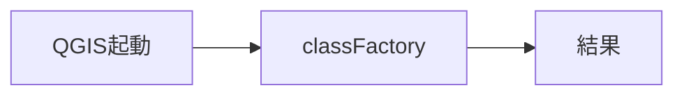

- 検証: 単独=import→呼出→戻り値assert / 連携=pyeval で属性実在+必要なら呼出
- 結果: **pass** 2026-11-18T02:15:18+09:00 — standalone経路のみ(要runtime依存無し)

### action.GeoWebView.initGui — initGui

- kind: `action` / source: `plugin.py:325`
- signature: `initGui()`
- 要約: プラグインのGUI要素を作成（プラグイン読み込み時に呼ばれる）
- needs_runtime=True / standalone_ok=False

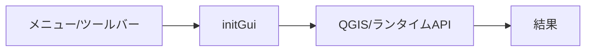

- 検証: 単独= / 連携=bridge_call/generic trigger→実在確認
- 結果: **pass** 2026-11-18T02:15:18+09:00 — 属性/シンボル実在確認(pyeval)

### action.GeoWebView.open_dialog — open_dialog

- kind: `action` / source: `plugin.py:416`
- signature: `open_dialog()`
- 要約: live driver の open_plugin から呼ばれる互換フック。
- needs_runtime=True / standalone_ok=False

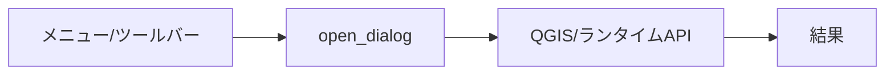

- 検証: 単独= / 連携=bridge_call/generic trigger→実在確認
- 結果: **pass** 2026-11-18T02:15:18+09:00 — 属性/シンボル実在確認(pyeval)

### action.GeoWebView.run — run

- kind: `action` / source: `plugin.py:426`
- signature: `run()`
- 要約: run() 互換エントリ: open_dialog と同じ(パネルを開く)。
- needs_runtime=True / standalone_ok=False

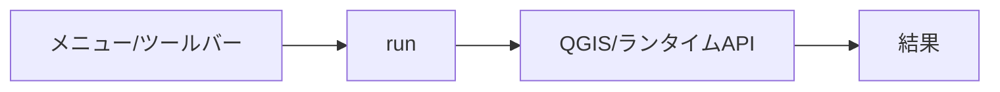

- 検証: 単独= / 連携=bridge_call/generic trigger→実在確認
- 結果: **pass** 2026-11-18T02:15:18+09:00 — 属性/シンボル実在確認(pyeval)

### action.GeoWebView.unload — unload

- kind: `action` / source: `plugin.py:987`
- signature: `unload()`
- 要約: プラグインのアンロード時の処理
- needs_runtime=True / standalone_ok=False

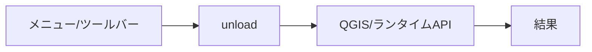

- 検証: 単独= / 連携=bridge_call/generic trigger→実在確認
- 結果: **pass** 2026-11-18T02:15:18+09:00 — 属性/シンボル実在確認(pyeval)

### dialog.GeoWebViewPanel — GeoWebViewPanel

- kind: `dialog` / source: `panel.py:43`
- signature: `GeoWebViewPanel`
- 要約: geo_webviewのパネルクラス
- needs_runtime=True / standalone_ok=False

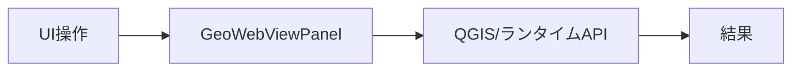

- 検証: 単独= / 連携=openDialog→screenshot→closeDialog
- 結果: **pass** 2026-11-18T02:15:18+09:00 — 属性/シンボル実在確認(pyeval)

### dialog.SettingsDialog — SettingsDialog

- kind: `dialog` / source: `settings_dialog.py:8`
- signature: `SettingsDialog`
- 要約: Settings dialog for KASUGAI Canvas integration configuration
- needs_runtime=True / standalone_ok=False

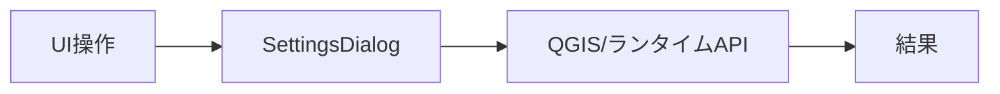

- 検証: 単独= / 連携=openDialog→screenshot→closeDialog
- 結果: **pass** 2026-11-18T02:15:18+09:00 — 属性/シンボル実在確認(pyeval)

### ui.GeoWebView._on_project_saved — _on_project_saved

- kind: `ui_control` / source: `plugin.py:391`
- signature: `_on_project_saved()`
- 要約: projectSaved フック。自動再エクスポートが有効なら再出力する。
- needs_runtime=True / standalone_ok=False

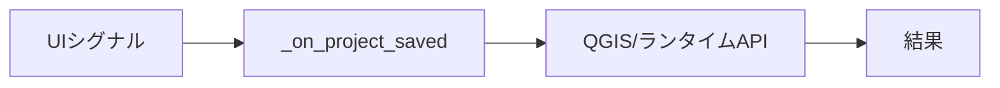

- 検証: 単独= / 連携=親dialog経由で操作・状態assert
- 結果: **pass** 2026-11-18T02:15:18+09:00 — 属性/シンボル実在確認(pyeval)

### ui.GeoWebView.handle_request_origin_changed — handle_request_origin_changed

- kind: `ui_control` / source: `plugin.py:162`
- signature: `handle_request_origin_changed(origin)`
- 要約: サーバから受け取った完全URLをパネルのlineEdit_navigateにセットする
- needs_runtime=True / standalone_ok=False

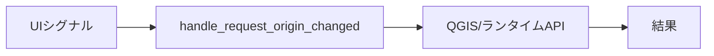

- 検証: 単独= / 連携=親dialog経由で操作・状態assert
- 結果: **pass** 2026-11-18T02:15:18+09:00 — 属性/シンボル実在確認(pyeval)

### ui.GeoWebView.on_basemap_groups_changed — on_basemap_groups_changed

- kind: `ui_control` / source: `plugin.py:1925`
- signature: `on_basemap_groups_changed()`
- 要約: XYZ タブのベースマップグループ追加名を QSettings へ保存する。
- needs_runtime=True / standalone_ok=False

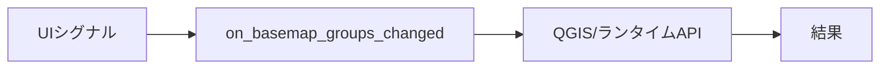

- 検証: 単独= / 連携=親dialog経由で操作・状態assert
- 結果: **untested**  — auto-added

### ui.GeoWebView.on_check_access_clicked — on_check_access_clicked

- kind: `ui_control` / source: `plugin.py:2404`
- signature: `on_check_access_clicked()`
- 要約: 外部アクセス診断ボタンがクリックされた時の処理
- needs_runtime=True / standalone_ok=False

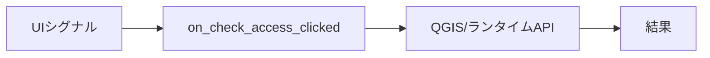

- 検証: 単独= / 連携=親dialog経由で操作・状態assert
- 結果: **pass** 2026-11-18T02:15:18+09:00 — 属性/シンボル実在確認(pyeval)

### ui.GeoWebView.on_copy_clicked_panel — on_copy_clicked_panel

- kind: `ui_control` / source: `plugin.py:1535`
- signature: `on_copy_clicked_panel()`
- 要約: パネル版：コピーボタンがクリックされた時の処理
- needs_runtime=True / standalone_ok=False

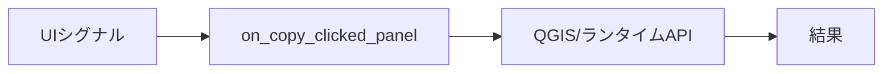

- 検証: 単独= / 連携=親dialog経由で操作・状態assert
- 結果: **pass** 2026-11-18T02:15:18+09:00 — 属性/シンボル実在確認(pyeval)

### ui.GeoWebView.on_engine_combo_changed — on_engine_combo_changed

- kind: `ui_control` / source: `plugin.py:1824`
- signature: `on_engine_combo_changed(index)`
- 要約: Web配信パネルのエンジン選択を QSettings に保存する。
- needs_runtime=True / standalone_ok=False

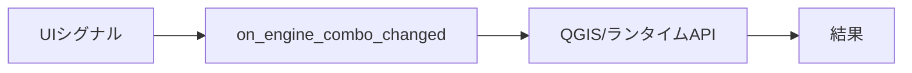

- 検証: 単独= / 連携=親dialog経由で操作・状態assert
- 結果: **pass** 2026-11-18T02:15:18+09:00 — 属性/シンボル実在確認(pyeval)

### ui.GeoWebView.on_generate_clicked_panel — on_generate_clicked_panel

- kind: `ui_control` / source: `plugin.py:1445`
- signature: `on_generate_clicked_panel()`
- 要約: パネル版：パーマリンク生成ボタンがクリックされた時の処理
- needs_runtime=True / standalone_ok=False

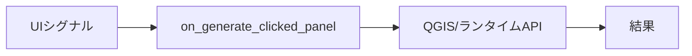

- 検証: 単独= / 連携=親dialog経由で操作・状態assert
- 結果: **pass** 2026-11-18T02:15:18+09:00 — 属性/シンボル実在確認(pyeval)

### ui.GeoWebView.on_hosted_combo_changed — on_hosted_combo_changed

- kind: `ui_control` / source: `plugin.py:1837`
- signature: `on_hosted_combo_changed(text)`
- 要約: Web配信パネルのCDN(ホスト版チャンネル)選択を QSettings に保存する。
- needs_runtime=True / standalone_ok=False


- 検証: 単独= / 連携=親dialog経由で操作・状態assert
- 結果: **pass** 2026-11-18T02:15:18+09:00 — 属性/シンボル実在確認(pyeval)

### ui.GeoWebView.on_kasugai_admin_clicked — on_kasugai_admin_clicked

- kind: `ui_control` / source: `plugin.py:1779`
- signature: `on_kasugai_admin_clicked()`
- 要約: KASUGAI Canvas の UI 設定管理画面をブラウザで開く。
- needs_runtime=True / standalone_ok=False

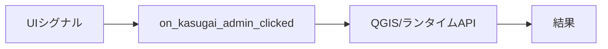

- 検証: 単独= / 連携=親dialog経由で操作・状態assert
- 結果: **untested**  — auto-added

### ui.GeoWebView.on_kasugai_export_clicked — on_kasugai_export_clicked

- kind: `ui_control` / source: `plugin.py:1702`
- signature: `on_kasugai_export_clicked()`
- 要約: パネル版：KASUGAI エクスポートボタン — 表示中レイヤを
- needs_runtime=True / standalone_ok=False


- 検証: 単独= / 連携=親dialog経由で操作・状態assert
- 結果: **pass** 2026-11-18T02:15:18+09:00 — 属性/シンボル実在確認(pyeval)

### ui.GeoWebView.on_kasugai_help_clicked — on_kasugai_help_clicked

- kind: `ui_control` / source: `plugin.py:1775`
- signature: `on_kasugai_help_clicked()`
- 要約: ドキュメントサイト(GitHub Pages の docs/)をブラウザで開く。
- needs_runtime=True / standalone_ok=False

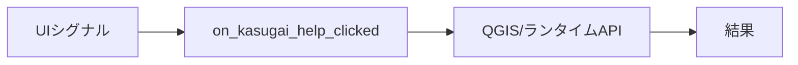

- 検証: 単独= / 連携=親dialog経由で操作・状態assert
- 結果: **pass** 2026-11-18T02:15:18+09:00 — 属性/シンボル実在確認(pyeval)

### ui.GeoWebView.on_kasugai_launch_clicked — on_kasugai_launch_clicked

- kind: `ui_control` / source: `plugin.py:2013`
- signature: `on_kasugai_launch_clicked(route=…)`
- 要約: パネル版：選択エンジンで エクスポート→登録→ブラウザ起動 まで
- needs_runtime=True / standalone_ok=False

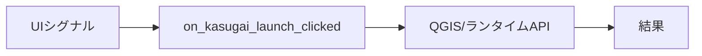

- 検証: 単独= / 連携=親dialog経由で操作・状態assert
- 結果: **pass** 2026-11-18T02:15:18+09:00 — 属性/シンボル実在確認(pyeval)

### ui.GeoWebView.on_kasugai_open_folder — on_kasugai_open_folder

- kind: `ui_control` / source: `plugin.py:1591`
- signature: `on_kasugai_open_folder()`
- 要約: KASUGAI 出力フォルダ(.kasc/canvas_data/<engine>.html/index.html が
- needs_runtime=True / standalone_ok=False

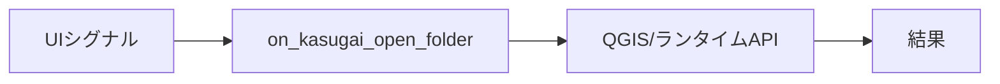

- 検証: 単独= / 連携=親dialog経由で操作・状態assert
- 結果: **pass** 2026-11-18T02:15:18+09:00 — 属性/シンボル実在確認(pyeval)

### ui.GeoWebView.on_kasugai_outdir_browse — on_kasugai_outdir_browse

- kind: `ui_control` / source: `plugin.py:1616`
- signature: `on_kasugai_outdir_browse()`
- 要約: 保存先表示のクリック — フォルダ選択でエクスポート出力先を変更。
- needs_runtime=True / standalone_ok=False

```mermaid
flowchart LR
  E_ui_GeoWebView_on_kasugai_outdir_browse["UIシグナル"] --> H_ui_GeoWebView_on_kasugai_outdir_browse["on_kasugai_outdir_browse"]
  H_ui_GeoWebView_on_kasugai_outdir_browse --> R_ui_GeoWebView_on_kasugai_outdir_browse["QGIS/ランタイムAPI"]
  R_ui_GeoWebView_on_kasugai_outdir_browse --> OUT["結果"]
```

- 検証: 単独= / 連携=親dialog経由で操作・状態assert
- 結果: **pass** 2026-11-18T02:15:18+09:00 — 属性/シンボル実在確認(pyeval)

### ui.GeoWebView.on_kasugai_outdir_reset — on_kasugai_outdir_reset

- kind: `ui_control` / source: `plugin.py:1641`
- signature: `on_kasugai_outdir_reset()`
- 要約: 保存先を既定(Canvasインストール先/<ドキュメント>)に戻す。
- needs_runtime=True / standalone_ok=False

```mermaid
flowchart LR
  E_ui_GeoWebView_on_kasugai_outdir_reset["UIシグナル"] --> H_ui_GeoWebView_on_kasugai_outdir_reset["on_kasugai_outdir_reset"]
  H_ui_GeoWebView_on_kasugai_outdir_reset --> R_ui_GeoWebView_on_kasugai_outdir_reset["QGIS/ランタイムAPI"]
  R_ui_GeoWebView_on_kasugai_outdir_reset --> OUT["結果"]
```

- 検証: 単独= / 連携=親dialog経由で操作・状態assert
- 結果: **pass** 2026-11-18T02:15:18+09:00 — 属性/シンボル実在確認(pyeval)

### ui.GeoWebView.on_kasugai_zip_clicked — on_kasugai_zip_clicked

- kind: `ui_control` / source: `plugin.py:1748`
- signature: `on_kasugai_zip_clicked()`
- 要約: エクスポート物一式を kasugai_canvas.zip としてブラウザで
- needs_runtime=True / standalone_ok=False

```mermaid
flowchart LR
  E_ui_GeoWebView_on_kasugai_zip_clicked["UIシグナル"] --> H_ui_GeoWebView_on_kasugai_zip_clicked["on_kasugai_zip_clicked"]
  H_ui_GeoWebView_on_kasugai_zip_clicked --> R_ui_GeoWebView_on_kasugai_zip_clicked["QGIS/ランタイムAPI"]
  R_ui_GeoWebView_on_kasugai_zip_clicked --> OUT["結果"]
```

- 検証: 単独= / 連携=親dialog経由で操作・状態assert
- 結果: **pass** 2026-11-18T02:15:18+09:00 — 属性/シンボル実在確認(pyeval)

### ui.GeoWebView.on_navigate_clicked_panel — on_navigate_clicked_panel

- kind: `ui_control` / source: `plugin.py:1486`
- signature: `on_navigate_clicked_panel()`
- 要約: パネル版：ナビゲートボタンがクリックされた時の処理
- needs_runtime=True / standalone_ok=False

```mermaid
flowchart LR
  E_ui_GeoWebView_on_navigate_clicked_panel["UIシグナル"] --> H_ui_GeoWebView_on_navigate_clicked_panel["on_navigate_clicked_panel"]
  H_ui_GeoWebView_on_navigate_clicked_panel --> R_ui_GeoWebView_on_navigate_clicked_panel["QGIS/ランタイムAPI"]
  R_ui_GeoWebView_on_navigate_clicked_panel --> OUT["結果"]
```

- 検証: 単独= / 連携=親dialog経由で操作・状態assert
- 結果: **pass** 2026-11-18T02:15:18+09:00 — 属性/シンボル実在確認(pyeval)

### ui.GeoWebView.on_present_clicked_panel — on_present_clicked_panel

- kind: `ui_control` / source: `plugin.py:2325`
- signature: `on_present_clicked_panel()`
- 要約: プレゼンテーション共有ページ(/present)をブラウザで開く。
- needs_runtime=True / standalone_ok=False

```mermaid
flowchart LR
  E_ui_GeoWebView_on_present_clicked_panel["UIシグナル"] --> H_ui_GeoWebView_on_present_clicked_panel["on_present_clicked_panel"]
  H_ui_GeoWebView_on_present_clicked_panel --> R_ui_GeoWebView_on_present_clicked_panel["QGIS/ランタイムAPI"]
  R_ui_GeoWebView_on_present_clicked_panel --> OUT["結果"]
```

- 検証: 単独= / 連携=親dialog経由で操作・状態assert
- 結果: **pass** 2026-11-18T02:15:18+09:00 — 属性/シンボル実在確認(pyeval)

### ui.GeoWebView.on_received_selected — on_received_selected

- kind: `ui_control` / source: `plugin.py:2355`
- signature: `on_received_selected(index)`
- 要約: 受領履歴コンボの選択をナビゲート欄へコピーする。
- needs_runtime=True / standalone_ok=False

```mermaid
flowchart LR
  E_ui_GeoWebView_on_received_selected["UIシグナル"] --> H_ui_GeoWebView_on_received_selected["on_received_selected"]
  H_ui_GeoWebView_on_received_selected --> R_ui_GeoWebView_on_received_selected["QGIS/ランタイムAPI"]
  R_ui_GeoWebView_on_received_selected --> OUT["結果"]
```

- 検証: 単独= / 連携=親dialog経由で操作・状態assert
- 結果: **pass** 2026-11-18T02:15:18+09:00 — 属性/シンボル実在確認(pyeval)

### ui.GeoWebView.on_save_theme_clicked_panel — on_save_theme_clicked_panel

- kind: `ui_control` / source: `plugin.py:2715`
- signature: `on_save_theme_clicked_panel()`
- 要約: テーマ保存ボタン: 現在の表示状態をマップテーマとして保存
- needs_runtime=True / standalone_ok=False

```mermaid
flowchart LR
  E_ui_GeoWebView_on_save_theme_clicked_panel["UIシグナル"] --> H_ui_GeoWebView_on_save_theme_clicked_panel["on_save_theme_clicked_panel"]
  H_ui_GeoWebView_on_save_theme_clicked_panel --> R_ui_GeoWebView_on_save_theme_clicked_panel["QGIS/ランタイムAPI"]
  R_ui_GeoWebView_on_save_theme_clicked_panel --> OUT["結果"]
```

- 検証: 単独= / 連携=親dialog経由で操作・状態assert
- 結果: **pass** 2026-11-18T02:15:18+09:00 — 属性/シンボル実在確認(pyeval)

### ui.GeoWebView.on_site_control_toggled — on_site_control_toggled

- kind: `ui_control` / source: `plugin.py:1876`
- signature: `on_site_control_toggled(checked)`
- 要約: パネルの「カスタムレイヤタブ」チェックを kasugai_site_control
- needs_runtime=True / standalone_ok=False

```mermaid
flowchart LR
  E_ui_GeoWebView_on_site_control_toggled["UIシグナル"] --> H_ui_GeoWebView_on_site_control_toggled["on_site_control_toggled"]
  H_ui_GeoWebView_on_site_control_toggled --> R_ui_GeoWebView_on_site_control_toggled["QGIS/ランタイムAPI"]
  R_ui_GeoWebView_on_site_control_toggled --> OUT["結果"]
```

- 検証: 単独= / 連携=親dialog経由で操作・状態assert
- 結果: **untested**  — auto-added

### ui.GeoWebView.on_standard_port_clicked — on_standard_port_clicked

- kind: `ui_control` / source: `plugin.py:2546`
- signature: `on_standard_port_clicked(port)`
- 要約: 標準ポートボタンがクリックされた時の処理
- needs_runtime=True / standalone_ok=False

```mermaid
flowchart LR
  E_ui_GeoWebView_on_standard_port_clicked["UIシグナル"] --> H_ui_GeoWebView_on_standard_port_clicked["on_standard_port_clicked"]
  H_ui_GeoWebView_on_standard_port_clicked --> R_ui_GeoWebView_on_standard_port_clicked["QGIS/ランタイムAPI"]
  R_ui_GeoWebView_on_standard_port_clicked --> OUT["結果"]
```

- 検証: 単独= / 連携=親dialog経由で操作・状態assert
- 結果: **pass** 2026-11-18T02:15:18+09:00 — 属性/シンボル実在確認(pyeval)

### ui.GeoWebView.on_vector_format_changed — on_vector_format_changed

- kind: `ui_control` / source: `plugin.py:1851`
- signature: `on_vector_format_changed(index)`
- 要約: パネルのベクター出力形式コンボを kasugai_vector_format へ保存する。
- needs_runtime=True / standalone_ok=False

```mermaid
flowchart LR
  E_ui_GeoWebView_on_vector_format_changed["UIシグナル"] --> H_ui_GeoWebView_on_vector_format_changed["on_vector_format_changed"]
  H_ui_GeoWebView_on_vector_format_changed --> R_ui_GeoWebView_on_vector_format_changed["QGIS/ランタイムAPI"]
  R_ui_GeoWebView_on_vector_format_changed --> OUT["結果"]
```

- 検証: 単独= / 連携=パネルのコンボ操作→QSettings 値assert、および get_vector_export_mode() 反映確認
- 結果: **pass** 2026-11-18T00:00:00+09:00 — 4.21.0 パネル Format: コンボ追加に伴う新規 / L2実機検証済み(reload後にコンボ実在・itemData確認、setCurrentIndex→kasugai_vector_format 保存確認)

### ui.GeoWebView.on_visible_only_toggled — on_visible_only_toggled

- kind: `ui_control` / source: `plugin.py:1866`
- signature: `on_visible_only_toggled(checked)`
- 要約: パネルの「表示中のみ変換」チェックを kasugai_visible_data_only
- needs_runtime=True / standalone_ok=False

```mermaid
flowchart LR
  E_ui_GeoWebView_on_visible_only_toggled["UIシグナル"] --> H_ui_GeoWebView_on_visible_only_toggled["on_visible_only_toggled"]
  H_ui_GeoWebView_on_visible_only_toggled --> R_ui_GeoWebView_on_visible_only_toggled["QGIS/ランタイムAPI"]
  R_ui_GeoWebView_on_visible_only_toggled --> OUT["結果"]
```

- 検証: 単独= / 連携=親dialog経由で操作・状態assert
- 結果: **untested**  — auto-added

### ui.GeoWebView.on_xyz_export_clicked — on_xyz_export_clicked

- kind: `ui_control` / source: `plugin.py:1941`
- signature: `on_xyz_export_clicked()`
- 要約: XYZ タブ: レイヤパネルで選択中のレイヤだけを XYZ タイルへ
- needs_runtime=True / standalone_ok=False

```mermaid
flowchart LR
  E_ui_GeoWebView_on_xyz_export_clicked["UIシグナル"] --> H_ui_GeoWebView_on_xyz_export_clicked["on_xyz_export_clicked"]
  H_ui_GeoWebView_on_xyz_export_clicked --> R_ui_GeoWebView_on_xyz_export_clicked["QGIS/ランタイムAPI"]
  R_ui_GeoWebView_on_xyz_export_clicked --> OUT["結果"]
```

- 検証: 単独= / 連携=親dialog経由で操作・状態assert
- 結果: **untested**  — auto-added

### ui.GeoWebView.on_xyz_open_clicked — on_xyz_open_clicked

- kind: `ui_control` / source: `plugin.py:1999`
- signature: `on_xyz_open_clicked()`
- 要約: XYZ タブ: 独立出力のルート(xyz_tiles/)をエクスプローラで開く。
- needs_runtime=True / standalone_ok=False

```mermaid
flowchart LR
  E_ui_GeoWebView_on_xyz_open_clicked["UIシグナル"] --> H_ui_GeoWebView_on_xyz_open_clicked["on_xyz_open_clicked"]
  H_ui_GeoWebView_on_xyz_open_clicked --> R_ui_GeoWebView_on_xyz_open_clicked["QGIS/ランタイムAPI"]
  R_ui_GeoWebView_on_xyz_open_clicked --> OUT["結果"]
```

- 検証: 単独= / 連携=親dialog経由で操作・状態assert
- 結果: **untested**  — auto-added

### ui.GeoWebView.on_xyz_tiles_toggled — on_xyz_tiles_toggled

- kind: `ui_control` / source: `plugin.py:1886`
- signature: `on_xyz_tiles_toggled(checked)`
- 要約: パネルの「XYZ tiles」チェックを kasugai_xyz_tiles へ保存する。
- needs_runtime=True / standalone_ok=False

```mermaid
flowchart LR
  E_ui_GeoWebView_on_xyz_tiles_toggled["UIシグナル"] --> H_ui_GeoWebView_on_xyz_tiles_toggled["on_xyz_tiles_toggled"]
  H_ui_GeoWebView_on_xyz_tiles_toggled --> R_ui_GeoWebView_on_xyz_tiles_toggled["QGIS/ランタイムAPI"]
  R_ui_GeoWebView_on_xyz_tiles_toggled --> OUT["結果"]
```

- 検証: 単独= / 連携=親dialog経由で操作・状態assert
- 結果: **untested**  — auto-added

### ui.GeoWebView.on_xyz_zooms_changed — on_xyz_zooms_changed

- kind: `ui_control` / source: `plugin.py:1914`
- signature: `on_xyz_zooms_changed(_value=…)`
- 要約: パネルの XYZ 焼き付けズーム範囲スピンを QSettings へ保存する。
- needs_runtime=True / standalone_ok=False

```mermaid
flowchart LR
  E_ui_GeoWebView_on_xyz_zooms_changed["UIシグナル"] --> H_ui_GeoWebView_on_xyz_zooms_changed["on_xyz_zooms_changed"]
  H_ui_GeoWebView_on_xyz_zooms_changed --> R_ui_GeoWebView_on_xyz_zooms_changed["QGIS/ランタイムAPI"]
  R_ui_GeoWebView_on_xyz_zooms_changed --> OUT["結果"]
```

- 検証: 単独= / 連携=親dialog経由で操作・状態assert
- 結果: **untested**  — auto-added

### ui.GeoWebViewPanel._on_copy_permalink_to_clipboard — _on_copy_permalink_to_clipboard

- kind: `ui_control` / source: `panel.py:1954`
- signature: `_on_copy_permalink_to_clipboard()`
- 要約: lineEdit_permalink の内容をシステムクリップボードにコピーする
- needs_runtime=True / standalone_ok=False

```mermaid
flowchart LR
  E_ui_GeoWebViewPanel__on_copy_permalink_to_clipboard["UIシグナル"] --> H_ui_GeoWebViewPanel__on_copy_permalink_to_clipboard["_on_copy_permalink_to_clipboard"]
  H_ui_GeoWebViewPanel__on_copy_permalink_to_clipboard --> R_ui_GeoWebViewPanel__on_copy_permalink_to_clipboard["QGIS/ランタイムAPI"]
  R_ui_GeoWebViewPanel__on_copy_permalink_to_clipboard --> OUT["結果"]
```

- 検証: 単独= / 連携=親dialog経由で操作・状態assert
- 結果: **pass** 2026-11-18T02:15:18+09:00 — 属性/シンボル実在確認(pyeval)

### ui.GeoWebViewPanel._on_kasugai_layer_item_changed — _on_kasugai_layer_item_changed

- kind: `ui_control` / source: `panel.py:1671`
- signature: `_on_kasugai_layer_item_changed(item, col)`
- 要約: セル編集をレイヤ customProperty へ反映する。
- needs_runtime=True / standalone_ok=False

```mermaid
flowchart LR
  E_ui_GeoWebViewPanel__on_kasugai_layer_item_changed["UIシグナル"] --> H_ui_GeoWebViewPanel__on_kasugai_layer_item_changed["_on_kasugai_layer_item_changed"]
  H_ui_GeoWebViewPanel__on_kasugai_layer_item_changed --> R_ui_GeoWebViewPanel__on_kasugai_layer_item_changed["QGIS/ランタイムAPI"]
  R_ui_GeoWebViewPanel__on_kasugai_layer_item_changed --> OUT["結果"]
```

- 検証: 単独= / 連携=親dialog経由で操作・状態assert
- 結果: **untested**  — auto-added

### ui.GeoWebViewPanel._on_kasugai_view_item_checked — _on_kasugai_view_item_checked

- kind: `ui_control` / source: `panel.py:1618`
- signature: `_on_kasugai_view_item_checked(item)`
- 要約: VIEW のチェックボックス → レイヤツリーの表示/非表示に反映。
- needs_runtime=True / standalone_ok=False

```mermaid
flowchart LR
  E_ui_GeoWebViewPanel__on_kasugai_view_item_checked["UIシグナル"] --> H_ui_GeoWebViewPanel__on_kasugai_view_item_checked["_on_kasugai_view_item_checked"]
  H_ui_GeoWebViewPanel__on_kasugai_view_item_checked --> R_ui_GeoWebViewPanel__on_kasugai_view_item_checked["QGIS/ランタイムAPI"]
  R_ui_GeoWebViewPanel__on_kasugai_view_item_checked --> OUT["結果"]
```

- 検証: 単独= / 連携=親dialog経由で操作・状態assert
- 結果: **untested**  — auto-added

### ui.GeoWebViewPanel._on_paste_from_clipboard — _on_paste_from_clipboard

- kind: `ui_control` / source: `panel.py:1964`
- signature: `_on_paste_from_clipboard()`
- 要約: クリップボードからテキストを取得して lineEdit_navigate に貼り付ける
- needs_runtime=True / standalone_ok=False

```mermaid
flowchart LR
  E_ui_GeoWebViewPanel__on_paste_from_clipboard["UIシグナル"] --> H_ui_GeoWebViewPanel__on_paste_from_clipboard["_on_paste_from_clipboard"]
  H_ui_GeoWebViewPanel__on_paste_from_clipboard --> R_ui_GeoWebViewPanel__on_paste_from_clipboard["QGIS/ランタイムAPI"]
  R_ui_GeoWebViewPanel__on_paste_from_clipboard --> OUT["結果"]
```

- 検証: 単独= / 連携=親dialog経由で操作・状態assert
- 結果: **pass** 2026-11-18T02:15:18+09:00 — 属性/シンボル実在確認(pyeval)

### ui.GeoWebViewPanel._on_visibility_changed — _on_visibility_changed

- kind: `ui_control` / source: `panel.py:515`
- signature: `_on_visibility_changed(visible)`
- 要約: 
- needs_runtime=True / standalone_ok=False

```mermaid
flowchart LR
  E_ui_GeoWebViewPanel__on_visibility_changed["UIシグナル"] --> H_ui_GeoWebViewPanel__on_visibility_changed["_on_visibility_changed"]
  H_ui_GeoWebViewPanel__on_visibility_changed --> R_ui_GeoWebViewPanel__on_visibility_changed["QGIS/ランタイムAPI"]
  R_ui_GeoWebViewPanel__on_visibility_changed --> OUT["結果"]
```

- 検証: 単独= / 連携=親dialog経由で操作・状態assert
- 結果: **pass** 2026-11-18T02:15:18+09:00 — 属性/シンボル実在確認(pyeval)

### ui.GeoWebViewPanel._on_xyz_layer_item_changed — _on_xyz_layer_item_changed

- kind: `ui_control` / source: `panel.py:716`
- signature: `_on_xyz_layer_item_changed(item, column)`
- 要約: render 列の編集を kasugai_render customProperty へ保存する。
- needs_runtime=True / standalone_ok=False

```mermaid
flowchart LR
  E_ui_GeoWebViewPanel__on_xyz_layer_item_changed["UIシグナル"] --> H_ui_GeoWebViewPanel__on_xyz_layer_item_changed["_on_xyz_layer_item_changed"]
  H_ui_GeoWebViewPanel__on_xyz_layer_item_changed --> R_ui_GeoWebViewPanel__on_xyz_layer_item_changed["QGIS/ランタイムAPI"]
  R_ui_GeoWebViewPanel__on_xyz_layer_item_changed --> OUT["結果"]
```

- 検証: 単独= / 連携=親dialog経由で操作・状態assert
- 結果: **removed**  — auto-added

### ui.GeoWebViewPanel._on_xyz_tab_shown — _on_xyz_tab_shown

- kind: `ui_control` / source: `panel.py:610`
- signature: `_on_xyz_tab_shown()`
- 要約: XYZ タブ表示時に対象表示と設定値を最新へ(設定ダイアログ側での
- needs_runtime=True / standalone_ok=False

```mermaid
flowchart LR
  E_ui_GeoWebViewPanel__on_xyz_tab_shown["UIシグナル"] --> H_ui_GeoWebViewPanel__on_xyz_tab_shown["_on_xyz_tab_shown"]
  H_ui_GeoWebViewPanel__on_xyz_tab_shown --> R_ui_GeoWebViewPanel__on_xyz_tab_shown["QGIS/ランタイムAPI"]
  R_ui_GeoWebViewPanel__on_xyz_tab_shown --> OUT["結果"]
```

- 検証: 単独= / 連携=親dialog経由で操作・状態assert
- 結果: **untested**  — auto-added

### ui.GeoWebViewPanel.set_external_control_handler — set_external_control_handler

- kind: `ui_control` / source: `panel.py:1929`
- signature: `set_external_control_handler(handler)`
- 要約: 外部制御トグルのハンドラを設定する
- needs_runtime=True / standalone_ok=False

```mermaid
flowchart LR
  E_ui_GeoWebViewPanel_set_external_control_handler["UIシグナル"] --> H_ui_GeoWebViewPanel_set_external_control_handler["set_external_control_handler"]
  H_ui_GeoWebViewPanel_set_external_control_handler --> R_ui_GeoWebViewPanel_set_external_control_handler["QGIS/ランタイムAPI"]
  R_ui_GeoWebViewPanel_set_external_control_handler --> OUT["結果"]
```

- 検証: 単独= / 連携=親dialog経由で操作・状態assert
- 結果: **pass** 2026-11-18T02:15:18+09:00 — 属性/シンボル実在確認(pyeval)

### ui.GeoWebViewPanel.set_port_change_handler — set_port_change_handler

- kind: `ui_control` / source: `panel.py:1941`
- signature: `set_port_change_handler(handler)`
- 要約: ポート番号変更のハンドラを設定する
- needs_runtime=True / standalone_ok=False

```mermaid
flowchart LR
  E_ui_GeoWebViewPanel_set_port_change_handler["UIシグナル"] --> H_ui_GeoWebViewPanel_set_port_change_handler["set_port_change_handler"]
  H_ui_GeoWebViewPanel_set_port_change_handler --> R_ui_GeoWebViewPanel_set_port_change_handler["QGIS/ランタイムAPI"]
  R_ui_GeoWebViewPanel_set_port_change_handler --> OUT["結果"]
```

- 検証: 単独= / 連携=親dialog経由で操作・状態assert
- 結果: **pass** 2026-11-18T02:15:18+09:00 — 属性/シンボル実在確認(pyeval)

### ui.GeoWebViewPanel.set_server_toggle_handler — set_server_toggle_handler

- kind: `ui_control` / source: `panel.py:1916`
- signature: `set_server_toggle_handler(handler)`
- 要約: 外部からトグルのハンドラを設定する
- needs_runtime=True / standalone_ok=False

```mermaid
flowchart LR
  E_ui_GeoWebViewPanel_set_server_toggle_handler["UIシグナル"] --> H_ui_GeoWebViewPanel_set_server_toggle_handler["set_server_toggle_handler"]
  H_ui_GeoWebViewPanel_set_server_toggle_handler --> R_ui_GeoWebViewPanel_set_server_toggle_handler["QGIS/ランタイムAPI"]
  R_ui_GeoWebViewPanel_set_server_toggle_handler --> OUT["結果"]
```

- 検証: 単独= / 連携=親dialog経由で操作・状態assert
- 結果: **pass** 2026-11-18T02:15:18+09:00 — 属性/シンボル実在確認(pyeval)

### ui.GeoWebViewServerManager._on_cursor_xy — _on_cursor_xy

- kind: `ui_control` / source: `server_manager.py:266`
- signature: `_on_cursor_xy(point)`
- 要約: キャンバス上のマウス移動(GUIスレッド)。最終位置を保持する。
- needs_runtime=True / standalone_ok=False

```mermaid
flowchart LR
  E_ui_GeoWebViewServerManager__on_cursor_xy["UIシグナル"] --> H_ui_GeoWebViewServerManager__on_cursor_xy["_on_cursor_xy"]
  H_ui_GeoWebViewServerManager__on_cursor_xy --> R_ui_GeoWebViewServerManager__on_cursor_xy["QGIS/ランタイムAPI"]
  R_ui_GeoWebViewServerManager__on_cursor_xy --> OUT["結果"]
```

- 検証: 単独= / 連携=親dialog経由で操作・状態assert
- 結果: **pass** 2026-11-18T02:15:18+09:00 — 属性/シンボル実在確認(pyeval)

### ui.LiveSyncController._on_layers_added — _on_layers_added

- kind: `ui_control` / source: `live_sync.py:258`
- signature: `_on_layers_added(layers)`
- 要約: 
- needs_runtime=True / standalone_ok=False

```mermaid
flowchart LR
  E_ui_LiveSyncController__on_layers_added["UIシグナル"] --> H_ui_LiveSyncController__on_layers_added["_on_layers_added"]
  H_ui_LiveSyncController__on_layers_added --> R_ui_LiveSyncController__on_layers_added["QGIS/ランタイムAPI"]
  R_ui_LiveSyncController__on_layers_added --> OUT["結果"]
```

- 検証: 単独= / 連携=親dialog経由で操作・状態assert
- 結果: **pass** 2026-11-18T02:15:18+09:00 — 属性/シンボル実在確認(pyeval)

### ui.LiveSyncController._on_project_read — _on_project_read

- kind: `ui_control` / source: `live_sync.py:263`
- signature: `_on_project_read(*args)`
- 要約: 
- needs_runtime=True / standalone_ok=False

```mermaid
flowchart LR
  E_ui_LiveSyncController__on_project_read["UIシグナル"] --> H_ui_LiveSyncController__on_project_read["_on_project_read"]
  H_ui_LiveSyncController__on_project_read --> R_ui_LiveSyncController__on_project_read["QGIS/ランタイムAPI"]
  R_ui_LiveSyncController__on_project_read --> OUT["結果"]
```

- 検証: 単独= / 連携=親dialog経由で操作・状態assert
- 結果: **pass** 2026-11-18T02:15:18+09:00 — 属性/シンボル実在確認(pyeval)

### ui.LiveSyncController._on_selection_changed — _on_selection_changed

- kind: `ui_control` / source: `live_sync.py:350`
- signature: `_on_selection_changed(*args)`
- 要約: ベクターレイヤの selectionChanged(GUIスレッド)。デバウンスして送信。
- needs_runtime=True / standalone_ok=False

```mermaid
flowchart LR
  E_ui_LiveSyncController__on_selection_changed["UIシグナル"] --> H_ui_LiveSyncController__on_selection_changed["_on_selection_changed"]
  H_ui_LiveSyncController__on_selection_changed --> R_ui_LiveSyncController__on_selection_changed["QGIS/ランタイムAPI"]
  R_ui_LiveSyncController__on_selection_changed --> OUT["結果"]
```

- 検証: 単独= / 連携=親dialog経由で操作・状態assert
- 結果: **pass** 2026-11-18T02:15:18+09:00 — 属性/シンボル実在確認(pyeval)

### ui.LiveSyncController._on_structure — _on_structure

- kind: `ui_control` / source: `live_sync.py:248`
- signature: `_on_structure(*args)`
- 要約: 
- needs_runtime=True / standalone_ok=False

```mermaid
flowchart LR
  E_ui_LiveSyncController__on_structure["UIシグナル"] --> H_ui_LiveSyncController__on_structure["_on_structure"]
  H_ui_LiveSyncController__on_structure --> R_ui_LiveSyncController__on_structure["QGIS/ランタイムAPI"]
  R_ui_LiveSyncController__on_structure --> OUT["結果"]
```

- 検証: 単独= / 連携=親dialog経由で操作・状態assert
- 結果: **pass** 2026-11-18T02:15:18+09:00 — 属性/シンボル実在確認(pyeval)

### ui.SettingsDialog._basemap_groups_changed — _basemap_groups_changed

- kind: `ui_control` / source: `settings_dialog.py:397`
- signature: `_basemap_groups_changed()`
- 要約: 追加のベースマップグループ名(カンマ区切り)を保存する。
- needs_runtime=True / standalone_ok=False

```mermaid
flowchart LR
  E_ui_SettingsDialog__basemap_groups_changed["UIシグナル"] --> H_ui_SettingsDialog__basemap_groups_changed["_basemap_groups_changed"]
  H_ui_SettingsDialog__basemap_groups_changed --> R_ui_SettingsDialog__basemap_groups_changed["QGIS/ランタイムAPI"]
  R_ui_SettingsDialog__basemap_groups_changed --> OUT["結果"]
```

- 検証: 単独= / 連携=親dialog経由で操作・状態assert
- 結果: **pass** 2026-11-18T02:15:18+09:00 — 属性/シンボル実在確認(pyeval)

### ui.SettingsDialog._hosted_channel_changed — _hosted_channel_changed

- kind: `ui_control` / source: `settings_dialog.py:403`
- signature: `_hosted_channel_changed(text)`
- 要約: ホスト版エンジンのチャンネル変更を保存する。
- needs_runtime=True / standalone_ok=False

```mermaid
flowchart LR
  E_ui_SettingsDialog__hosted_channel_changed["UIシグナル"] --> H_ui_SettingsDialog__hosted_channel_changed["_hosted_channel_changed"]
  H_ui_SettingsDialog__hosted_channel_changed --> R_ui_SettingsDialog__hosted_channel_changed["QGIS/ランタイムAPI"]
  R_ui_SettingsDialog__hosted_channel_changed --> OUT["結果"]
```

- 検証: 単独= / 連携=親dialog経由で操作・状態assert
- 結果: **pass** 2026-11-18T02:15:18+09:00 — 属性/シンボル実在確認(pyeval)

### ui.SettingsDialog._vector_format_changed — _vector_format_changed

- kind: `ui_control` / source: `settings_dialog.py:362`
- signature: `_vector_format_changed(index)`
- 要約: ベクター出力モード(native/recommended/geojson)を保存する。
- needs_runtime=True / standalone_ok=False

```mermaid
flowchart LR
  E_ui_SettingsDialog__vector_format_changed["UIシグナル"] --> H_ui_SettingsDialog__vector_format_changed["_vector_format_changed"]
  H_ui_SettingsDialog__vector_format_changed --> R_ui_SettingsDialog__vector_format_changed["QGIS/ランタイムAPI"]
  R_ui_SettingsDialog__vector_format_changed --> OUT["結果"]
```

- 検証: 単独= / 連携=親dialog経由で操作・状態assert
- 結果: **untested**  — auto-added

### ui.SettingsDialog._xyz_zooms_changed — _xyz_zooms_changed

- kind: `ui_control` / source: `settings_dialog.py:387`
- signature: `_xyz_zooms_changed(_value=…)`
- 要約: XYZ 焼き付けズーム範囲を保存する。
- needs_runtime=True / standalone_ok=False

```mermaid
flowchart LR
  E_ui_SettingsDialog__xyz_zooms_changed["UIシグナル"] --> H_ui_SettingsDialog__xyz_zooms_changed["_xyz_zooms_changed"]
  H_ui_SettingsDialog__xyz_zooms_changed --> R_ui_SettingsDialog__xyz_zooms_changed["QGIS/ランタイムAPI"]
  R_ui_SettingsDialog__xyz_zooms_changed --> OUT["結果"]
```

- 検証: 単独= / 連携=親dialog経由で操作・状態assert
- 結果: **untested**  — auto-added

### bridge.addFirewallRule — addFirewallRule

- kind: `bridge_method` / source: `bridge.py:1737`
- signature: `addFirewallRule(port=…)`
- 要約: Windowsファイアウォールに受信ルールを追加する。
- needs_runtime=True / standalone_ok=False

```mermaid
flowchart LR
  E_bridge_addFirewallRule["AI/bridge_call"] --> H_bridge_addFirewallRule["addFirewallRule"]
  H_bridge_addFirewallRule --> R_bridge_addFirewallRule["QGIS/ランタイムAPI"]
  R_bridge_addFirewallRule --> OUT["結果"]
```

- 検証: 単独= / 連携=bridge_call addFirewallRule → 応答assert
- 結果: **skip** 2026-11-18T02:15:18+09:00 — 副作用/破壊的/外部通信操作のため手動検証対象

### bridge.applyTheme — applyTheme

- kind: `bridge_method` / source: `bridge.py:908`
- signature: `applyTheme(name)`
- 要約: マップテーマをレイヤツリーへ適用し、パネルコンボも同期する。
- needs_runtime=True / standalone_ok=False

```mermaid
flowchart LR
  E_bridge_applyTheme["AI/bridge_call"] --> H_bridge_applyTheme["applyTheme"]
  H_bridge_applyTheme --> R_bridge_applyTheme["QGIS/ランタイムAPI"]
  R_bridge_applyTheme --> OUT["結果"]
```

- 検証: 単独= / 連携=bridge_call applyTheme → 応答assert
- 結果: **skip** 2026-11-18T02:15:18+09:00 — 副作用/破壊的/外部通信操作のため手動検証対象

### bridge.checkAccess — checkAccess

- kind: `bridge_method` / source: `bridge.py:1498`
- signature: `checkAccess()`
- 要約: 外部アクセス診断(ファイアウォール含む)を実行し結果を返す。
- needs_runtime=True / standalone_ok=False

```mermaid
flowchart LR
  E_bridge_checkAccess["AI/bridge_call"] --> H_bridge_checkAccess["checkAccess"]
  H_bridge_checkAccess --> R_bridge_checkAccess["QGIS/ランタイムAPI"]
  R_bridge_checkAccess --> OUT["結果"]
```

- 検証: 単独= / 連携=bridge_call checkAccess → 応答assert
- 結果: **pass** 2026-11-18T02:15:18+09:00 — bridge_call応答あり args=[]

### bridge.closePanel — closePanel

- kind: `bridge_method` / source: `bridge.py:583`
- signature: `closePanel()`
- 要約: GeoWebViewドックパネルを隠す(インスタンスは保持)。
- needs_runtime=True / standalone_ok=False

```mermaid
flowchart LR
  E_bridge_closePanel["AI/bridge_call"] --> H_bridge_closePanel["closePanel"]
  H_bridge_closePanel --> R_bridge_closePanel["QGIS/ランタイムAPI"]
  R_bridge_closePanel --> OUT["結果"]
```

- 検証: 単独= / 連携=bridge_call closePanel → 応答assert
- 結果: **skip** 2026-11-18T02:15:18+09:00 — 副作用/破壊的/外部通信操作のため手動検証対象

### bridge.cmsRegisterLayer — cmsRegisterLayer

- kind: `bridge_method` / source: `bridge.py:1457`
- signature: `cmsRegisterLayer(layer_name=…, mapping=…, geometry_key=…, selected_only=…, publish=…, max_features=…)`
- 要約: ベクタレイヤを Re:Earth CMS アイテムとして登録する。
- needs_runtime=True / standalone_ok=False

```mermaid
flowchart LR
  E_bridge_cmsRegisterLayer["AI/bridge_call"] --> H_bridge_cmsRegisterLayer["cmsRegisterLayer"]
  H_bridge_cmsRegisterLayer --> R_bridge_cmsRegisterLayer["QGIS/ランタイムAPI"]
  R_bridge_cmsRegisterLayer --> OUT["結果"]
```

- 検証: 単独= / 連携=bridge_call cmsRegisterLayer → 応答assert
- 結果: **skip** 2026-11-18T02:15:18+09:00 — 副作用/破壊的/外部通信操作のため手動検証対象

### bridge.cmsSchema — cmsSchema

- kind: `bridge_method` / source: `bridge.py:1446`
- signature: `cmsSchema(model=…)`
- 要約: 接続先モデルのスキーマ(フィールド定義)を返す。
- needs_runtime=True / standalone_ok=False

```mermaid
flowchart LR
  E_bridge_cmsSchema["AI/bridge_call"] --> H_bridge_cmsSchema["cmsSchema"]
  H_bridge_cmsSchema --> R_bridge_cmsSchema["QGIS/ランタイムAPI"]
  R_bridge_cmsSchema --> OUT["結果"]
```

- 検証: 単独= / 連携=bridge_call cmsSchema → 応答assert
- 結果: **skip** 2026-11-18T02:15:18+09:00 — 副作用/破壊的/外部通信操作のため手動検証対象

### bridge.cmsSettings — cmsSettings

- kind: `bridge_method` / source: `bridge.py:1415`
- signature: `cmsSettings(settings=…)`
- 要約: Re:Earth CMS 接続設定を保存する。
- needs_runtime=True / standalone_ok=False

```mermaid
flowchart LR
  E_bridge_cmsSettings["AI/bridge_call"] --> H_bridge_cmsSettings["cmsSettings"]
  H_bridge_cmsSettings --> R_bridge_cmsSettings["QGIS/ランタイムAPI"]
  R_bridge_cmsSettings --> OUT["結果"]
```

- 検証: 単独= / 連携=bridge_call cmsSettings → 応答assert
- 結果: **skip** 2026-11-18T02:15:18+09:00 — 副作用/破壊的/外部通信操作のため手動検証対象

### bridge.cmsStatus — cmsStatus

- kind: `bridge_method` / source: `bridge.py:1403`
- signature: `cmsStatus()`
- 要約: Re:Earth CMS 接続設定の状態を返す。
- needs_runtime=True / standalone_ok=False

```mermaid
flowchart LR
  E_bridge_cmsStatus["AI/bridge_call"] --> H_bridge_cmsStatus["cmsStatus"]
  H_bridge_cmsStatus --> R_bridge_cmsStatus["QGIS/ランタイムAPI"]
  R_bridge_cmsStatus --> OUT["結果"]
```

- 検証: 単独= / 連携=bridge_call cmsStatus → 応答assert
- 結果: **pass** 2026-11-18T02:15:18+09:00 — bridge_call応答あり args=[]

### bridge.cmsUploadKasc — cmsUploadKasc

- kind: `bridge_method` / source: `bridge.py:1481`
- signature: `cmsUploadKasc(export_dir=…, publish=…)`
- 要約: .kasc+canvas_data/ 出力物を ZIP 化して CMS アセットとして公開する。
- needs_runtime=True / standalone_ok=False

```mermaid
flowchart LR
  E_bridge_cmsUploadKasc["AI/bridge_call"] --> H_bridge_cmsUploadKasc["cmsUploadKasc"]
  H_bridge_cmsUploadKasc --> R_bridge_cmsUploadKasc["QGIS/ランタイムAPI"]
  R_bridge_cmsUploadKasc --> OUT["結果"]
```

- 検証: 単独= / 連携=bridge_call cmsUploadKasc → 応答assert
- 結果: **skip** 2026-11-18T02:15:18+09:00 — 副作用/破壊的/外部通信操作のため手動検証対象

### bridge.copyPermalink — copyPermalink

- kind: `bridge_method` / source: `bridge.py:769`
- signature: `copyPermalink()`
- 要約: 現在のパーマリンクをクリップボードへコピーする(未生成なら生成)。
- needs_runtime=True / standalone_ok=False

```mermaid
flowchart LR
  E_bridge_copyPermalink["AI/bridge_call"] --> H_bridge_copyPermalink["copyPermalink"]
  H_bridge_copyPermalink --> R_bridge_copyPermalink["QGIS/ランタイムAPI"]
  R_bridge_copyPermalink --> OUT["結果"]
```

- 検証: 単独= / 連携=bridge_call copyPermalink → 応答assert
- 結果: **pass** 2026-11-18T02:15:18+09:00 — bridge_call応答あり args=[]

### bridge.deleteTheme — deleteTheme

- kind: `bridge_method` / source: `bridge.py:959`
- signature: `deleteTheme(name)`
- 要約: マップテーマを削除する。
- needs_runtime=True / standalone_ok=False

```mermaid
flowchart LR
  E_bridge_deleteTheme["AI/bridge_call"] --> H_bridge_deleteTheme["deleteTheme"]
  H_bridge_deleteTheme --> R_bridge_deleteTheme["QGIS/ランタイムAPI"]
  R_bridge_deleteTheme --> OUT["結果"]
```

- 検証: 単独= / 連携=bridge_call deleteTheme → 応答assert
- 結果: **skip** 2026-11-18T02:15:18+09:00 — 副作用/破壊的/外部通信操作のため手動検証対象

### bridge.endpoints — endpoints

- kind: `bridge_method` / source: `bridge.py:1514`
- signature: `endpoints()`
- 要約: HTTPサーバが公開するエンドポイント一覧と基底URLを返す。
- needs_runtime=True / standalone_ok=False

```mermaid
flowchart LR
  E_bridge_endpoints["AI/bridge_call"] --> H_bridge_endpoints["endpoints"]
  H_bridge_endpoints --> R_bridge_endpoints["QGIS/ランタイムAPI"]
  R_bridge_endpoints --> OUT["結果"]
```

- 検証: 単独= / 連携=bridge_call endpoints → 応答assert
- 結果: **pass** 2026-11-18T02:15:18+09:00 — bridge_call応答あり args=[]

### bridge.externalControl — externalControl

- kind: `bridge_method` / source: `bridge.py:707`
- signature: `externalControl(enabled=…)`
- 要約: 外部制御モード(HTTP要求で自動ナビゲート)を取得/設定する。
- needs_runtime=True / standalone_ok=False

```mermaid
flowchart LR
  E_bridge_externalControl["AI/bridge_call"] --> H_bridge_externalControl["externalControl"]
  H_bridge_externalControl --> R_bridge_externalControl["QGIS/ランタイムAPI"]
  R_bridge_externalControl --> OUT["結果"]
```

- 検証: 単独= / 連携=bridge_call externalControl → 応答assert
- 結果: **pass** 2026-11-18T02:15:18+09:00 — bridge_call応答あり args=[]

### bridge.generatePermalink — generatePermalink

- kind: `bridge_method` / source: `bridge.py:727`
- signature: `generatePermalink(theme=…)`
- 要約: 現在の地図ビューからパーマリンクURLを生成する。
- needs_runtime=True / standalone_ok=False

```mermaid
flowchart LR
  E_bridge_generatePermalink["AI/bridge_call"] --> H_bridge_generatePermalink["generatePermalink"]
  H_bridge_generatePermalink --> R_bridge_generatePermalink["QGIS/ランタイムAPI"]
  R_bridge_generatePermalink --> OUT["結果"]
```

- 検証: 単独= / 連携=bridge_call generatePermalink → 応答assert
- 結果: **pass** 2026-11-18T02:15:18+09:00 — bridge_call応答あり args=[]

### bridge.getSettings — getSettings

- kind: `bridge_method` / source: `bridge.py:1568`
- signature: `getSettings()`
- 要約: 設定(出力先ディレクトリ・優先ポート)とバージョンを返す。
- needs_runtime=True / standalone_ok=False

```mermaid
flowchart LR
  E_bridge_getSettings["AI/bridge_call"] --> H_bridge_getSettings["getSettings"]
  H_bridge_getSettings --> R_bridge_getSettings["QGIS/ランタイムAPI"]
  R_bridge_getSettings --> OUT["結果"]
```

- 検証: 単独= / 連携=bridge_call getSettings → 応答assert
- 結果: **pass** 2026-11-18T02:15:18+09:00 — bridge_call応答あり args=[]

### bridge.kascImport — kascImport

- kind: `bridge_method` / source: `bridge.py:1371`
- signature: `kascImport(source=…, add_to_project=…, only_visible=…, apply_camera=…, group_prefix=…, replace=…)`
- 要約: .kasc+canvas_data/ を QGIS プロジェクトへ逆取り込みする。
- needs_runtime=True / standalone_ok=False

```mermaid
flowchart LR
  E_bridge_kascImport["AI/bridge_call"] --> H_bridge_kascImport["kascImport"]
  H_bridge_kascImport --> R_bridge_kascImport["QGIS/ランタイムAPI"]
  R_bridge_kascImport --> OUT["結果"]
```

- 検証: 単独= / 連携=bridge_call kascImport → added/skipped/warnings + pyeval でレイヤ実在assert
- 結果: **skip** 2026-11-18T02:15:18+09:00 — 要実引数(応答あり): {'ok': False, 'error': 'source (.kasc path or URL) is required'}

### bridge.kascInspect — kascInspect

- kind: `bridge_method` / source: `bridge.py:1355`
- signature: `kascInspect(source)`
- 要約: .kasc を解析して一覧を返す(プロジェクト非変更の dry run)。
- needs_runtime=True / standalone_ok=False

```mermaid
flowchart LR
  E_bridge_kascInspect["AI/bridge_call"] --> H_bridge_kascInspect["kascInspect"]
  H_bridge_kascInspect --> R_bridge_kascInspect["QGIS/ランタイムAPI"]
  R_bridge_kascInspect --> OUT["結果"]
```

- 検証: 単独= / 連携=bridge_call kascInspect → counts/layers/bases 応答assert
- 結果: **skip** 2026-11-18T02:15:18+09:00 — 要実引数(応答あり): {'ok': False, 'error': 'source (.kasc path or URL) is required'}

### bridge.kasugaiExport — kasugaiExport

- kind: `bridge_method` / source: `bridge.py:998`
- signature: `kasugaiExport(output_dir=…, open_app=…, native_formats=…, hidden_as_off=…, emit_themes=…, emit_bookmarks=…, emit_launchers=…, emit_zip=…, engine=…, install=…, route=…, use_existing=…, emit_atlas=…, fields=…, where=…, limit=…, link_files=…, vector_format=…, visible_data_only=…, progress_cb=…, site_control=…)`
- 要約: 表示中レイヤをKASUGAI Canvasプロジェクトとして出力・連携する。
- needs_runtime=True / standalone_ok=False

```mermaid
flowchart LR
  E_bridge_kasugaiExport["AI/bridge_call"] --> H_bridge_kasugaiExport["kasugaiExport"]
  H_bridge_kasugaiExport --> R_bridge_kasugaiExport["QGIS/ランタイムAPI"]
  R_bridge_kasugaiExport --> OUT["結果"]
```

- 検証: 単独= / 連携=bridge_call kasugaiExport → 応答assert
- 結果: **pass** 2026-11-18T02:15:18+09:00 — bridge_call応答あり args=[]

### bridge.listBookmarks — listBookmarks

- kind: `bridge_method` / source: `bridge.py:971`
- signature: `listBookmarks()`
- 要約: プロジェクト/ユーザブックマーク一覧(中心EPSG:3857)を返す。
- needs_runtime=True / standalone_ok=False

```mermaid
flowchart LR
  E_bridge_listBookmarks["AI/bridge_call"] --> H_bridge_listBookmarks["listBookmarks"]
  H_bridge_listBookmarks --> R_bridge_listBookmarks["QGIS/ランタイムAPI"]
  R_bridge_listBookmarks --> OUT["結果"]
```

- 検証: 単独= / 連携=bridge_call listBookmarks → 応答assert
- 結果: **pass** 2026-11-18T02:15:18+09:00 — bridge_call応答あり args=[]

### bridge.listThemes — listThemes

- kind: `bridge_method` / source: `bridge.py:891`
- signature: `listThemes()`
- 要約: マップテーマ一覧・パネルコンボの現在選択を返す。
- needs_runtime=True / standalone_ok=False

```mermaid
flowchart LR
  E_bridge_listThemes["AI/bridge_call"] --> H_bridge_listThemes["listThemes"]
  H_bridge_listThemes --> R_bridge_listThemes["QGIS/ランタイムAPI"]
  R_bridge_listThemes --> OUT["結果"]
```

- 検証: 単独= / 連携=bridge_call listThemes → 応答assert
- 結果: **pass** 2026-11-18T02:15:18+09:00 — bridge_call応答あり args=[]

### bridge.liveAddFeatures — liveAddFeatures

- kind: `bridge_method` / source: `bridge.py:1867`
- signature: `liveAddFeatures(name=…, geojson=…, replace=…)`
- 要約: GeoJSON をスクラッチ(memory)レイヤとしてプロジェクトへ
- needs_runtime=True / standalone_ok=False

```mermaid
flowchart LR
  E_bridge_liveAddFeatures["AI/bridge_call"] --> H_bridge_liveAddFeatures["liveAddFeatures"]
  H_bridge_liveAddFeatures --> R_bridge_liveAddFeatures["QGIS/ランタイムAPI"]
  R_bridge_liveAddFeatures --> OUT["結果"]
```

- 検証: 単独= / 連携=bridge_call liveAddFeatures → 応答assert
- 結果: **pass** 2026-11-18T02:15:18+09:00 — bridge_call応答あり args=[]

### bridge.liveSyncFlush — liveSyncFlush

- kind: `bridge_method` / source: `bridge.py:1843`
- signature: `liveSyncFlush()`
- 要約: 保留中の変更を即時差分エクスポート+通知する。
- needs_runtime=True / standalone_ok=False

```mermaid
flowchart LR
  E_bridge_liveSyncFlush["AI/bridge_call"] --> H_bridge_liveSyncFlush["liveSyncFlush"]
  H_bridge_liveSyncFlush --> R_bridge_liveSyncFlush["QGIS/ランタイムAPI"]
  R_bridge_liveSyncFlush --> OUT["結果"]
```

- 検証: 単独= / 連携=bridge_call liveSyncFlush → 応答assert
- 結果: **fail** 2026-11-18T02:15:18+09:00 — {'ok': False, 'error': 'live sync not attached'}

### bridge.liveSyncStart — liveSyncStart

- kind: `bridge_method` / source: `bridge.py:1817`
- signature: `liveSyncStart()`
- 要約: ライブ双方向連携を有効化して監視を開始する。
- needs_runtime=True / standalone_ok=False

```mermaid
flowchart LR
  E_bridge_liveSyncStart["AI/bridge_call"] --> H_bridge_liveSyncStart["liveSyncStart"]
  H_bridge_liveSyncStart --> R_bridge_liveSyncStart["QGIS/ランタイムAPI"]
  R_bridge_liveSyncStart --> OUT["結果"]
```

- 検証: 単独= / 連携=bridge_call liveSyncStart → 応答assert
- 結果: **pass** 2026-11-18T02:15:18+09:00 — bridge_call応答あり args=[]

### bridge.liveSyncStatus — liveSyncStatus

- kind: `bridge_method` / source: `bridge.py:1802`
- signature: `liveSyncStatus()`
- 要約: ライブ連携の状態を返す。
- needs_runtime=True / standalone_ok=False

```mermaid
flowchart LR
  E_bridge_liveSyncStatus["AI/bridge_call"] --> H_bridge_liveSyncStatus["liveSyncStatus"]
  H_bridge_liveSyncStatus --> R_bridge_liveSyncStatus["QGIS/ランタイムAPI"]
  R_bridge_liveSyncStatus --> OUT["結果"]
```

- 検証: 単独= / 連携=bridge_call liveSyncStatus → 応答assert
- 結果: **pass** 2026-11-18T02:15:18+09:00 — bridge_call応答あり args=[]

### bridge.liveSyncStop — liveSyncStop

- kind: `bridge_method` / source: `bridge.py:1832`
- signature: `liveSyncStop()`
- 要約: ライブ双方向連携を無効化して監視を停止する。
- needs_runtime=True / standalone_ok=False

```mermaid
flowchart LR
  E_bridge_liveSyncStop["AI/bridge_call"] --> H_bridge_liveSyncStop["liveSyncStop"]
  H_bridge_liveSyncStop --> R_bridge_liveSyncStop["QGIS/ランタイムAPI"]
  R_bridge_liveSyncStop --> OUT["結果"]
```

- 検証: 単独= / 連携=bridge_call liveSyncStop → 応答assert
- 結果: **skip** 2026-11-18T02:15:18+09:00 — 副作用/破壊的/外部通信操作のため手動検証対象

### bridge.liveWriteback — liveWriteback

- kind: `bridge_method` / source: `bridge.py:1850`
- signature: `liveWriteback(payload=…)`
- 要約: Canvas 側の表示/フィルタ/テーマ状態を QGIS プロジェクトへ
- needs_runtime=True / standalone_ok=False

```mermaid
flowchart LR
  E_bridge_liveWriteback["AI/bridge_call"] --> H_bridge_liveWriteback["liveWriteback"]
  H_bridge_liveWriteback --> R_bridge_liveWriteback["QGIS/ランタイムAPI"]
  R_bridge_liveWriteback --> OUT["結果"]
```

- 検証: 単独= / 連携=bridge_call liveWriteback → 応答assert
- 結果: **pass** 2026-11-18T02:15:18+09:00 — bridge_call応答あり args=[]

### bridge.macAuth — macAuth

- kind: `bridge_method` / source: `bridge.py:1763`
- signature: `macAuth(enabled=…, allowed=…)`
- 要約: MACアドレス認証を取得/設定する。
- needs_runtime=True / standalone_ok=False

```mermaid
flowchart LR
  E_bridge_macAuth["AI/bridge_call"] --> H_bridge_macAuth["macAuth"]
  H_bridge_macAuth --> R_bridge_macAuth["QGIS/ランタイムAPI"]
  R_bridge_macAuth --> OUT["結果"]
```

- 検証: 単独= / 連携=bridge_call macAuth → 応答assert
- 結果: **pass** 2026-11-18T02:15:18+09:00 — bridge_call応答あり args=[]

### bridge.navigate — navigate

- kind: `bridge_method` / source: `bridge.py:801`
- signature: `navigate(url)`
- 要約: パーマリンクURLから地図ビューを移動する(モーダル無し)。
- needs_runtime=True / standalone_ok=False

```mermaid
flowchart LR
  E_bridge_navigate["AI/bridge_call"] --> H_bridge_navigate["navigate"]
  H_bridge_navigate --> R_bridge_navigate["QGIS/ランタイムAPI"]
  R_bridge_navigate --> OUT["結果"]
```

- 検証: 単独= / 連携=bridge_call navigate → 応答assert
- 結果: **skip** 2026-11-18T02:15:18+09:00 — 要実引数(応答あり): {'ok': False, 'error': 'url required'}

### bridge.navigateTo — navigateTo

- kind: `bridge_method` / source: `bridge.py:858`
- signature: `navigateTo(x=…, y=…, lat=…, lon=…, scale=…, zoom=…, crs=…, rotation=…, theme=…)`
- 要約: 座標を直接指定して地図ビューを移動する。
- needs_runtime=True / standalone_ok=False

```mermaid
flowchart LR
  E_bridge_navigateTo["AI/bridge_call"] --> H_bridge_navigateTo["navigateTo"]
  H_bridge_navigateTo --> R_bridge_navigateTo["QGIS/ランタイムAPI"]
  R_bridge_navigateTo --> OUT["結果"]
```

- 検証: 単独= / 連携=bridge_call navigateTo → 応答assert
- 結果: **skip** 2026-11-18T02:15:18+09:00 — 要実引数(応答あり): {'ok': False, 'error': 'x/y or lat/lon required'}

### bridge.openExportFolder — openExportFolder

- kind: `bridge_method` / source: `bridge.py:1685`
- signature: `openExportFolder()`
- 要約: KASUGAI出力フォルダをOSのファイルマネージャで開く。
- needs_runtime=True / standalone_ok=False

```mermaid
flowchart LR
  E_bridge_openExportFolder["AI/bridge_call"] --> H_bridge_openExportFolder["openExportFolder"]
  H_bridge_openExportFolder --> R_bridge_openExportFolder["QGIS/ランタイムAPI"]
  R_bridge_openExportFolder --> OUT["結果"]
```

- 検証: 単独= / 連携=bridge_call openExportFolder → 応答assert
- 結果: **skip** 2026-11-18T02:15:18+09:00 — 副作用/破壊的/外部通信操作のため手動検証対象

### bridge.openExternal — openExternal

- kind: `bridge_method` / source: `bridge.py:981`
- signature: `openExternal(service)`
- 要約: KASUGAI Canvas を指定エンジンで起動する。
- needs_runtime=True / standalone_ok=False

```mermaid
flowchart LR
  E_bridge_openExternal["AI/bridge_call"] --> H_bridge_openExternal["openExternal"]
  H_bridge_openExternal --> R_bridge_openExternal["QGIS/ランタイムAPI"]
  R_bridge_openExternal --> OUT["結果"]
```

- 検証: 単独= / 連携=bridge_call openExternal → 応答assert
- 結果: **skip** 2026-11-18T02:15:18+09:00 — 副作用/破壊的/外部通信操作のため手動検証対象

### bridge.openKasugaiAdmin — openKasugaiAdmin

- kind: `bridge_method` / source: `bridge.py:1713`
- signature: `openKasugaiAdmin()`
- 要約: KASUGAI Canvas の UI 設定管理画面をブラウザで開く。
- needs_runtime=True / standalone_ok=False

```mermaid
flowchart LR
  E_bridge_openKasugaiAdmin["AI/bridge_call"] --> H_bridge_openKasugaiAdmin["openKasugaiAdmin"]
  H_bridge_openKasugaiAdmin --> R_bridge_openKasugaiAdmin["QGIS/ランタイムAPI"]
  R_bridge_openKasugaiAdmin --> OUT["結果"]
```

- 検証: 単独= / 連携=bridge_call openKasugaiAdmin → 応答assert
- 結果: **untested**  — auto-added

### bridge.openPanel — openPanel

- kind: `bridge_method` / source: `bridge.py:565`
- signature: `openPanel()`
- 要約: GeoWebViewドックパネルを生成・表示する(冪等、トグルではない)。
- needs_runtime=True / standalone_ok=False

```mermaid
flowchart LR
  E_bridge_openPanel["AI/bridge_call"] --> H_bridge_openPanel["openPanel"]
  H_bridge_openPanel --> R_bridge_openPanel["QGIS/ランタイムAPI"]
  R_bridge_openPanel --> OUT["結果"]
```

- 検証: 単独= / 連携=bridge_call openPanel → 応答assert
- 結果: **skip** 2026-11-18T02:15:18+09:00 — 副作用/破壊的/外部通信操作のため手動検証対象

### bridge.openPresent — openPresent

- kind: `bridge_method` / source: `bridge.py:1696`
- signature: `openPresent()`
- 要約: キャンバス画面共有ページ(/present)をブラウザで開く。
- needs_runtime=True / standalone_ok=False

```mermaid
flowchart LR
  E_bridge_openPresent["AI/bridge_call"] --> H_bridge_openPresent["openPresent"]
  H_bridge_openPresent --> R_bridge_openPresent["QGIS/ランタイムAPI"]
  R_bridge_openPresent --> OUT["結果"]
```

- 検証: 単独= / 連携=bridge_call openPresent → 応答assert
- 結果: **skip** 2026-11-18T02:15:18+09:00 — 副作用/破壊的/外部通信操作のため手動検証対象

### bridge.pluginInfo — pluginInfo

- kind: `bridge_method` / source: `bridge.py:482`
- signature: `pluginInfo()`
- 要約: プラグインの自己記述(id/summary/when_to_use/methods)を返す。
- needs_runtime=True / standalone_ok=False

```mermaid
flowchart LR
  E_bridge_pluginInfo["AI/bridge_call"] --> H_bridge_pluginInfo["pluginInfo"]
  H_bridge_pluginInfo --> R_bridge_pluginInfo["QGIS/ランタイムAPI"]
  R_bridge_pluginInfo --> OUT["結果"]
```

- 検証: 単独= / 連携=bridge_call pluginInfo → 応答assert
- 結果: **pass** 2026-11-18T02:15:18+09:00 — bridge_call応答あり args=[]

### bridge.receivedHistory — receivedHistory

- kind: `bridge_method` / source: `bridge.py:1729`
- signature: `receivedHistory()`
- 要約: 受領パーマリンク履歴(最新10件)を返す。
- needs_runtime=True / standalone_ok=False

```mermaid
flowchart LR
  E_bridge_receivedHistory["AI/bridge_call"] --> H_bridge_receivedHistory["receivedHistory"]
  H_bridge_receivedHistory --> R_bridge_receivedHistory["QGIS/ランタイムAPI"]
  R_bridge_receivedHistory --> OUT["結果"]
```

- 検証: 単独= / 連携=bridge_call receivedHistory → 応答assert
- 結果: **pass** 2026-11-18T02:15:18+09:00 — bridge_call応答あり args=[]

### bridge.saveTheme — saveTheme

- kind: `bridge_method` / source: `bridge.py:934`
- signature: `saveTheme(name=…, overwrite=…)`
- 要約: 現在のレイヤツリー状態をマップテーマとして保存する。
- needs_runtime=True / standalone_ok=False

```mermaid
flowchart LR
  E_bridge_saveTheme["AI/bridge_call"] --> H_bridge_saveTheme["saveTheme"]
  H_bridge_saveTheme --> R_bridge_saveTheme["QGIS/ランタイムAPI"]
  R_bridge_saveTheme --> OUT["結果"]
```

- 検証: 単独= / 連携=bridge_call saveTheme → 応答assert
- 結果: **skip** 2026-11-18T02:15:18+09:00 — 副作用/破壊的/外部通信操作のため手動検証対象

### bridge.serverStatus — serverStatus

- kind: `bridge_method` / source: `bridge.py:596`
- signature: `serverStatus(deep=…)`
- 要約: HTTPサーバの稼働状態・ポート・URLを返す。
- needs_runtime=True / standalone_ok=False

```mermaid
flowchart LR
  E_bridge_serverStatus["AI/bridge_call"] --> H_bridge_serverStatus["serverStatus"]
  H_bridge_serverStatus --> R_bridge_serverStatus["QGIS/ランタイムAPI"]
  R_bridge_serverStatus --> OUT["結果"]
```

- 検証: 単独= / 連携=bridge_call serverStatus → 応答assert
- 結果: **pass** 2026-11-18T02:15:18+09:00 — bridge_call応答あり args=[]

### bridge.setPort — setPort

- kind: `bridge_method` / source: `bridge.py:663`
- signature: `setPort(port)`
- 要約: 優先ポートを設定する。起動中ならそのポートで再起動する。
- needs_runtime=True / standalone_ok=False

```mermaid
flowchart LR
  E_bridge_setPort["AI/bridge_call"] --> H_bridge_setPort["setPort"]
  H_bridge_setPort --> R_bridge_setPort["QGIS/ランタイムAPI"]
  R_bridge_setPort --> OUT["結果"]
```

- 検証: 単独= / 連携=bridge_call setPort → 応答assert
- 結果: **skip** 2026-11-18T02:15:18+09:00 — 副作用/破壊的/外部通信操作のため手動検証対象

### bridge.setSettings — setSettings

- kind: `bridge_method` / source: `bridge.py:1596`
- signature: `setSettings(settings=…)`
- 要約: 設定を変更する。
- needs_runtime=True / standalone_ok=False

```mermaid
flowchart LR
  E_bridge_setSettings["AI/bridge_call"] --> H_bridge_setSettings["setSettings"]
  H_bridge_setSettings --> R_bridge_setSettings["QGIS/ランタイムAPI"]
  R_bridge_setSettings --> OUT["結果"]
```

- 検証: 単独= / 連携=bridge_call setSettings → 応答assert
- 結果: **skip** 2026-11-18T02:15:18+09:00 — 副作用/破壊的/外部通信操作のため手動検証対象

### bridge.startServer — startServer

- kind: `bridge_method` / source: `bridge.py:621`
- signature: `startServer(port=…)`
- 要約: HTTPサーバを起動する。port指定時はそのポートを優先する。
- needs_runtime=True / standalone_ok=False

```mermaid
flowchart LR
  E_bridge_startServer["AI/bridge_call"] --> H_bridge_startServer["startServer"]
  H_bridge_startServer --> R_bridge_startServer["QGIS/ランタイムAPI"]
  R_bridge_startServer --> OUT["結果"]
```

- 検証: 単独= / 連携=bridge_call startServer → 応答assert
- 結果: **pass** 2026-11-18T02:15:18+09:00 — bridge_call応答あり args=[]

### bridge.status — status

- kind: `bridge_method` / source: `bridge.py:509`
- signature: `status()`
- 要約: パネル・サーバ・キャンバス・入出力欄の実行時状態を返す。
- needs_runtime=True / standalone_ok=False

```mermaid
flowchart LR
  E_bridge_status["AI/bridge_call"] --> H_bridge_status["status"]
  H_bridge_status --> R_bridge_status["QGIS/ランタイムAPI"]
  R_bridge_status --> OUT["結果"]
```

- 検証: 単独= / 連携=bridge_call status → 応答assert
- 結果: **pass** 2026-11-18T02:15:18+09:00 — bridge_call応答あり args=[]

### bridge.stopServer — stopServer

- kind: `bridge_method` / source: `bridge.py:654`
- signature: `stopServer()`
- 要約: HTTPサーバを停止する。
- needs_runtime=True / standalone_ok=False

```mermaid
flowchart LR
  E_bridge_stopServer["AI/bridge_call"] --> H_bridge_stopServer["stopServer"]
  H_bridge_stopServer --> R_bridge_stopServer["QGIS/ランタイムAPI"]
  R_bridge_stopServer --> OUT["結果"]
```

- 検証: 単独= / 連携=bridge_call stopServer → 応答assert
- 結果: **skip** 2026-11-18T02:15:18+09:00 — 副作用/破壊的/外部通信操作のため手動検証対象

### bridge.xyzExport — xyzExport

- kind: `bridge_method` / source: `bridge.py:1281`
- signature: `xyzExport(layers=…, zmin=…, zmax=…, out_dir=…, add_to_project=…, progress_cb=…)`
- 要約: 指定レイヤだけを XYZ タイルへ焼き付ける(独立機能)。
- needs_runtime=True / standalone_ok=False

```mermaid
flowchart LR
  E_bridge_xyzExport["AI/bridge_call"] --> H_bridge_xyzExport["xyzExport"]
  H_bridge_xyzExport --> R_bridge_xyzExport["QGIS/ランタイムAPI"]
  R_bridge_xyzExport --> OUT["結果"]
```

- 検証: 単独= / 連携=bridge_call xyzExport → 応答assert
- 結果: **untested**  — auto-added

### registry.kasugai_export.py:register_kasugai_project — register_kasugai_project

- kind: `registry` / source: `kasugai_export.py:5663`
- signature: `register_kasugai_project(kasc_path, port=…, engine=…)`
- 要約: POST /api/projects/register で.kascを外部プロジェクト登録する。
- needs_runtime=True / standalone_ok=False

```mermaid
flowchart LR
  E_registry_kasugai_export_py_register_kasugai_project["共有レジストリ"] --> H_registry_kasugai_export_py_register_kasugai_project["register_kasugai_project"]
  H_registry_kasugai_export_py_register_kasugai_project --> R_registry_kasugai_export_py_register_kasugai_project["QGIS/ランタイムAPI"]
  R_registry_kasugai_export_py_register_kasugai_project --> OUT["結果"]
```

- 検証: 単独= / 連携=pyeval で属性実在+必要なら呼出
- 結果: **pass** 2026-11-18T02:15:18+09:00 — 属性/シンボル実在確認(pyeval)

### registry.reearth_cms.py:register_layer — register_layer

- kind: `registry` / source: `reearth_cms.py:309`
- signature: `register_layer(layer_name=…, mapping=…, geometry_key=…, selected_only=…, publish=…, max_features=…)`
- 要約: 指定(またはアクティブ)ベクタレイヤを CMS アイテムとして登録する。
- needs_runtime=True / standalone_ok=False

```mermaid
flowchart LR
  E_registry_reearth_cms_py_register_layer["共有レジストリ"] --> H_registry_reearth_cms_py_register_layer["register_layer"]
  H_registry_reearth_cms_py_register_layer --> R_registry_reearth_cms_py_register_layer["QGIS/ランタイムAPI"]
  R_registry_reearth_cms_py_register_layer --> OUT["結果"]
```

- 検証: 単独= / 連携=pyeval で属性実在+必要なら呼出
- 結果: **pass** 2026-11-18T02:15:18+09:00 — 属性/シンボル実在確認(pyeval)

### integration.bridge.py:1692 — QDesktopServices.openUrl

- kind: `integration` / source: `bridge.py:1692`
- signature: `QDesktopServices.openUrl(…)`
- 要約: 外部連携呼出
- needs_runtime=True / standalone_ok=False

```mermaid
flowchart LR
  E_integration_bridge_py_1692["呼出元"] --> H_integration_bridge_py_1692["QDesktopServices.openUrl"]
  H_integration_bridge_py_1692 --> R_integration_bridge_py_1692["QGIS/ランタイムAPI"]
  R_integration_bridge_py_1692 --> OUT["結果"]
```

- 検証: 単独= / 連携=連携先の実在/生成物を確認
- 結果: **untested**  — auto-added

### integration.bridge.py:451 — QDesktopServices.openUrl

- kind: `integration` / source: `bridge.py:451`
- signature: `QDesktopServices.openUrl(…)`
- 要約: 外部連携呼出
- needs_runtime=True / standalone_ok=False

```mermaid
flowchart LR
  E_integration_bridge_py_451["呼出元"] --> H_integration_bridge_py_451["QDesktopServices.openUrl"]
  H_integration_bridge_py_451 --> R_integration_bridge_py_451["QGIS/ランタイムAPI"]
  R_integration_bridge_py_451 --> OUT["結果"]
```

- 検証: 単独= / 連携=連携先の実在/生成物を確認
- 結果: **untested**  — auto-added

### integration.bridge.py:453 — webbrowser.open

- kind: `integration` / source: `bridge.py:453`
- signature: `webbrowser.open(…)`
- 要約: 外部連携呼出
- needs_runtime=True / standalone_ok=False

```mermaid
flowchart LR
  E_integration_bridge_py_453["呼出元"] --> H_integration_bridge_py_453["webbrowser.open"]
  H_integration_bridge_py_453 --> R_integration_bridge_py_453["QGIS/ランタイムAPI"]
  R_integration_bridge_py_453 --> OUT["結果"]
```

- 検証: 単独= / 連携=連携先の実在/生成物を確認
- 結果: **untested**  — auto-added

### integration.kasugai_export.py:5792 — subprocess.Popen

- kind: `integration` / source: `kasugai_export.py:5792`
- signature: `subprocess.Popen(…)`
- 要約: 外部連携呼出
- needs_runtime=True / standalone_ok=False

```mermaid
flowchart LR
  E_integration_kasugai_export_py_5792["呼出元"] --> H_integration_kasugai_export_py_5792["subprocess.Popen"]
  H_integration_kasugai_export_py_5792 --> R_integration_kasugai_export_py_5792["QGIS/ランタイムAPI"]
  R_integration_kasugai_export_py_5792 --> OUT["結果"]
```

- 検証: 単独= / 連携=連携先の実在/生成物を確認
- 結果: **untested**  — auto-added

### integration.kasugai_export.py:6029 — subprocess.Popen

- kind: `integration` / source: `kasugai_export.py:6029`
- signature: `subprocess.Popen(…)`
- 要約: 外部連携呼出
- needs_runtime=True / standalone_ok=False

```mermaid
flowchart LR
  E_integration_kasugai_export_py_6029["呼出元"] --> H_integration_kasugai_export_py_6029["subprocess.Popen"]
  H_integration_kasugai_export_py_6029 --> R_integration_kasugai_export_py_6029["QGIS/ランタイムAPI"]
  R_integration_kasugai_export_py_6029 --> OUT["結果"]
```

- 検証: 単独= / 連携=連携先の実在/生成物を確認
- 結果: **untested**  — auto-added

### integration.plugin.py:1598 — QDesktopServices.openUrl

- kind: `integration` / source: `plugin.py:1598`
- signature: `QDesktopServices.openUrl(…)`
- 要約: 外部連携呼出
- needs_runtime=True / standalone_ok=False

```mermaid
flowchart LR
  E_integration_plugin_py_1598["呼出元"] --> H_integration_plugin_py_1598["QDesktopServices.openUrl"]
  H_integration_plugin_py_1598 --> R_integration_plugin_py_1598["QGIS/ランタイムAPI"]
  R_integration_plugin_py_1598 --> OUT["結果"]
```

- 検証: 単独= / 連携=連携先の実在/生成物を確認
- 結果: **untested**  — auto-added

### integration.plugin.py:1762 — QDesktopServices.openUrl

- kind: `integration` / source: `plugin.py:1762`
- signature: `QDesktopServices.openUrl(…)`
- 要約: 外部連携呼出
- needs_runtime=True / standalone_ok=False

```mermaid
flowchart LR
  E_integration_plugin_py_1762["呼出元"] --> H_integration_plugin_py_1762["QDesktopServices.openUrl"]
  H_integration_plugin_py_1762 --> R_integration_plugin_py_1762["QGIS/ランタイムAPI"]
  R_integration_plugin_py_1762 --> OUT["結果"]
```

- 検証: 単独= / 連携=連携先の実在/生成物を確認
- 結果: **untested**  — auto-added

### integration.plugin.py:1777 — QDesktopServices.openUrl

- kind: `integration` / source: `plugin.py:1777`
- signature: `QDesktopServices.openUrl(…)`
- 要約: 外部連携呼出
- needs_runtime=True / standalone_ok=False

```mermaid
flowchart LR
  E_integration_plugin_py_1777["呼出元"] --> H_integration_plugin_py_1777["QDesktopServices.openUrl"]
  H_integration_plugin_py_1777 --> R_integration_plugin_py_1777["QGIS/ランタイムAPI"]
  R_integration_plugin_py_1777 --> OUT["結果"]
```

- 検証: 単独= / 連携=連携先の実在/生成物を確認
- 結果: **untested**  — auto-added

### integration.plugin.py:1822 — QDesktopServices.openUrl

- kind: `integration` / source: `plugin.py:1822`
- signature: `QDesktopServices.openUrl(…)`
- 要約: 外部連携呼出
- needs_runtime=True / standalone_ok=False

```mermaid
flowchart LR
  E_integration_plugin_py_1822["呼出元"] --> H_integration_plugin_py_1822["QDesktopServices.openUrl"]
  H_integration_plugin_py_1822 --> R_integration_plugin_py_1822["QGIS/ランタイムAPI"]
  R_integration_plugin_py_1822 --> OUT["結果"]
```

- 検証: 単独= / 連携=連携先の実在/生成物を確認
- 結果: **untested**  — auto-added

### integration.plugin.py:2006 — QDesktopServices.openUrl

- kind: `integration` / source: `plugin.py:2006`
- signature: `QDesktopServices.openUrl(…)`
- 要約: 外部連携呼出
- needs_runtime=True / standalone_ok=False

```mermaid
flowchart LR
  E_integration_plugin_py_2006["呼出元"] --> H_integration_plugin_py_2006["QDesktopServices.openUrl"]
  H_integration_plugin_py_2006 --> R_integration_plugin_py_2006["QGIS/ランタイムAPI"]
  R_integration_plugin_py_2006 --> OUT["結果"]
```

- 検証: 単独= / 連携=連携先の実在/生成物を確認
- 結果: **untested**  — auto-added

### integration.plugin.py:2341 — QDesktopServices.openUrl

- kind: `integration` / source: `plugin.py:2341`
- signature: `QDesktopServices.openUrl(…)`
- 要約: 外部連携呼出
- needs_runtime=True / standalone_ok=False

```mermaid
flowchart LR
  E_integration_plugin_py_2341["呼出元"] --> H_integration_plugin_py_2341["QDesktopServices.openUrl"]
  H_integration_plugin_py_2341 --> R_integration_plugin_py_2341["QGIS/ランタイムAPI"]
  R_integration_plugin_py_2341 --> OUT["結果"]
```

- 検証: 単独= / 連携=連携先の実在/生成物を確認
- 結果: **untested**  — auto-added

### integration.server_manager.py:1131 — subprocess.check_output

- kind: `integration` / source: `server_manager.py:1131`
- signature: `subprocess.check_output(…)`
- 要約: 外部連携呼出
- needs_runtime=True / standalone_ok=False

```mermaid
flowchart LR
  E_integration_server_manager_py_1131["呼出元"] --> H_integration_server_manager_py_1131["subprocess.check_output"]
  H_integration_server_manager_py_1131 --> R_integration_server_manager_py_1131["QGIS/ランタイムAPI"]
  R_integration_server_manager_py_1131 --> OUT["結果"]
```

- 検証: 単独= / 連携=連携先の実在/生成物を確認
- 結果: **skip** 2026-11-18T02:15:18+09:00 — 連携呼出点の記録(実連携実行はbridge_method等で確認)

### integration.server_manager.py:1160 — subprocess.check_output

- kind: `integration` / source: `server_manager.py:1160`
- signature: `subprocess.check_output(…)`
- 要約: 外部連携呼出
- needs_runtime=True / standalone_ok=False

```mermaid
flowchart LR
  E_integration_server_manager_py_1160["呼出元"] --> H_integration_server_manager_py_1160["subprocess.check_output"]
  H_integration_server_manager_py_1160 --> R_integration_server_manager_py_1160["QGIS/ランタイムAPI"]
  R_integration_server_manager_py_1160 --> OUT["結果"]
```

- 検証: 単独= / 連携=連携先の実在/生成物を確認
- 結果: **untested**  — auto-added

### integration.server_manager.py:1164 — subprocess.check_output

- kind: `integration` / source: `server_manager.py:1164`
- signature: `subprocess.check_output(…)`
- 要約: 外部連携呼出
- needs_runtime=True / standalone_ok=False

```mermaid
flowchart LR
  E_integration_server_manager_py_1164["呼出元"] --> H_integration_server_manager_py_1164["subprocess.check_output"]
  H_integration_server_manager_py_1164 --> R_integration_server_manager_py_1164["QGIS/ランタイムAPI"]
  R_integration_server_manager_py_1164 --> OUT["結果"]
```

- 検証: 単独= / 連携=連携先の実在/生成物を確認
- 結果: **untested**  — auto-added

### integration.server_manager.py:1168 — subprocess.check_output

- kind: `integration` / source: `server_manager.py:1168`
- signature: `subprocess.check_output(…)`
- 要約: 外部連携呼出
- needs_runtime=True / standalone_ok=False

```mermaid
flowchart LR
  E_integration_server_manager_py_1168["呼出元"] --> H_integration_server_manager_py_1168["subprocess.check_output"]
  H_integration_server_manager_py_1168 --> R_integration_server_manager_py_1168["QGIS/ランタイムAPI"]
  R_integration_server_manager_py_1168 --> OUT["結果"]
```

- 検証: 単独= / 連携=連携先の実在/生成物を確認
- 結果: **untested**  — auto-added

### integration.server_manager.py:2970 — _socket.socket

- kind: `integration` / source: `server_manager.py:2970`
- signature: `_socket.socket(…)`
- 要約: 外部連携呼出
- needs_runtime=True / standalone_ok=False

```mermaid
flowchart LR
  E_integration_server_manager_py_2970["呼出元"] --> H_integration_server_manager_py_2970["_socket.socket"]
  H_integration_server_manager_py_2970 --> R_integration_server_manager_py_2970["QGIS/ランタイムAPI"]
  R_integration_server_manager_py_2970 --> OUT["結果"]
```

- 検証: 単独= / 連携=連携先の実在/生成物を確認
- 結果: **untested**  — auto-added

### integration.server_manager.py:3016 — socket.socket

- kind: `integration` / source: `server_manager.py:3016`
- signature: `socket.socket(…)`
- 要約: 外部連携呼出
- needs_runtime=True / standalone_ok=False

```mermaid
flowchart LR
  E_integration_server_manager_py_3016["呼出元"] --> H_integration_server_manager_py_3016["socket.socket"]
  H_integration_server_manager_py_3016 --> R_integration_server_manager_py_3016["QGIS/ランタイムAPI"]
  R_integration_server_manager_py_3016 --> OUT["結果"]
```

- 検証: 単独= / 連携=連携先の実在/生成物を確認
- 結果: **untested**  — auto-added

### integration.server_manager.py:3094 — socket.gethostname

- kind: `integration` / source: `server_manager.py:3094`
- signature: `socket.gethostname(…)`
- 要約: 外部連携呼出
- needs_runtime=True / standalone_ok=False

```mermaid
flowchart LR
  E_integration_server_manager_py_3094["呼出元"] --> H_integration_server_manager_py_3094["socket.gethostname"]
  H_integration_server_manager_py_3094 --> R_integration_server_manager_py_3094["QGIS/ランタイムAPI"]
  R_integration_server_manager_py_3094 --> OUT["結果"]
```

- 検証: 単独= / 連携=連携先の実在/生成物を確認
- 結果: **untested**  — auto-added

### integration.server_manager.py:3098 — socket.getaddrinfo

- kind: `integration` / source: `server_manager.py:3098`
- signature: `socket.getaddrinfo(…)`
- 要約: 外部連携呼出
- needs_runtime=True / standalone_ok=False

```mermaid
flowchart LR
  E_integration_server_manager_py_3098["呼出元"] --> H_integration_server_manager_py_3098["socket.getaddrinfo"]
  H_integration_server_manager_py_3098 --> R_integration_server_manager_py_3098["QGIS/ランタイムAPI"]
  R_integration_server_manager_py_3098 --> OUT["結果"]
```

- 検証: 単独= / 連携=連携先の実在/生成物を確認
- 結果: **untested**  — auto-added

### integration.server_manager.py:3127 — subprocess.run

- kind: `integration` / source: `server_manager.py:3127`
- signature: `subprocess.run(…)`
- 要約: 外部連携呼出
- needs_runtime=True / standalone_ok=False

```mermaid
flowchart LR
  E_integration_server_manager_py_3127["呼出元"] --> H_integration_server_manager_py_3127["subprocess.run"]
  H_integration_server_manager_py_3127 --> R_integration_server_manager_py_3127["QGIS/ランタイムAPI"]
  R_integration_server_manager_py_3127 --> OUT["結果"]
```

- 検証: 単独= / 連携=連携先の実在/生成物を確認
- 結果: **untested**  — auto-added

### integration.server_manager.py:3203 — subprocess.run

- kind: `integration` / source: `server_manager.py:3203`
- signature: `subprocess.run(…)`
- 要約: 外部連携呼出
- needs_runtime=True / standalone_ok=False

```mermaid
flowchart LR
  E_integration_server_manager_py_3203["呼出元"] --> H_integration_server_manager_py_3203["subprocess.run"]
  H_integration_server_manager_py_3203 --> R_integration_server_manager_py_3203["QGIS/ランタイムAPI"]
  R_integration_server_manager_py_3203 --> OUT["結果"]
```

- 検証: 単独= / 連携=連携先の実在/生成物を確認
- 結果: **untested**  — auto-added

### integration.server_manager.py:3319 — subprocess.run

- kind: `integration` / source: `server_manager.py:3319`
- signature: `subprocess.run(…)`
- 要約: 外部連携呼出
- needs_runtime=True / standalone_ok=False

```mermaid
flowchart LR
  E_integration_server_manager_py_3319["呼出元"] --> H_integration_server_manager_py_3319["subprocess.run"]
  H_integration_server_manager_py_3319 --> R_integration_server_manager_py_3319["QGIS/ランタイムAPI"]
  R_integration_server_manager_py_3319 --> OUT["結果"]
```

- 検証: 単独= / 連携=連携先の実在/生成物を確認
- 結果: **untested**  — auto-added

### integration.server_manager.py:3374 — subprocess.run

- kind: `integration` / source: `server_manager.py:3374`
- signature: `subprocess.run(…)`
- 要約: 外部連携呼出
- needs_runtime=True / standalone_ok=False

```mermaid
flowchart LR
  E_integration_server_manager_py_3374["呼出元"] --> H_integration_server_manager_py_3374["subprocess.run"]
  H_integration_server_manager_py_3374 --> R_integration_server_manager_py_3374["QGIS/ランタイムAPI"]
  R_integration_server_manager_py_3374 --> OUT["結果"]
```

- 検証: 単独= / 連携=連携先の実在/生成物を確認
- 結果: **untested**  — auto-added

### integration.server_manager.py:3387 — subprocess.run

- kind: `integration` / source: `server_manager.py:3387`
- signature: `subprocess.run(…)`
- 要約: 外部連携呼出
- needs_runtime=True / standalone_ok=False

```mermaid
flowchart LR
  E_integration_server_manager_py_3387["呼出元"] --> H_integration_server_manager_py_3387["subprocess.run"]
  H_integration_server_manager_py_3387 --> R_integration_server_manager_py_3387["QGIS/ランタイムAPI"]
  R_integration_server_manager_py_3387 --> OUT["結果"]
```

- 検証: 単独= / 連携=連携先の実在/生成物を確認
- 結果: **untested**  — auto-added

### integration.server_manager.py:342 — socket.socket

- kind: `integration` / source: `server_manager.py:342`
- signature: `socket.socket(…)`
- 要約: 外部連携呼出
- needs_runtime=True / standalone_ok=False

```mermaid
flowchart LR
  E_integration_server_manager_py_342["呼出元"] --> H_integration_server_manager_py_342["socket.socket"]
  H_integration_server_manager_py_342 --> R_integration_server_manager_py_342["QGIS/ランタイムAPI"]
  R_integration_server_manager_py_342 --> OUT["結果"]
```

- 検証: 単独= / 連携=連携先の実在/生成物を確認
- 結果: **untested**  — auto-added

### integration.server_manager.py:345 — server_socket.bind

- kind: `integration` / source: `server_manager.py:345`
- signature: `server_socket.bind(…)`
- 要約: 外部連携呼出
- needs_runtime=True / standalone_ok=False

```mermaid
flowchart LR
  E_integration_server_manager_py_345["呼出元"] --> H_integration_server_manager_py_345["server_socket.bind"]
  H_integration_server_manager_py_345 --> R_integration_server_manager_py_345["QGIS/ランタイムAPI"]
  R_integration_server_manager_py_345 --> OUT["結果"]
```

- 検証: 単独= / 連携=連携先の実在/生成物を確認
- 結果: **untested**  — auto-added

### integration.server_manager.py:346 — server_socket.listen

- kind: `integration` / source: `server_manager.py:346`
- signature: `server_socket.listen(…)`
- 要約: 外部連携呼出
- needs_runtime=True / standalone_ok=False

```mermaid
flowchart LR
  E_integration_server_manager_py_346["呼出元"] --> H_integration_server_manager_py_346["server_socket.listen"]
  H_integration_server_manager_py_346 --> R_integration_server_manager_py_346["QGIS/ランタイムAPI"]
  R_integration_server_manager_py_346 --> OUT["結果"]
```

- 検証: 単独= / 連携=連携先の実在/生成物を確認
- 結果: **untested**  — auto-added

### integration.server_manager.py:347 — server_socket.settimeout

- kind: `integration` / source: `server_manager.py:347`
- signature: `server_socket.settimeout(…)`
- 要約: 外部連携呼出
- needs_runtime=True / standalone_ok=False

```mermaid
flowchart LR
  E_integration_server_manager_py_347["呼出元"] --> H_integration_server_manager_py_347["server_socket.settimeout"]
  H_integration_server_manager_py_347 --> R_integration_server_manager_py_347["QGIS/ランタイムAPI"]
  R_integration_server_manager_py_347 --> OUT["結果"]
```

- 検証: 単独= / 連携=連携先の実在/生成物を確認
- 結果: **untested**  — auto-added

### ai.bridge_route — bridge_call経由全到達

- kind: `ai_integration` / source: `bridge.py`
- signature: ``
- 要約: 全bridge_methodがAI経路で呼べる
- needs_runtime=True / standalone_ok=False

```mermaid
flowchart LR
  E_ai_bridge_route["AI経路"] --> H_ai_bridge_route["bridge_call経由全到達"]
  H_ai_bridge_route --> R_ai_bridge_route["QGIS/ランタイムAPI"]
  R_ai_bridge_route --> OUT["結果"]
```

- 検証: 単独= / 連携=bridge_call 全method→ok/error記録
- 結果: **pass** 2026-11-18T02:15:18+09:00 — 29メソッド到達可能

### ai.catalog — describe_plugins登録

- kind: `ai_integration` / source: `geo_driver経由`
- signature: ``
- 要約: カタログに載り呼出可能か
- needs_runtime=True / standalone_ok=False

```mermaid
flowchart LR
  E_ai_catalog["AI経路"] --> H_ai_catalog["describe_plugins登録"]
  H_ai_catalog --> R_ai_catalog["QGIS/ランタイムAPI"]
  R_ai_catalog --> OUT["結果"]
```

- 検証: 単独= / 連携=describe_plugins→plugins[]にid実在+methods非空
- 結果: **pass** 2026-11-18T02:15:18+09:00 — describe_plugins: methods=41

### ai.pluginInfo — pluginInfo自己記述

- kind: `ai_integration` / source: `bridge.py`
- signature: `pluginInfo()`
- 要約: summary/when_to_use/methodsの正確性
- needs_runtime=True / standalone_ok=False

```mermaid
flowchart LR
  E_ai_pluginInfo["AI経路"] --> H_ai_pluginInfo["pluginInfo自己記述"]
  H_ai_pluginInfo --> R_ai_pluginInfo["QGIS/ランタイムAPI"]
  R_ai_pluginInfo --> OUT["結果"]
```

- 検証: 単独= / 連携=bridge_call pluginInfo→メタ一致assert
- 結果: **pass** 2026-11-18T02:15:18+09:00 — 自己記述あり

### logic_fn.http_server.py:cors_allowed_origin — cors_allowed_origin

- kind: `logic_fn` / source: `http_server.py:48`
- signature: `cors_allowed_origin(origin)`
- 要約: CORS で応答を読ませてよいオリジンか判定する。
- needs_runtime=False / standalone_ok=True

```mermaid
flowchart LR
  E_logic_fn_http_server_py_cors_allowed_origin["呼出元"] --> H_logic_fn_http_server_py_cors_allowed_origin["cors_allowed_origin"]
  H_logic_fn_http_server_py_cors_allowed_origin --> OUT["結果"]
```

- 検証: 単独=import→呼出→戻り値assert / 連携=pyeval で属性実在+必要なら呼出
- 結果: **pass** 2026-11-18T02:15:18+09:00 — standalone import+attr実在

### logic_fn.http_server.py:read_http_request — read_http_request

- kind: `logic_fn` / source: `http_server.py:88`
- signature: `read_http_request(conn, max_size=…, max_body=…)`
- 要約: Read raw HTTP request bytes from a connected socket.
- needs_runtime=False / standalone_ok=True

```mermaid
flowchart LR
  E_logic_fn_http_server_py_read_http_request["呼出元"] --> H_logic_fn_http_server_py_read_http_request["read_http_request"]
  H_logic_fn_http_server_py_read_http_request --> OUT["結果"]
```

- 検証: 単独=import→呼出→戻り値assert / 連携=pyeval で属性実在+必要なら呼出
- 結果: **pass** 2026-11-18T02:15:18+09:00 — standalone import+attr実在

### logic_fn.http_server.py:send_binary_response — send_binary_response

- kind: `logic_fn` / source: `http_server.py:166`
- signature: `send_binary_response(conn, status_code, reason, data, content_type, extra_headers=…)`
- 要約: Send a binary HTTP response (images, etc.).
- needs_runtime=False / standalone_ok=True

```mermaid
flowchart LR
  E_logic_fn_http_server_py_send_binary_response["呼出元"] --> H_logic_fn_http_server_py_send_binary_response["send_binary_response"]
  H_logic_fn_http_server_py_send_binary_response --> OUT["結果"]
```

- 検証: 単独=import→呼出→戻り値assert / 連携=pyeval で属性実在+必要なら呼出
- 結果: **pass** 2026-11-18T02:15:18+09:00 — standalone import+attr実在

### logic_fn.http_server.py:send_head_response — send_head_response

- kind: `logic_fn` / source: `http_server.py:229`
- signature: `send_head_response(conn, status_code, reason, content_length, content_type)`
- 要約: Send headers only for a HEAD request (no body).
- needs_runtime=False / standalone_ok=True

```mermaid
flowchart LR
  E_logic_fn_http_server_py_send_head_response["呼出元"] --> H_logic_fn_http_server_py_send_head_response["send_head_response"]
  H_logic_fn_http_server_py_send_head_response --> OUT["結果"]
```

- 検証: 単独=import→呼出→戻り値assert / 連携=pyeval で属性実在+必要なら呼出
- 結果: **pass** 2026-11-18T02:15:18+09:00 — standalone import+attr実在

### logic_fn.http_server.py:send_http_response — send_http_response

- kind: `logic_fn` / source: `http_server.py:132`
- signature: `send_http_response(conn, status_code, reason, body, content_type=…)`
- 要約: Send a minimal HTTP response (text or bytes).
- needs_runtime=False / standalone_ok=True

```mermaid
flowchart LR
  E_logic_fn_http_server_py_send_http_response["呼出元"] --> H_logic_fn_http_server_py_send_http_response["send_http_response"]
  H_logic_fn_http_server_py_send_http_response --> OUT["結果"]
```

- 検証: 単独=import→呼出→戻り値assert / 連携=pyeval で属性実在+必要なら呼出
- 結果: **pass** 2026-11-18T02:15:18+09:00 — standalone import+attr実在

### logic_fn.http_server.py:send_options_response — send_options_response

- kind: `logic_fn` / source: `http_server.py:194`
- signature: `send_options_response(conn)`
- 要約: CORS + Private Network Access プリフライト(OPTIONS)応答。
- needs_runtime=False / standalone_ok=True

```mermaid
flowchart LR
  E_logic_fn_http_server_py_send_options_response["呼出元"] --> H_logic_fn_http_server_py_send_options_response["send_options_response"]
  H_logic_fn_http_server_py_send_options_response --> OUT["結果"]
```

- 検証: 単独=import→呼出→戻り値assert / 連携=pyeval で属性実在+必要なら呼出
- 結果: **pass** 2026-11-18T02:15:18+09:00 — standalone import+attr実在

### logic_fn.http_server.py:set_request_origin — set_request_origin

- kind: `logic_fn` / source: `http_server.py:28`
- signature: `set_request_origin(origin)`
- 要約: 接続ハンドラが現在リクエストの Origin ヘッダを記録する。
- needs_runtime=False / standalone_ok=True

```mermaid
flowchart LR
  E_logic_fn_http_server_py_set_request_origin["呼出元"] --> H_logic_fn_http_server_py_set_request_origin["set_request_origin"]
  H_logic_fn_http_server_py_set_request_origin --> OUT["結果"]
```

- 検証: 単独=import→呼出→戻り値assert / 連携=pyeval で属性実在+必要なら呼出
- 結果: **pass** 2026-11-18T02:15:18+09:00 — standalone import+attr実在

### logic_fn.kasc_import.py:import_kasc — import_kasc

- kind: `logic_fn` / source: `kasc_import.py:953`
- signature: `import_kasc(source, iface=…, add_to_project=…, only_visible=…, apply_camera=…, group_prefix=…, replace=…, timeout=…)`
- 要約: .kasc を QGIS プロジェクトへ再構成する(GUIスレッド前提)。
- needs_runtime=True / standalone_ok=False

```mermaid
flowchart LR
  E_logic_fn_kasc_import_py_import_kasc["呼出元"] --> H_logic_fn_kasc_import_py_import_kasc["import_kasc"]
  H_logic_fn_kasc_import_py_import_kasc --> R_logic_fn_kasc_import_py_import_kasc["QGIS/ランタイムAPI"]
  R_logic_fn_kasc_import_py_import_kasc --> OUT["結果"]
```

- 検証: 単独= / 連携=pyeval で属性実在+必要なら呼出
- 結果: **pass** 2026-11-18T02:15:18+09:00 — 属性/シンボル実在確認(pyeval)

### logic_fn.kasc_import.py:inspect_kasc — inspect_kasc

- kind: `logic_fn` / source: `kasc_import.py:306`
- signature: `inspect_kasc(source, timeout=…)`
- 要約: .kasc を解析し参照を解決した一覧を返す(QGIS副作用なし)。
- needs_runtime=True / standalone_ok=False

```mermaid
flowchart LR
  E_logic_fn_kasc_import_py_inspect_kasc["呼出元"] --> H_logic_fn_kasc_import_py_inspect_kasc["inspect_kasc"]
  H_logic_fn_kasc_import_py_inspect_kasc --> R_logic_fn_kasc_import_py_inspect_kasc["QGIS/ランタイムAPI"]
  R_logic_fn_kasc_import_py_inspect_kasc --> OUT["結果"]
```

- 検証: 単独= / 連携=pyeval で属性実在+必要なら呼出
- 結果: **pass** 2026-11-18T02:15:18+09:00 — 属性/シンボル実在確認(pyeval)

### logic_fn.kasc_import.py:parse_kasc — parse_kasc

- kind: `logic_fn` / source: `kasc_import.py:126`
- signature: `parse_kasc(text)`
- 要約: .kasc テキストを構造化 dict へ変換する(stdlib のみ)。
- needs_runtime=True / standalone_ok=False

```mermaid
flowchart LR
  E_logic_fn_kasc_import_py_parse_kasc["呼出元"] --> H_logic_fn_kasc_import_py_parse_kasc["parse_kasc"]
  H_logic_fn_kasc_import_py_parse_kasc --> R_logic_fn_kasc_import_py_parse_kasc["QGIS/ランタイムAPI"]
  R_logic_fn_kasc_import_py_parse_kasc --> OUT["結果"]
```

- 検証: 単独= / 連携=pyeval で属性実在+必要なら呼出
- 結果: **pass** 2026-11-18T02:15:18+09:00 — 属性/シンボル実在確認(pyeval)

### logic_fn.kasc_import.py:resolve_ref — resolve_ref

- kind: `logic_fn` / source: `kasc_import.py:281`
- signature: `resolve_ref(ref, base)`
- 要約: canvas_data/x.gpkg 等の相対参照を base(.kasc の所在)から絶対化する。
- needs_runtime=True / standalone_ok=False

```mermaid
flowchart LR
  E_logic_fn_kasc_import_py_resolve_ref["呼出元"] --> H_logic_fn_kasc_import_py_resolve_ref["resolve_ref"]
  H_logic_fn_kasc_import_py_resolve_ref --> R_logic_fn_kasc_import_py_resolve_ref["QGIS/ランタイムAPI"]
  R_logic_fn_kasc_import_py_resolve_ref --> OUT["結果"]
```

- 検証: 単独= / 連携=pyeval で属性実在+必要なら呼出
- 結果: **pass** 2026-11-18T02:15:18+09:00 — 属性/シンボル実在確認(pyeval)

### logic_fn.kasugai_export.py:build_export_zip — build_export_zip

- kind: `logic_fn` / source: `kasugai_export.py:5597`
- signature: `build_export_zip(out_dir=…)`
- 要約: エクスポート物一式を kasugai_canvas_<tag>.zip 相当の bytes で返す。
- needs_runtime=True / standalone_ok=False

```mermaid
flowchart LR
  E_logic_fn_kasugai_export_py_build_export_zip["呼出元"] --> H_logic_fn_kasugai_export_py_build_export_zip["build_export_zip"]
  H_logic_fn_kasugai_export_py_build_export_zip --> R_logic_fn_kasugai_export_py_build_export_zip["QGIS/ランタイムAPI"]
  R_logic_fn_kasugai_export_py_build_export_zip --> OUT["結果"]
```

- 検証: 単独= / 連携=pyeval で属性実在+必要なら呼出
- 結果: **pass** 2026-11-18T02:15:18+09:00 — 属性/シンボル実在確認(pyeval)

### logic_fn.kasugai_export.py:build_hosted_view_url — build_hosted_view_url

- kind: `logic_fn` / source: `kasugai_export.py:1052`
- signature: `build_hosted_view_url(kasc_path, engine=…, port=…, channel=…)`
- 要約: ホスト版エンジン + geo_webviewサーバのデータ配信で .kasc を開くURL。
- needs_runtime=True / standalone_ok=False

```mermaid
flowchart LR
  E_logic_fn_kasugai_export_py_build_hosted_view_url["呼出元"] --> H_logic_fn_kasugai_export_py_build_hosted_view_url["build_hosted_view_url"]
  H_logic_fn_kasugai_export_py_build_hosted_view_url --> R_logic_fn_kasugai_export_py_build_hosted_view_url["QGIS/ランタイムAPI"]
  R_logic_fn_kasugai_export_py_build_hosted_view_url --> OUT["結果"]
```

- 検証: 単独= / 連携=pyeval で属性実在+必要なら呼出
- 結果: **pass** 2026-11-18T02:15:18+09:00 — 属性/シンボル実在確認(pyeval)

### logic_fn.kasugai_export.py:build_kasugai_url — build_kasugai_url

- kind: `logic_fn` / source: `kasugai_export.py:5645`
- signature: `build_kasugai_url(project_id, engine=…, port=…)`
- 要約: KASUGAI Canvas のプロジェクトURLを構築する。
- needs_runtime=True / standalone_ok=False

```mermaid
flowchart LR
  E_logic_fn_kasugai_export_py_build_kasugai_url["呼出元"] --> H_logic_fn_kasugai_export_py_build_kasugai_url["build_kasugai_url"]
  H_logic_fn_kasugai_export_py_build_kasugai_url --> R_logic_fn_kasugai_export_py_build_kasugai_url["QGIS/ランタイムAPI"]
  R_logic_fn_kasugai_export_py_build_kasugai_url --> OUT["結果"]
```

- 検証: 単独= / 連携=pyeval で属性実在+必要なら呼出
- 結果: **pass** 2026-11-18T02:15:18+09:00 — 属性/シンボル実在確認(pyeval)

### logic_fn.kasugai_export.py:build_local_view_url — build_local_view_url

- kind: `logic_fn` / source: `kasugai_export.py:5751`
- signature: `build_local_view_url(kasc_path, engine=…, port=…)`
- 要約: geo_webview の HTTP サーバ経由で .kasc を開くURLを組み立てる。
- needs_runtime=True / standalone_ok=False

```mermaid
flowchart LR
  E_logic_fn_kasugai_export_py_build_local_view_url["呼出元"] --> H_logic_fn_kasugai_export_py_build_local_view_url["build_local_view_url"]
  H_logic_fn_kasugai_export_py_build_local_view_url --> R_logic_fn_kasugai_export_py_build_local_view_url["QGIS/ランタイムAPI"]
  R_logic_fn_kasugai_export_py_build_local_view_url --> OUT["結果"]
```

- 検証: 単独= / 連携=pyeval で属性実在+必要なら呼出
- 結果: **pass** 2026-11-18T02:15:18+09:00 — 属性/シンボル実在確認(pyeval)

### logic_fn.kasugai_export.py:default_install_dir — default_install_dir

- kind: `logic_fn` / source: `kasugai_export.py:5892`
- signature: `default_install_dir()`
- 要約: 既定インストール先。インストーラ既定の C:\kasugai\kasugai_canvas
- needs_runtime=True / standalone_ok=False

```mermaid
flowchart LR
  E_logic_fn_kasugai_export_py_default_install_dir["呼出元"] --> H_logic_fn_kasugai_export_py_default_install_dir["default_install_dir"]
  H_logic_fn_kasugai_export_py_default_install_dir --> R_logic_fn_kasugai_export_py_default_install_dir["QGIS/ランタイムAPI"]
  R_logic_fn_kasugai_export_py_default_install_dir --> OUT["結果"]
```

- 検証: 単独= / 連携=pyeval で属性実在+必要なら呼出
- 結果: **pass** 2026-11-18T02:15:18+09:00 — 属性/シンボル実在確認(pyeval)

### logic_fn.kasugai_export.py:default_output_dir — default_output_dir

- kind: `logic_fn` / source: `kasugai_export.py:524`
- signature: `default_output_dir()`
- 要約: 既定出力先: <ドキュメント>/kasugai_canvas_qgis。
- needs_runtime=True / standalone_ok=False

```mermaid
flowchart LR
  E_logic_fn_kasugai_export_py_default_output_dir["呼出元"] --> H_logic_fn_kasugai_export_py_default_output_dir["default_output_dir"]
  H_logic_fn_kasugai_export_py_default_output_dir --> R_logic_fn_kasugai_export_py_default_output_dir["QGIS/ランタイムAPI"]
  R_logic_fn_kasugai_export_py_default_output_dir --> OUT["結果"]
```

- 検証: 単独= / 連携=pyeval で属性実在+必要なら呼出
- 結果: **pass** 2026-11-18T02:15:18+09:00 — 属性/シンボル実在確認(pyeval)

### logic_fn.kasugai_export.py:detect_kasugai — detect_kasugai

- kind: `logic_fn` / source: `kasugai_export.py:5630`
- signature: `detect_kasugai(port=…)`
- 要約: KASUGAIローカルサーバが稼働していればcapabilitiesを返す。
- needs_runtime=True / standalone_ok=False

```mermaid
flowchart LR
  E_logic_fn_kasugai_export_py_detect_kasugai["呼出元"] --> H_logic_fn_kasugai_export_py_detect_kasugai["detect_kasugai"]
  H_logic_fn_kasugai_export_py_detect_kasugai --> R_logic_fn_kasugai_export_py_detect_kasugai["QGIS/ランタイムAPI"]
  R_logic_fn_kasugai_export_py_detect_kasugai --> OUT["結果"]
```

- 検証: 単独= / 連携=pyeval で属性実在+必要なら呼出
- 結果: **pass** 2026-11-18T02:15:18+09:00 — 属性/シンボル実在確認(pyeval)

### logic_fn.kasugai_export.py:detect_kasugai_install_dir — detect_kasugai_install_dir

- kind: `logic_fn` / source: `kasugai_export.py:597`
- signature: `detect_kasugai_install_dir()`
- 要約: KASUGAI Canvas のインストール先を特定して返す（見つからなければ None）。
- needs_runtime=True / standalone_ok=False

```mermaid
flowchart LR
  E_logic_fn_kasugai_export_py_detect_kasugai_install_dir["呼出元"] --> H_logic_fn_kasugai_export_py_detect_kasugai_install_dir["detect_kasugai_install_dir"]
  H_logic_fn_kasugai_export_py_detect_kasugai_install_dir --> R_logic_fn_kasugai_export_py_detect_kasugai_install_dir["QGIS/ランタイムAPI"]
  R_logic_fn_kasugai_export_py_detect_kasugai_install_dir --> OUT["結果"]
```

- 検証: 単独= / 連携=pyeval で属性実在+必要なら呼出
- 結果: **pass** 2026-11-18T02:15:18+09:00 — 属性/シンボル実在確認(pyeval)

### logic_fn.kasugai_export.py:ensure_kasugai_running — ensure_kasugai_running

- kind: `logic_fn` / source: `kasugai_export.py:5839`
- signature: `ensure_kasugai_running(kasc_path=…, timeout=…, pump_events=…)`
- 要約: KASUGAI Canvas ローカルサーバを使える状態にして capabilities を返す。
- needs_runtime=True / standalone_ok=False

```mermaid
flowchart LR
  E_logic_fn_kasugai_export_py_ensure_kasugai_running["呼出元"] --> H_logic_fn_kasugai_export_py_ensure_kasugai_running["ensure_kasugai_running"]
  H_logic_fn_kasugai_export_py_ensure_kasugai_running --> R_logic_fn_kasugai_export_py_ensure_kasugai_running["QGIS/ランタイムAPI"]
  R_logic_fn_kasugai_export_py_ensure_kasugai_running --> OUT["結果"]
```

- 検証: 単独= / 連携=pyeval で属性実在+必要なら呼出
- 結果: **pass** 2026-11-18T02:15:18+09:00 — 属性/シンボル実在確認(pyeval)

### logic_fn.kasugai_export.py:existing_export — existing_export

- kind: `logic_fn` / source: `kasugai_export.py:686`
- signature: `existing_export(output_dir=…)`
- 要約: 既にエクスポート済みの ``kasugai_canvas.kasc`` を探す。
- needs_runtime=True / standalone_ok=False

```mermaid
flowchart LR
  E_logic_fn_kasugai_export_py_existing_export["呼出元"] --> H_logic_fn_kasugai_export_py_existing_export["existing_export"]
  H_logic_fn_kasugai_export_py_existing_export --> R_logic_fn_kasugai_export_py_existing_export["QGIS/ランタイムAPI"]
  R_logic_fn_kasugai_export_py_existing_export --> OUT["結果"]
```

- 検証: 単独= / 連携=pyeval で属性実在+必要なら呼出
- 結果: **pass** 2026-11-18T02:15:18+09:00 — 属性/シンボル実在確認(pyeval)

### logic_fn.kasugai_export.py:export_kasugai_project — export_kasugai_project

- kind: `logic_fn` / source: `kasugai_export.py:4534`
- signature: `export_kasugai_project(iface, out_dir=…, visible_only=…, native_formats=…, hidden_as_off=…, emit_themes=…, emit_bookmarks=…, emit_launchers=…, emit_zip=…, emit_atlas=…, changed=…, live_url=…, fields=…, where=…, limit=…, link_files=…, vector_format=…, visible_data_only=…, progress_cb=…, site_control=…)`
- 要約: レイヤツリーを KASUGAI Canvas プロジェクトとして出力する。
- needs_runtime=True / standalone_ok=False

```mermaid
flowchart LR
  E_logic_fn_kasugai_export_py_export_kasugai_project["呼出元"] --> H_logic_fn_kasugai_export_py_export_kasugai_project["export_kasugai_project"]
  H_logic_fn_kasugai_export_py_export_kasugai_project --> R_logic_fn_kasugai_export_py_export_kasugai_project["QGIS/ランタイムAPI"]
  R_logic_fn_kasugai_export_py_export_kasugai_project --> OUT["結果"]
```

- 検証: 単独= / 連携=pyeval で属性実在+必要なら呼出
- 結果: **pass** 2026-11-18T02:15:18+09:00 — 属性/シンボル実在確認(pyeval)

### logic_fn.kasugai_export.py:export_layers_xyz — export_layers_xyz

- kind: `logic_fn` / source: `kasugai_export.py:3581`
- signature: `export_layers_xyz(layers, out_dir=…, zmin=…, zmax=…, add_to_project=…, progress_cb=…)`
- 要約: 指定レイヤだけを QGIS レンダラで XYZ PNG タイルへ焼き付ける。
- needs_runtime=True / standalone_ok=False

```mermaid
flowchart LR
  E_logic_fn_kasugai_export_py_export_layers_xyz["呼出元"] --> H_logic_fn_kasugai_export_py_export_layers_xyz["export_layers_xyz"]
  H_logic_fn_kasugai_export_py_export_layers_xyz --> R_logic_fn_kasugai_export_py_export_layers_xyz["QGIS/ランタイムAPI"]
  R_logic_fn_kasugai_export_py_export_layers_xyz --> OUT["結果"]
```

- 検証: 単独= / 連携=pyeval で属性実在+必要なら呼出
- 結果: **untested**  — auto-added

### logic_fn.kasugai_export.py:export_zip_name — export_zip_name

- kind: `logic_fn` / source: `kasugai_export.py:1012`
- signature: `export_zip_name(channel=…)`
- 要約: エクスポートZIPのファイル名を返す。
- needs_runtime=True / standalone_ok=False

```mermaid
flowchart LR
  E_logic_fn_kasugai_export_py_export_zip_name["呼出元"] --> H_logic_fn_kasugai_export_py_export_zip_name["export_zip_name"]
  H_logic_fn_kasugai_export_py_export_zip_name --> R_logic_fn_kasugai_export_py_export_zip_name["QGIS/ランタイムAPI"]
  R_logic_fn_kasugai_export_py_export_zip_name --> OUT["結果"]
```

- 検証: 単独= / 連携=pyeval で属性実在+必要なら呼出
- 結果: **pass** 2026-11-18T02:15:18+09:00 — 属性/シンボル実在確認(pyeval)

### logic_fn.kasugai_export.py:find_kasugai_engine_dir — find_kasugai_engine_dir

- kind: `logic_fn` / source: `kasugai_export.py:5734`
- signature: `find_kasugai_engine_dir(engine=…)`
- 要約: インストール済みCanvas web/ 内の ``<engine>/`` ディレクトリを返す。
- needs_runtime=True / standalone_ok=False

```mermaid
flowchart LR
  E_logic_fn_kasugai_export_py_find_kasugai_engine_dir["呼出元"] --> H_logic_fn_kasugai_export_py_find_kasugai_engine_dir["find_kasugai_engine_dir"]
  H_logic_fn_kasugai_export_py_find_kasugai_engine_dir --> R_logic_fn_kasugai_export_py_find_kasugai_engine_dir["QGIS/ランタイムAPI"]
  R_logic_fn_kasugai_export_py_find_kasugai_engine_dir --> OUT["結果"]
```

- 検証: 単独= / 連携=pyeval で属性実在+必要なら呼出
- 結果: **pass** 2026-11-18T02:15:18+09:00 — 属性/シンボル実在確認(pyeval)

### logic_fn.kasugai_export.py:find_kasugai_exe — find_kasugai_exe

- kind: `logic_fn` / source: `kasugai_export.py:5695`
- signature: `find_kasugai_exe()`
- 要約: 起動可能な kasugai_canvas.exe のパスを返す（見つからなければ None）。
- needs_runtime=True / standalone_ok=False

```mermaid
flowchart LR
  E_logic_fn_kasugai_export_py_find_kasugai_exe["呼出元"] --> H_logic_fn_kasugai_export_py_find_kasugai_exe["find_kasugai_exe"]
  H_logic_fn_kasugai_export_py_find_kasugai_exe --> R_logic_fn_kasugai_export_py_find_kasugai_exe["QGIS/ランタイムAPI"]
  R_logic_fn_kasugai_export_py_find_kasugai_exe --> OUT["結果"]
```

- 検証: 単独= / 連携=pyeval で属性実在+必要なら呼出
- 結果: **pass** 2026-11-18T02:15:18+09:00 — 属性/シンボル実在確認(pyeval)

### logic_fn.kasugai_export.py:find_kasugai_web_dir — find_kasugai_web_dir

- kind: `logic_fn` / source: `kasugai_export.py:5711`
- signature: `find_kasugai_web_dir()`
- 要約: インストール済み KASUGAI Canvas の配信用 ``web/`` ディレクトリを返す。
- needs_runtime=True / standalone_ok=False

```mermaid
flowchart LR
  E_logic_fn_kasugai_export_py_find_kasugai_web_dir["呼出元"] --> H_logic_fn_kasugai_export_py_find_kasugai_web_dir["find_kasugai_web_dir"]
  H_logic_fn_kasugai_export_py_find_kasugai_web_dir --> R_logic_fn_kasugai_export_py_find_kasugai_web_dir["QGIS/ランタイムAPI"]
  R_logic_fn_kasugai_export_py_find_kasugai_web_dir --> OUT["結果"]
```

- 検証: 単独= / 連携=pyeval で属性実在+必要なら呼出
- 結果: **pass** 2026-11-18T02:15:18+09:00 — 属性/シンボル実在確認(pyeval)

### logic_fn.kasugai_export.py:get_hosted_channel — get_hosted_channel

- kind: `logic_fn` / source: `kasugai_export.py:1003`
- signature: `get_hosted_channel()`
- 要約: QSettings の kasugai_hosted_channel(未設定は 'stable')を返す。
- needs_runtime=True / standalone_ok=False

```mermaid
flowchart LR
  E_logic_fn_kasugai_export_py_get_hosted_channel["呼出元"] --> H_logic_fn_kasugai_export_py_get_hosted_channel["get_hosted_channel"]
  H_logic_fn_kasugai_export_py_get_hosted_channel --> R_logic_fn_kasugai_export_py_get_hosted_channel["QGIS/ランタイムAPI"]
  R_logic_fn_kasugai_export_py_get_hosted_channel --> OUT["結果"]
```

- 検証: 単独= / 連携=pyeval で属性実在+必要なら呼出
- 結果: **pass** 2026-11-18T02:15:18+09:00 — 属性/シンボル実在確認(pyeval)

### logic_fn.kasugai_export.py:get_kasugai_install_dir — get_kasugai_install_dir

- kind: `logic_fn` / source: `kasugai_export.py:560`
- signature: `get_kasugai_install_dir()`
- 要約: QSettings の kasugai_install_path（KASUGAI Canvas インストール先）を返す。
- needs_runtime=True / standalone_ok=False

```mermaid
flowchart LR
  E_logic_fn_kasugai_export_py_get_kasugai_install_dir["呼出元"] --> H_logic_fn_kasugai_export_py_get_kasugai_install_dir["get_kasugai_install_dir"]
  H_logic_fn_kasugai_export_py_get_kasugai_install_dir --> R_logic_fn_kasugai_export_py_get_kasugai_install_dir["QGIS/ランタイムAPI"]
  R_logic_fn_kasugai_export_py_get_kasugai_install_dir --> OUT["結果"]
```

- 検証: 単独= / 連携=pyeval で属性実在+必要なら呼出
- 結果: **pass** 2026-11-18T02:15:18+09:00 — 属性/シンボル実在確認(pyeval)

### logic_fn.kasugai_export.py:get_kasugai_port — get_kasugai_port

- kind: `logic_fn` / source: `kasugai_export.py:722`
- signature: `get_kasugai_port()`
- 要約: QSettings の kasugai_port(未設定は8510)を返す。
- needs_runtime=True / standalone_ok=False

```mermaid
flowchart LR
  E_logic_fn_kasugai_export_py_get_kasugai_port["呼出元"] --> H_logic_fn_kasugai_export_py_get_kasugai_port["get_kasugai_port"]
  H_logic_fn_kasugai_export_py_get_kasugai_port --> R_logic_fn_kasugai_export_py_get_kasugai_port["QGIS/ランタイムAPI"]
  R_logic_fn_kasugai_export_py_get_kasugai_port --> OUT["結果"]
```

- 検証: 単独= / 連携=pyeval で属性実在+必要なら呼出
- 結果: **pass** 2026-11-18T02:15:18+09:00 — 属性/シンボル実在確認(pyeval)

### logic_fn.kasugai_export.py:get_output_dir — get_output_dir

- kind: `logic_fn` / source: `kasugai_export.py:540`
- signature: `get_output_dir()`
- 要約: QSettings の kasugai_output_path(空/'__default__'は既定)を返す。
- needs_runtime=True / standalone_ok=False

```mermaid
flowchart LR
  E_logic_fn_kasugai_export_py_get_output_dir["呼出元"] --> H_logic_fn_kasugai_export_py_get_output_dir["get_output_dir"]
  H_logic_fn_kasugai_export_py_get_output_dir --> R_logic_fn_kasugai_export_py_get_output_dir["QGIS/ランタイムAPI"]
  R_logic_fn_kasugai_export_py_get_output_dir --> OUT["結果"]
```

- 検証: 単独= / 連携=pyeval で属性実在+必要なら呼出
- 結果: **pass** 2026-11-18T02:15:18+09:00 — 属性/シンボル実在確認(pyeval)

### logic_fn.kasugai_export.py:get_site_control — get_site_control

- kind: `logic_fn` / source: `kasugai_export.py:846`
- signature: `get_site_control()`
- 要約: QSettings の kasugai_site_control(未設定は False)を返す。
- needs_runtime=True / standalone_ok=False

```mermaid
flowchart LR
  E_logic_fn_kasugai_export_py_get_site_control["呼出元"] --> H_logic_fn_kasugai_export_py_get_site_control["get_site_control"]
  H_logic_fn_kasugai_export_py_get_site_control --> R_logic_fn_kasugai_export_py_get_site_control["QGIS/ランタイムAPI"]
  R_logic_fn_kasugai_export_py_get_site_control --> OUT["結果"]
```

- 検証: 単独= / 連携=pyeval で属性実在+必要なら呼出
- 結果: **untested**  — auto-added

### logic_fn.kasugai_export.py:get_vector_export_mode — get_vector_export_mode

- kind: `logic_fn` / source: `kasugai_export.py:735`
- signature: `get_vector_export_mode()`
- 要約: QSettings の kasugai_vector_format を返す。
- needs_runtime=True / standalone_ok=False

```mermaid
flowchart LR
  E_logic_fn_kasugai_export_py_get_vector_export_mode["呼出元"] --> H_logic_fn_kasugai_export_py_get_vector_export_mode["get_vector_export_mode"]
  H_logic_fn_kasugai_export_py_get_vector_export_mode --> R_logic_fn_kasugai_export_py_get_vector_export_mode["QGIS/ランタイムAPI"]
  R_logic_fn_kasugai_export_py_get_vector_export_mode --> OUT["結果"]
```

- 検証: 単独=import→呼出→戻り値assert / 連携=pyeval で属性実在+必要なら呼出
- 結果: **pass** 2026-11-18T21:31:14+09:00 — vector_format スイッチ追加に伴う新規 / L2実機検証済み(recommended/native 両モードでエクスポート確認)

### logic_fn.kasugai_export.py:get_visible_data_only — get_visible_data_only

- kind: `logic_fn` / source: `kasugai_export.py:765`
- signature: `get_visible_data_only()`
- 要約: QSettings の kasugai_visible_data_only(未設定は True)を返す。
- needs_runtime=True / standalone_ok=False

```mermaid
flowchart LR
  E_logic_fn_kasugai_export_py_get_visible_data_only["呼出元"] --> H_logic_fn_kasugai_export_py_get_visible_data_only["get_visible_data_only"]
  H_logic_fn_kasugai_export_py_get_visible_data_only --> R_logic_fn_kasugai_export_py_get_visible_data_only["QGIS/ランタイムAPI"]
  R_logic_fn_kasugai_export_py_get_visible_data_only --> OUT["結果"]
```

- 検証: 単独= / 連携=pyeval で属性実在+必要なら呼出
- 結果: **untested**  — auto-added

### logic_fn.kasugai_export.py:get_xyz_tiles_enabled — get_xyz_tiles_enabled

- kind: `logic_fn` / source: `kasugai_export.py:790`
- signature: `get_xyz_tiles_enabled()`
- 要約: QSettings の kasugai_xyz_tiles(未設定は True)を返す。
- needs_runtime=True / standalone_ok=False

```mermaid
flowchart LR
  E_logic_fn_kasugai_export_py_get_xyz_tiles_enabled["呼出元"] --> H_logic_fn_kasugai_export_py_get_xyz_tiles_enabled["get_xyz_tiles_enabled"]
  H_logic_fn_kasugai_export_py_get_xyz_tiles_enabled --> R_logic_fn_kasugai_export_py_get_xyz_tiles_enabled["QGIS/ランタイムAPI"]
  R_logic_fn_kasugai_export_py_get_xyz_tiles_enabled --> OUT["結果"]
```

- 検証: 単独= / 連携=pyeval で属性実在+必要なら呼出
- 結果: **untested**  — auto-added

### logic_fn.kasugai_export.py:get_xyz_zooms — get_xyz_zooms

- kind: `logic_fn` / source: `kasugai_export.py:814`
- signature: `get_xyz_zooms()`
- 要約: QSettings の XYZ 焼き付けズーム範囲 (zmin, zmax)。
- needs_runtime=True / standalone_ok=False

```mermaid
flowchart LR
  E_logic_fn_kasugai_export_py_get_xyz_zooms["呼出元"] --> H_logic_fn_kasugai_export_py_get_xyz_zooms["get_xyz_zooms"]
  H_logic_fn_kasugai_export_py_get_xyz_zooms --> R_logic_fn_kasugai_export_py_get_xyz_zooms["QGIS/ランタイムAPI"]
  R_logic_fn_kasugai_export_py_get_xyz_zooms --> OUT["結果"]
```

- 検証: 単独= / 連携=pyeval で属性実在+必要なら呼出
- 結果: **untested**  — auto-added

### logic_fn.kasugai_export.py:hosted_engine_base — hosted_engine_base

- kind: `logic_fn` / source: `kasugai_export.py:1037`
- signature: `hosted_engine_base(channel=…)`
- 要約: ホスト版エンジンのベースURL(末尾/付き)を返す。
- needs_runtime=True / standalone_ok=False

```mermaid
flowchart LR
  E_logic_fn_kasugai_export_py_hosted_engine_base["呼出元"] --> H_logic_fn_kasugai_export_py_hosted_engine_base["hosted_engine_base"]
  H_logic_fn_kasugai_export_py_hosted_engine_base --> R_logic_fn_kasugai_export_py_hosted_engine_base["QGIS/ランタイムAPI"]
  R_logic_fn_kasugai_export_py_hosted_engine_base --> OUT["結果"]
```

- 検証: 単独= / 連携=pyeval で属性実在+必要なら呼出
- 結果: **pass** 2026-11-18T02:15:18+09:00 — 属性/シンボル実在確認(pyeval)

### logic_fn.kasugai_export.py:install_kasugai — install_kasugai

- kind: `logic_fn` / source: `kasugai_export.py:5947`
- signature: `install_kasugai(dest_dir=…, progress_cb=…, cancel=…)`
- 要約: KASUGAI Canvas の配布ZIPをダウンロード・展開してインストール先を返す。
- needs_runtime=True / standalone_ok=False

```mermaid
flowchart LR
  E_logic_fn_kasugai_export_py_install_kasugai["呼出元"] --> H_logic_fn_kasugai_export_py_install_kasugai["install_kasugai"]
  H_logic_fn_kasugai_export_py_install_kasugai --> R_logic_fn_kasugai_export_py_install_kasugai["QGIS/ランタイムAPI"]
  R_logic_fn_kasugai_export_py_install_kasugai --> OUT["結果"]
```

- 検証: 単独= / 連携=pyeval で属性実在+必要なら呼出
- 結果: **pass** 2026-11-18T02:15:18+09:00 — 属性/シンボル実在確認(pyeval)

### logic_fn.kasugai_export.py:install_kasugai_setup — install_kasugai_setup

- kind: `logic_fn` / source: `kasugai_export.py:6005`
- signature: `install_kasugai_setup(wait=…, progress_cb=…, cancel=…)`
- 要約: NSIS セットアップをダウンロード・実行する通常インストール経路。
- needs_runtime=True / standalone_ok=False

```mermaid
flowchart LR
  E_logic_fn_kasugai_export_py_install_kasugai_setup["呼出元"] --> H_logic_fn_kasugai_export_py_install_kasugai_setup["install_kasugai_setup"]
  H_logic_fn_kasugai_export_py_install_kasugai_setup --> R_logic_fn_kasugai_export_py_install_kasugai_setup["QGIS/ランタイムAPI"]
  R_logic_fn_kasugai_export_py_install_kasugai_setup --> OUT["結果"]
```

- 検証: 単独= / 連携=pyeval で属性実在+必要なら呼出
- 結果: **pass** 2026-11-18T02:15:18+09:00 — 属性/シンボル実在確認(pyeval)

### logic_fn.kasugai_export.py:kasugai_command — kasugai_command

- kind: `logic_fn` / source: `kasugai_export.py:5683`
- signature: `kasugai_command(name, args=…, port=…)`
- 要約: POST /api/command でチャットツールをキューイング(ベストエフォート)。
- needs_runtime=True / standalone_ok=False

```mermaid
flowchart LR
  E_logic_fn_kasugai_export_py_kasugai_command["呼出元"] --> H_logic_fn_kasugai_export_py_kasugai_command["kasugai_command"]
  H_logic_fn_kasugai_export_py_kasugai_command --> R_logic_fn_kasugai_export_py_kasugai_command["QGIS/ランタイムAPI"]
  R_logic_fn_kasugai_export_py_kasugai_command --> OUT["結果"]
```

- 検証: 単独= / 連携=pyeval で属性実在+必要なら呼出
- 結果: **pass** 2026-11-18T02:15:18+09:00 — 属性/シンボル実在確認(pyeval)

### logic_fn.kasugai_export.py:kasugai_download_url — kasugai_download_url

- kind: `logic_fn` / source: `kasugai_export.py:5879`
- signature: `kasugai_download_url()`
- 要約: latest.json から配布ZIPのURLを返す（取得失敗時は既定URL）。
- needs_runtime=True / standalone_ok=False

```mermaid
flowchart LR
  E_logic_fn_kasugai_export_py_kasugai_download_url["呼出元"] --> H_logic_fn_kasugai_export_py_kasugai_download_url["kasugai_download_url"]
  H_logic_fn_kasugai_export_py_kasugai_download_url --> R_logic_fn_kasugai_export_py_kasugai_download_url["QGIS/ランタイムAPI"]
  R_logic_fn_kasugai_export_py_kasugai_download_url --> OUT["結果"]
```

- 検証: 単独= / 連携=pyeval で属性実在+必要なら呼出
- 結果: **pass** 2026-11-18T02:15:18+09:00 — 属性/シンボル実在確認(pyeval)

### logic_fn.kasugai_export.py:kasugai_projects_dir — kasugai_projects_dir

- kind: `logic_fn` / source: `kasugai_export.py:607`
- signature: `kasugai_projects_dir()`
- 要約: KASUGAI インストール先の projects/ ディレクトリを返す（未設定なら None）。
- needs_runtime=True / standalone_ok=False

```mermaid
flowchart LR
  E_logic_fn_kasugai_export_py_kasugai_projects_dir["呼出元"] --> H_logic_fn_kasugai_export_py_kasugai_projects_dir["kasugai_projects_dir"]
  H_logic_fn_kasugai_export_py_kasugai_projects_dir --> R_logic_fn_kasugai_export_py_kasugai_projects_dir["QGIS/ランタイムAPI"]
  R_logic_fn_kasugai_export_py_kasugai_projects_dir --> OUT["結果"]
```

- 検証: 単独= / 連携=pyeval で属性実在+必要なら呼出
- 結果: **pass** 2026-11-18T02:15:18+09:00 — 属性/シンボル実在確認(pyeval)

### logic_fn.kasugai_export.py:kasugai_qgis_projects_dir — kasugai_qgis_projects_dir

- kind: `logic_fn` / source: `kasugai_export.py:625`
- signature: `kasugai_qgis_projects_dir()`
- 要約: QGIS 連携プロジェクト専用の ``<install>/QGIS_projects/`` を返す。
- needs_runtime=True / standalone_ok=False

```mermaid
flowchart LR
  E_logic_fn_kasugai_export_py_kasugai_qgis_projects_dir["呼出元"] --> H_logic_fn_kasugai_export_py_kasugai_qgis_projects_dir["kasugai_qgis_projects_dir"]
  H_logic_fn_kasugai_export_py_kasugai_qgis_projects_dir --> R_logic_fn_kasugai_export_py_kasugai_qgis_projects_dir["QGIS/ランタイムAPI"]
  R_logic_fn_kasugai_export_py_kasugai_qgis_projects_dir --> OUT["結果"]
```

- 検証: 単独= / 連携=pyeval で属性実在+必要なら呼出
- 結果: **pass** 2026-11-18T02:15:18+09:00 — 属性/シンボル実在確認(pyeval)

### logic_fn.kasugai_export.py:kasugai_setup_url — kasugai_setup_url

- kind: `logic_fn` / source: `kasugai_export.py:5993`
- signature: `kasugai_setup_url()`
- 要約: 配布セットアップ(NSIS EXE)のURLを返す。
- needs_runtime=True / standalone_ok=False

```mermaid
flowchart LR
  E_logic_fn_kasugai_export_py_kasugai_setup_url["呼出元"] --> H_logic_fn_kasugai_export_py_kasugai_setup_url["kasugai_setup_url"]
  H_logic_fn_kasugai_export_py_kasugai_setup_url --> R_logic_fn_kasugai_export_py_kasugai_setup_url["QGIS/ランタイムAPI"]
  R_logic_fn_kasugai_export_py_kasugai_setup_url --> OUT["結果"]
```

- 検証: 単独= / 連携=pyeval で属性実在+必要なら呼出
- 結果: **pass** 2026-11-18T02:15:18+09:00 — 属性/シンボル実在確認(pyeval)

### logic_fn.kasugai_export.py:last_export_dir — last_export_dir

- kind: `logic_fn` / source: `kasugai_export.py:677`
- signature: `last_export_dir()`
- 要約: 直近のエクスポート出力先（/export-data/ の配信ルート）。
- needs_runtime=True / standalone_ok=False

```mermaid
flowchart LR
  E_logic_fn_kasugai_export_py_last_export_dir["呼出元"] --> H_logic_fn_kasugai_export_py_last_export_dir["last_export_dir"]
  H_logic_fn_kasugai_export_py_last_export_dir --> R_logic_fn_kasugai_export_py_last_export_dir["QGIS/ランタイムAPI"]
  R_logic_fn_kasugai_export_py_last_export_dir --> OUT["結果"]
```

- 検証: 単独= / 連携=pyeval で属性実在+必要なら呼出
- 結果: **pass** 2026-11-18T02:15:18+09:00 — 属性/シンボル実在確認(pyeval)

### logic_fn.kasugai_export.py:launch_kasugai — launch_kasugai

- kind: `logic_fn` / source: `kasugai_export.py:5776`
- signature: `launch_kasugai(kasc_path=…, open_browser=…)`
- 要約: kasugai_canvas.exe を起動する。起動要求に成功すれば True。
- needs_runtime=True / standalone_ok=False

```mermaid
flowchart LR
  E_logic_fn_kasugai_export_py_launch_kasugai["呼出元"] --> H_logic_fn_kasugai_export_py_launch_kasugai["launch_kasugai"]
  H_logic_fn_kasugai_export_py_launch_kasugai --> R_logic_fn_kasugai_export_py_launch_kasugai["QGIS/ランタイムAPI"]
  R_logic_fn_kasugai_export_py_launch_kasugai --> OUT["結果"]
```

- 検証: 単独= / 連携=pyeval で属性実在+必要なら呼出
- 結果: **pass** 2026-11-18T02:15:18+09:00 — 属性/シンボル実在確認(pyeval)

### logic_fn.kasugai_export.py:normalize_engine — normalize_engine

- kind: `logic_fn` / source: `kasugai_export.py:513`
- signature: `normalize_engine(engine)`
- 要約: engine 名を正規化。無効値は None を返す。
- needs_runtime=True / standalone_ok=False

```mermaid
flowchart LR
  E_logic_fn_kasugai_export_py_normalize_engine["呼出元"] --> H_logic_fn_kasugai_export_py_normalize_engine["normalize_engine"]
  H_logic_fn_kasugai_export_py_normalize_engine --> R_logic_fn_kasugai_export_py_normalize_engine["QGIS/ランタイムAPI"]
  R_logic_fn_kasugai_export_py_normalize_engine --> OUT["結果"]
```

- 検証: 単独= / 連携=pyeval で属性実在+必要なら呼出
- 結果: **pass** 2026-11-18T02:15:18+09:00 — 属性/シンボル実在確認(pyeval)

### logic_fn.kasugai_export.py:open_kasc_with_association — open_kasc_with_association

- kind: `logic_fn` / source: `kasugai_export.py:5823`
- signature: `open_kasc_with_association(kasc_path)`
- 要約: .kasc ファイル関連付け経由で Canvas 起動を要求する（Windows）。
- needs_runtime=True / standalone_ok=False

```mermaid
flowchart LR
  E_logic_fn_kasugai_export_py_open_kasc_with_association["呼出元"] --> H_logic_fn_kasugai_export_py_open_kasc_with_association["open_kasc_with_association"]
  H_logic_fn_kasugai_export_py_open_kasc_with_association --> R_logic_fn_kasugai_export_py_open_kasc_with_association["QGIS/ランタイムAPI"]
  R_logic_fn_kasugai_export_py_open_kasc_with_association --> OUT["結果"]
```

- 検証: 単独= / 連携=pyeval で属性実在+必要なら呼出
- 結果: **pass** 2026-11-18T02:15:18+09:00 — 属性/シンボル実在確認(pyeval)

### logic_fn.kasugai_export.py:preferred_output_dir — preferred_output_dir

- kind: `logic_fn` / source: `kasugai_export.py:642`
- signature: `preferred_output_dir(project_name=…)`
- 要約: QGIS 連携プロジェクトの出力先ディレクトリを決める。
- needs_runtime=True / standalone_ok=False

```mermaid
flowchart LR
  E_logic_fn_kasugai_export_py_preferred_output_dir["呼出元"] --> H_logic_fn_kasugai_export_py_preferred_output_dir["preferred_output_dir"]
  H_logic_fn_kasugai_export_py_preferred_output_dir --> R_logic_fn_kasugai_export_py_preferred_output_dir["QGIS/ランタイムAPI"]
  R_logic_fn_kasugai_export_py_preferred_output_dir --> OUT["結果"]
```

- 検証: 単独= / 連携=pyeval で属性実在+必要なら呼出
- 結果: **pass** 2026-11-18T02:15:18+09:00 — 属性/シンボル実在確認(pyeval)

### logic_fn.kasugai_export.py:project_dir_slug — project_dir_slug

- kind: `logic_fn` / source: `kasugai_export.py:715`
- signature: `project_dir_slug(name)`
- 要約: プロジェクト名から projects/<id>/ 用の安全なスラッグを作る。
- needs_runtime=True / standalone_ok=False

```mermaid
flowchart LR
  E_logic_fn_kasugai_export_py_project_dir_slug["呼出元"] --> H_logic_fn_kasugai_export_py_project_dir_slug["project_dir_slug"]
  H_logic_fn_kasugai_export_py_project_dir_slug --> R_logic_fn_kasugai_export_py_project_dir_slug["QGIS/ランタイムAPI"]
  R_logic_fn_kasugai_export_py_project_dir_slug --> OUT["結果"]
```

- 検証: 単独= / 連携=pyeval で属性実在+必要なら呼出
- 結果: **pass** 2026-11-18T02:15:18+09:00 — 属性/シンボル実在確認(pyeval)

### logic_fn.kasugai_export.py:set_filter_panel_state — set_filter_panel_state

- kind: `logic_fn` / source: `kasugai_export.py:100`
- signature: `set_filter_panel_state(state)`
- 要約: Filter タブの選択状態を記録する(エクスポート時に plugin: 行へ反映)。
- needs_runtime=True / standalone_ok=False

```mermaid
flowchart LR
  E_logic_fn_kasugai_export_py_set_filter_panel_state["呼出元"] --> H_logic_fn_kasugai_export_py_set_filter_panel_state["set_filter_panel_state"]
  H_logic_fn_kasugai_export_py_set_filter_panel_state --> R_logic_fn_kasugai_export_py_set_filter_panel_state["QGIS/ランタイムAPI"]
  R_logic_fn_kasugai_export_py_set_filter_panel_state --> OUT["結果"]
```

- 検証: 単独= / 連携=pyeval で属性実在+必要なら呼出
- 結果: **untested**  — auto-added

### logic_fn.kasugai_export.py:set_output_dir — set_output_dir

- kind: `logic_fn` / source: `kasugai_export.py:552`
- signature: `set_output_dir(path)`
- 要約: パネル等で選択した出力先を QSettings に保存する。
- needs_runtime=True / standalone_ok=False

```mermaid
flowchart LR
  E_logic_fn_kasugai_export_py_set_output_dir["呼出元"] --> H_logic_fn_kasugai_export_py_set_output_dir["set_output_dir"]
  H_logic_fn_kasugai_export_py_set_output_dir --> R_logic_fn_kasugai_export_py_set_output_dir["QGIS/ランタイムAPI"]
  R_logic_fn_kasugai_export_py_set_output_dir --> OUT["結果"]
```

- 検証: 単独= / 連携=pyeval で属性実在+必要なら呼出
- 結果: **pass** 2026-11-18T02:15:18+09:00 — 属性/シンボル実在確認(pyeval)

### logic_fn.kasugai_export.py:set_site_control — set_site_control

- kind: `logic_fn` / source: `kasugai_export.py:866`
- signature: `set_site_control(on)`
- 要約: カスタムレイヤタブの有効化を QSettings へ保存する。
- needs_runtime=True / standalone_ok=False

```mermaid
flowchart LR
  E_logic_fn_kasugai_export_py_set_site_control["呼出元"] --> H_logic_fn_kasugai_export_py_set_site_control["set_site_control"]
  H_logic_fn_kasugai_export_py_set_site_control --> R_logic_fn_kasugai_export_py_set_site_control["QGIS/ランタイムAPI"]
  R_logic_fn_kasugai_export_py_set_site_control --> OUT["結果"]
```

- 検証: 単独= / 連携=pyeval で属性実在+必要なら呼出
- 結果: **untested**  — auto-added

### logic_fn.kasugai_export.py:set_vector_export_mode — set_vector_export_mode

- kind: `logic_fn` / source: `kasugai_export.py:755`
- signature: `set_vector_export_mode(mode)`
- 要約: ベクター出力モードを QSettings へ保存する(VECTOR_EXPORT_MODES)。
- needs_runtime=True / standalone_ok=False

```mermaid
flowchart LR
  E_logic_fn_kasugai_export_py_set_vector_export_mode["呼出元"] --> H_logic_fn_kasugai_export_py_set_vector_export_mode["set_vector_export_mode"]
  H_logic_fn_kasugai_export_py_set_vector_export_mode --> R_logic_fn_kasugai_export_py_set_vector_export_mode["QGIS/ランタイムAPI"]
  R_logic_fn_kasugai_export_py_set_vector_export_mode --> OUT["結果"]
```

- 検証: 単独=import→呼出→戻り値assert / 連携=pyeval で属性実在+必要なら呼出
- 結果: **pass** 2026-11-18T21:31:14+09:00 — vector_format スイッチ追加に伴う新規 / L2実機検証済み(recommended/native 両モードでエクスポート確認)

### logic_fn.kasugai_export.py:set_visible_data_only — set_visible_data_only

- kind: `logic_fn` / source: `kasugai_export.py:782`
- signature: `set_visible_data_only(on)`
- 要約: 非表示レイヤのデータ変換スキップを QSettings へ保存する。
- needs_runtime=True / standalone_ok=False

```mermaid
flowchart LR
  E_logic_fn_kasugai_export_py_set_visible_data_only["呼出元"] --> H_logic_fn_kasugai_export_py_set_visible_data_only["set_visible_data_only"]
  H_logic_fn_kasugai_export_py_set_visible_data_only --> R_logic_fn_kasugai_export_py_set_visible_data_only["QGIS/ランタイムAPI"]
  R_logic_fn_kasugai_export_py_set_visible_data_only --> OUT["結果"]
```

- 検証: 単独= / 連携=pyeval で属性実在+必要なら呼出
- 結果: **untested**  — auto-added

### logic_fn.kasugai_export.py:set_xyz_tiles_enabled — set_xyz_tiles_enabled

- kind: `logic_fn` / source: `kasugai_export.py:808`
- signature: `set_xyz_tiles_enabled(on)`
- 要約: XYZ タイル焼き付けの有効/無効を QSettings へ保存する。
- needs_runtime=True / standalone_ok=False

```mermaid
flowchart LR
  E_logic_fn_kasugai_export_py_set_xyz_tiles_enabled["呼出元"] --> H_logic_fn_kasugai_export_py_set_xyz_tiles_enabled["set_xyz_tiles_enabled"]
  H_logic_fn_kasugai_export_py_set_xyz_tiles_enabled --> R_logic_fn_kasugai_export_py_set_xyz_tiles_enabled["QGIS/ランタイムAPI"]
  R_logic_fn_kasugai_export_py_set_xyz_tiles_enabled --> OUT["結果"]
```

- 検証: 単独= / 連携=pyeval で属性実在+必要なら呼出
- 結果: **untested**  — auto-added

### logic_fn.kasugai_export.py:set_xyz_zooms — set_xyz_zooms

- kind: `logic_fn` / source: `kasugai_export.py:838`
- signature: `set_xyz_zooms(zmin, zmax)`
- 要約: XYZ 焼き付けズーム範囲を QSettings へ保存する。
- needs_runtime=True / standalone_ok=False

```mermaid
flowchart LR
  E_logic_fn_kasugai_export_py_set_xyz_zooms["呼出元"] --> H_logic_fn_kasugai_export_py_set_xyz_zooms["set_xyz_zooms"]
  H_logic_fn_kasugai_export_py_set_xyz_zooms --> R_logic_fn_kasugai_export_py_set_xyz_zooms["QGIS/ランタイムAPI"]
  R_logic_fn_kasugai_export_py_set_xyz_zooms --> OUT["結果"]
```

- 検証: 単独= / 連携=pyeval で属性実在+必要なら呼出
- 結果: **untested**  — auto-added

### logic_fn.kasugai_export.py:wait_for_kasugai — wait_for_kasugai

- kind: `logic_fn` / source: `kasugai_export.py:5800`
- signature: `wait_for_kasugai(timeout=…, interval=…, pump_events=…)`
- 要約: 起動直後のローカルサーバ応答を待つ。応答があれば capabilities。
- needs_runtime=True / standalone_ok=False

```mermaid
flowchart LR
  E_logic_fn_kasugai_export_py_wait_for_kasugai["呼出元"] --> H_logic_fn_kasugai_export_py_wait_for_kasugai["wait_for_kasugai"]
  H_logic_fn_kasugai_export_py_wait_for_kasugai --> R_logic_fn_kasugai_export_py_wait_for_kasugai["QGIS/ランタイムAPI"]
  R_logic_fn_kasugai_export_py_wait_for_kasugai --> OUT["結果"]
```

- 検証: 単独= / 連携=pyeval で属性実在+必要なら呼出
- 結果: **pass** 2026-11-18T02:15:18+09:00 — 属性/シンボル実在確認(pyeval)

### logic_fn.kasugai_export.py:xyz_tiles_dir — xyz_tiles_dir

- kind: `logic_fn` / source: `kasugai_export.py:3576`
- signature: `xyz_tiles_dir()`
- 要約: 独立 XYZ 出力の既定ルート ``<preferred_output_dir()>/xyz_tiles/``。
- needs_runtime=True / standalone_ok=False

```mermaid
flowchart LR
  E_logic_fn_kasugai_export_py_xyz_tiles_dir["呼出元"] --> H_logic_fn_kasugai_export_py_xyz_tiles_dir["xyz_tiles_dir"]
  H_logic_fn_kasugai_export_py_xyz_tiles_dir --> R_logic_fn_kasugai_export_py_xyz_tiles_dir["QGIS/ランタイムAPI"]
  R_logic_fn_kasugai_export_py_xyz_tiles_dir --> OUT["結果"]
```

- 検証: 単独= / 連携=pyeval で属性実在+必要なら呼出
- 結果: **untested**  — auto-added

### logic_fn.live_mcp.py:discover_payload — discover_payload

- kind: `logic_fn` / source: `live_mcp.py:161`
- signature: `discover_payload(self_port)`
- 要約: GET /live/mcp-discover の応答JSONを返す。
- needs_runtime=False / standalone_ok=True

```mermaid
flowchart LR
  E_logic_fn_live_mcp_py_discover_payload["呼出元"] --> H_logic_fn_live_mcp_py_discover_payload["discover_payload"]
  H_logic_fn_live_mcp_py_discover_payload --> OUT["結果"]
```

- 検証: 単独=import→呼出→戻り値assert / 連携=pyeval で属性実在+必要なら呼出
- 結果: **pass** 2026-11-18T02:15:18+09:00 — standalone import+attr実在

### logic_fn.live_mcp.py:driver_sessions — driver_sessions

- kind: `logic_fn` / source: `live_mcp.py:66`
- signature: `driver_sessions()`
- 要約: レジストリを走査し Live Driver セッション候補を返す。
- needs_runtime=False / standalone_ok=True

```mermaid
flowchart LR
  E_logic_fn_live_mcp_py_driver_sessions["呼出元"] --> H_logic_fn_live_mcp_py_driver_sessions["driver_sessions"]
  H_logic_fn_live_mcp_py_driver_sessions --> OUT["結果"]
```

- 検証: 単独=import→呼出→戻り値assert / 連携=pyeval で属性実在+必要なら呼出
- 結果: **pass** 2026-11-18T02:15:18+09:00 — standalone import+attr実在

### logic_fn.live_mcp.py:is_loopback_peer — is_loopback_peer

- kind: `logic_fn` / source: `live_mcp.py:43`
- signature: `is_loopback_peer(ip)`
- 要約: TCP ピアの IP が loopback か判定する。
- needs_runtime=False / standalone_ok=True

```mermaid
flowchart LR
  E_logic_fn_live_mcp_py_is_loopback_peer["呼出元"] --> H_logic_fn_live_mcp_py_is_loopback_peer["is_loopback_peer"]
  H_logic_fn_live_mcp_py_is_loopback_peer --> OUT["結果"]
```

- 検証: 単独=import→呼出→戻り値assert / 連携=pyeval で属性実在+必要なら呼出
- 結果: **pass** 2026-11-18T02:15:18+09:00 — standalone import+attr実在

### logic_fn.live_mcp.py:pick_session — pick_session

- kind: `logic_fn` / source: `live_mcp.py:140`
- signature: `pick_session(timeout=…)`
- 要約: 生存確認できた最初のセッションを (base_url, token, entry) で返す。
- needs_runtime=False / standalone_ok=True

```mermaid
flowchart LR
  E_logic_fn_live_mcp_py_pick_session["呼出元"] --> H_logic_fn_live_mcp_py_pick_session["pick_session"]
  H_logic_fn_live_mcp_py_pick_session --> OUT["結果"]
```

- 検証: 単独=import→呼出→戻り値assert / 連携=pyeval で属性実在+必要なら呼出
- 結果: **pass** 2026-11-18T02:15:18+09:00 — standalone import+attr実在

### logic_fn.live_mcp.py:relay — relay

- kind: `logic_fn` / source: `live_mcp.py:193`
- signature: `relay(body, content_type=…, accept=…, session_id=…, protocol_version=…, timeout=…)`
- 要約: POST ボディを Live Driver の /mcp へ転送し応答を返す。
- needs_runtime=False / standalone_ok=True

```mermaid
flowchart LR
  E_logic_fn_live_mcp_py_relay["呼出元"] --> H_logic_fn_live_mcp_py_relay["relay"]
  H_logic_fn_live_mcp_py_relay --> OUT["結果"]
```

- 検証: 単独=import→呼出→戻り値assert / 連携=pyeval で属性実在+必要なら呼出
- 結果: **pass** 2026-11-18T02:15:18+09:00 — standalone import+attr実在

### logic_fn.live_mcp.py:request_header — request_header

- kind: `logic_fn` / source: `live_mcp.py:184`
- signature: `request_header(request_text, name)`
- 要約: 生のHTTPリクエストテキストから指定ヘッダ値を取り出す。
- needs_runtime=False / standalone_ok=True

```mermaid
flowchart LR
  E_logic_fn_live_mcp_py_request_header["呼出元"] --> H_logic_fn_live_mcp_py_request_header["request_header"]
  H_logic_fn_live_mcp_py_request_header --> OUT["結果"]
```

- 検証: 単独=import→呼出→戻り値assert / 連携=pyeval で属性実在+必要なら呼出
- 結果: **pass** 2026-11-18T02:15:18+09:00 — standalone import+attr実在

### logic_fn.live_sync.py:live_enabled — live_enabled

- kind: `logic_fn` / source: `live_sync.py:36`
- signature: `live_enabled()`
- 要約: ライブ双方向連携が有効か(QSettings)。
- needs_runtime=True / standalone_ok=False

```mermaid
flowchart LR
  E_logic_fn_live_sync_py_live_enabled["呼出元"] --> H_logic_fn_live_sync_py_live_enabled["live_enabled"]
  H_logic_fn_live_sync_py_live_enabled --> R_logic_fn_live_sync_py_live_enabled["QGIS/ランタイムAPI"]
  R_logic_fn_live_sync_py_live_enabled --> OUT["結果"]
```

- 検証: 単独= / 連携=pyeval で属性実在+必要なら呼出
- 結果: **pass** 2026-11-18T02:15:18+09:00 — 属性/シンボル実在確認(pyeval)

### logic_fn.reearth_cms.py:create_item — create_item

- kind: `logic_fn` / source: `reearth_cms.py:288`
- signature: `create_item(item, project=…, model=…)`
- 要約: POST /projects/{p}/models/{m}/items でアイテムを1件作成する。
- needs_runtime=True / standalone_ok=False

```mermaid
flowchart LR
  E_logic_fn_reearth_cms_py_create_item["呼出元"] --> H_logic_fn_reearth_cms_py_create_item["create_item"]
  H_logic_fn_reearth_cms_py_create_item --> R_logic_fn_reearth_cms_py_create_item["QGIS/ランタイムAPI"]
  R_logic_fn_reearth_cms_py_create_item --> OUT["結果"]
```

- 検証: 単独= / 連携=pyeval で属性実在+必要なら呼出
- 結果: **pass** 2026-11-18T02:15:18+09:00 — 属性/シンボル実在確認(pyeval)

### logic_fn.reearth_cms.py:get_asset — get_asset

- kind: `logic_fn` / source: `reearth_cms.py:409`
- signature: `get_asset(asset_id)`
- 要約: 
- needs_runtime=True / standalone_ok=False

```mermaid
flowchart LR
  E_logic_fn_reearth_cms_py_get_asset["呼出元"] --> H_logic_fn_reearth_cms_py_get_asset["get_asset"]
  H_logic_fn_reearth_cms_py_get_asset --> R_logic_fn_reearth_cms_py_get_asset["QGIS/ランタイムAPI"]
  R_logic_fn_reearth_cms_py_get_asset --> OUT["結果"]
```

- 検証: 単独= / 連携=pyeval で属性実在+必要なら呼出
- 結果: **pass** 2026-11-18T02:15:18+09:00 — 属性/シンボル実在確認(pyeval)

### logic_fn.reearth_cms.py:get_schema — get_schema

- kind: `logic_fn` / source: `reearth_cms.py:198`
- signature: `get_schema(workspace=…, project=…, model=…)`
- 要約: モデルのスキーマ(フィールド定義)を返す。
- needs_runtime=True / standalone_ok=False

```mermaid
flowchart LR
  E_logic_fn_reearth_cms_py_get_schema["呼出元"] --> H_logic_fn_reearth_cms_py_get_schema["get_schema"]
  H_logic_fn_reearth_cms_py_get_schema --> R_logic_fn_reearth_cms_py_get_schema["QGIS/ランタイムAPI"]
  R_logic_fn_reearth_cms_py_get_schema --> OUT["結果"]
```

- 検証: 単独= / 連携=pyeval で属性実在+必要なら呼出
- 結果: **pass** 2026-11-18T02:15:18+09:00 — 属性/シンボル実在確認(pyeval)

### logic_fn.reearth_cms.py:get_settings — get_settings

- kind: `logic_fn` / source: `reearth_cms.py:69`
- signature: `get_settings()`
- 要約: CMS 接続設定を返す(トークン値は含めない)。
- needs_runtime=True / standalone_ok=False

```mermaid
flowchart LR
  E_logic_fn_reearth_cms_py_get_settings["呼出元"] --> H_logic_fn_reearth_cms_py_get_settings["get_settings"]
  H_logic_fn_reearth_cms_py_get_settings --> R_logic_fn_reearth_cms_py_get_settings["QGIS/ランタイムAPI"]
  R_logic_fn_reearth_cms_py_get_settings --> OUT["結果"]
```

- 検証: 単独= / 連携=pyeval で属性実在+必要なら呼出
- 結果: **pass** 2026-11-18T02:15:18+09:00 — 属性/シンボル実在確認(pyeval)

### logic_fn.reearth_cms.py:get_token — get_token

- kind: `logic_fn` / source: `reearth_cms.py:108`
- signature: `get_token()`
- 要約: インテグレーショントークン。環境変数 REEARTH_CMS_TOKEN 優先。
- needs_runtime=True / standalone_ok=False

```mermaid
flowchart LR
  E_logic_fn_reearth_cms_py_get_token["呼出元"] --> H_logic_fn_reearth_cms_py_get_token["get_token"]
  H_logic_fn_reearth_cms_py_get_token --> R_logic_fn_reearth_cms_py_get_token["QGIS/ランタイムAPI"]
  R_logic_fn_reearth_cms_py_get_token --> OUT["結果"]
```

- 検証: 単独= / 連携=pyeval で属性実在+必要なら呼出
- 結果: **pass** 2026-11-18T02:15:18+09:00 — 属性/シンボル実在確認(pyeval)

### logic_fn.reearth_cms.py:layer_to_items — layer_to_items

- kind: `logic_fn` / source: `reearth_cms.py:244`
- signature: `layer_to_items(layer, mapping=…, geometry_key=…, selected_only=…)`
- 要約: ベクタレイヤを CMS アイテム作成用フィールド配列へ変換する。
- needs_runtime=True / standalone_ok=False

```mermaid
flowchart LR
  E_logic_fn_reearth_cms_py_layer_to_items["呼出元"] --> H_logic_fn_reearth_cms_py_layer_to_items["layer_to_items"]
  H_logic_fn_reearth_cms_py_layer_to_items --> R_logic_fn_reearth_cms_py_layer_to_items["QGIS/ランタイムAPI"]
  R_logic_fn_reearth_cms_py_layer_to_items --> OUT["結果"]
```

- 検証: 単独= / 連携=pyeval で属性実在+必要なら呼出
- 結果: **pass** 2026-11-18T02:15:18+09:00 — 属性/シンボル実在確認(pyeval)

### logic_fn.reearth_cms.py:publish_asset — publish_asset

- kind: `logic_fn` / source: `reearth_cms.py:403`
- signature: `publish_asset(asset_id)`
- 要約: アセットを公開し assets.cms.reearth.io で配信可能にする。
- needs_runtime=True / standalone_ok=False

```mermaid
flowchart LR
  E_logic_fn_reearth_cms_py_publish_asset["呼出元"] --> H_logic_fn_reearth_cms_py_publish_asset["publish_asset"]
  H_logic_fn_reearth_cms_py_publish_asset --> R_logic_fn_reearth_cms_py_publish_asset["QGIS/ランタイムAPI"]
  R_logic_fn_reearth_cms_py_publish_asset --> OUT["結果"]
```

- 検証: 単独= / 連携=pyeval で属性実在+必要なら呼出
- 結果: **pass** 2026-11-18T02:15:18+09:00 — 属性/シンボル実在確認(pyeval)

### logic_fn.reearth_cms.py:publish_item — publish_item

- kind: `logic_fn` / source: `reearth_cms.py:299`
- signature: `publish_item(item_id, project=…)`
- 要約: アイテムを公開状態にする(Public API で読めるようにする)。
- needs_runtime=True / standalone_ok=False

```mermaid
flowchart LR
  E_logic_fn_reearth_cms_py_publish_item["呼出元"] --> H_logic_fn_reearth_cms_py_publish_item["publish_item"]
  H_logic_fn_reearth_cms_py_publish_item --> R_logic_fn_reearth_cms_py_publish_item["QGIS/ランタイムAPI"]
  R_logic_fn_reearth_cms_py_publish_item --> OUT["結果"]
```

- 検証: 単独= / 連携=pyeval で属性実在+必要なら呼出
- 結果: **pass** 2026-11-18T02:15:18+09:00 — 属性/シンボル実在確認(pyeval)

### logic_fn.reearth_cms.py:save_settings — save_settings

- kind: `logic_fn` / source: `reearth_cms.py:84`
- signature: `save_settings(base_url=…, workspace=…, project=…, model=…, token=…)`
- 要約: CMS 接続設定を保存する。None の項目は変更しない。
- needs_runtime=True / standalone_ok=False

```mermaid
flowchart LR
  E_logic_fn_reearth_cms_py_save_settings["呼出元"] --> H_logic_fn_reearth_cms_py_save_settings["save_settings"]
  H_logic_fn_reearth_cms_py_save_settings --> R_logic_fn_reearth_cms_py_save_settings["QGIS/ランタイムAPI"]
  R_logic_fn_reearth_cms_py_save_settings --> OUT["結果"]
```

- 検証: 単独= / 連携=pyeval で属性実在+必要なら呼出
- 結果: **pass** 2026-11-18T02:15:18+09:00 — 属性/シンボル実在確認(pyeval)

### logic_fn.reearth_cms.py:upload_asset — upload_asset

- kind: `logic_fn` / source: `reearth_cms.py:392`
- signature: `upload_asset(file_path, project=…)`
- 要約: multipart でアセットを作成する。戻り値はアセットJSON。
- needs_runtime=True / standalone_ok=False

```mermaid
flowchart LR
  E_logic_fn_reearth_cms_py_upload_asset["呼出元"] --> H_logic_fn_reearth_cms_py_upload_asset["upload_asset"]
  H_logic_fn_reearth_cms_py_upload_asset --> R_logic_fn_reearth_cms_py_upload_asset["QGIS/ランタイムAPI"]
  R_logic_fn_reearth_cms_py_upload_asset --> OUT["結果"]
```

- 検証: 単独= / 連携=pyeval で属性実在+必要なら呼出
- 結果: **pass** 2026-11-18T02:15:18+09:00 — 属性/シンボル実在確認(pyeval)

### logic_fn.reearth_cms.py:upload_kasc_export — upload_kasc_export

- kind: `logic_fn` / source: `reearth_cms.py:414`
- signature: `upload_kasc_export(export_dir=…, publish=…)`
- 要約: .kasc+canvas_data/ 出力物を ZIP 化して CMS アセットとして公開する。
- needs_runtime=True / standalone_ok=False

```mermaid
flowchart LR
  E_logic_fn_reearth_cms_py_upload_kasc_export["呼出元"] --> H_logic_fn_reearth_cms_py_upload_kasc_export["upload_kasc_export"]
  H_logic_fn_reearth_cms_py_upload_kasc_export --> R_logic_fn_reearth_cms_py_upload_kasc_export["QGIS/ランタイムAPI"]
  R_logic_fn_reearth_cms_py_upload_kasc_export --> OUT["結果"]
```

- 検証: 単独= / 連携=pyeval で属性実在+必要なら呼出
- 結果: **pass** 2026-11-18T02:15:18+09:00 — 属性/シンボル実在確認(pyeval)

### logic_fn.reearth_cms.py:zip_export_dir — zip_export_dir

- kind: `logic_fn` / source: `reearth_cms.py:369`
- signature: `zip_export_dir(src_dir, zip_path=…)`
- 要約: .kasc+canvas_data/ の出力フォルダ一式を ZIP 化する。
- needs_runtime=True / standalone_ok=False

```mermaid
flowchart LR
  E_logic_fn_reearth_cms_py_zip_export_dir["呼出元"] --> H_logic_fn_reearth_cms_py_zip_export_dir["zip_export_dir"]
  H_logic_fn_reearth_cms_py_zip_export_dir --> R_logic_fn_reearth_cms_py_zip_export_dir["QGIS/ランタイムAPI"]
  R_logic_fn_reearth_cms_py_zip_export_dir --> OUT["結果"]
```

- 検証: 単独= / 連携=pyeval で属性実在+必要なら呼出
- 結果: **pass** 2026-11-18T02:15:18+09:00 — 属性/シンボル実在確認(pyeval)

### logic_fn.scale_zoom.py:estimate_scale_from_zoom — estimate_scale_from_zoom

- kind: `logic_fn` / source: `scale_zoom.py:136`
- signature: `estimate_scale_from_zoom(zoom_level)`
- 要約: Estimate a scale denominator from a (possibly fractional) zoom level.
- needs_runtime=False / standalone_ok=True

```mermaid
flowchart LR
  E_logic_fn_scale_zoom_py_estimate_scale_from_zoom["呼出元"] --> H_logic_fn_scale_zoom_py_estimate_scale_from_zoom["estimate_scale_from_zoom"]
  H_logic_fn_scale_zoom_py_estimate_scale_from_zoom --> OUT["結果"]
```

- 検証: 単独=import→呼出→戻り値assert / 連携=pyeval で属性実在+必要なら呼出
- 結果: **pass** 2026-11-18T02:15:18+09:00 — standalone import+attr実在

### logic_fn.scale_zoom.py:estimate_zoom_from_scale — estimate_zoom_from_scale

- kind: `logic_fn` / source: `scale_zoom.py:84`
- signature: `estimate_zoom_from_scale(scale)`
- 要約: Estimate a continuous zoom level from a scale denominator.
- needs_runtime=False / standalone_ok=True

```mermaid
flowchart LR
  E_logic_fn_scale_zoom_py_estimate_zoom_from_scale["呼出元"] --> H_logic_fn_scale_zoom_py_estimate_zoom_from_scale["estimate_zoom_from_scale"]
  H_logic_fn_scale_zoom_py_estimate_zoom_from_scale --> OUT["結果"]
```

- 検証: 単独=import→呼出→戻り値assert / 連携=pyeval で属性実在+必要なら呼出
- 結果: **pass** 2026-11-18T02:15:18+09:00 — standalone import+attr実在

### logic_fn.scale_zoom.py:estimate_zoom_from_scale_maplibre — estimate_zoom_from_scale_maplibre

- kind: `logic_fn` / source: `scale_zoom.py:240`
- signature: `estimate_zoom_from_scale_maplibre(scale)`
- 要約: MapLibre-specific wrapper: duplicated implementation of
- needs_runtime=False / standalone_ok=True

```mermaid
flowchart LR
  E_logic_fn_scale_zoom_py_estimate_zoom_from_scale_maplibre["呼出元"] --> H_logic_fn_scale_zoom_py_estimate_zoom_from_scale_maplibre["estimate_zoom_from_scale_maplibre"]
  H_logic_fn_scale_zoom_py_estimate_zoom_from_scale_maplibre --> OUT["結果"]
```

- 検証: 単独=import→呼出→戻り値assert / 連携=pyeval で属性実在+必要なら呼出
- 結果: **pass** 2026-11-18T02:15:18+09:00 — standalone import+attr実在

## 検証マトリクス

| 機能 | kind | 単独 | 連携 | 結果 |
|---|---|---|---|---|
| entry_point.__init__.py:classFactory | entry_point | ○ | - | pass |
| action.GeoWebView.initGui | action | - | ○ | pass |
| action.GeoWebView.open_dialog | action | - | ○ | pass |
| action.GeoWebView.run | action | - | ○ | pass |
| action.GeoWebView.unload | action | - | ○ | pass |
| dialog.GeoWebViewPanel | dialog | - | ○ | pass |
| dialog.SettingsDialog | dialog | - | ○ | pass |
| ui.GeoWebView._on_project_saved | ui_control | - | ○ | pass |
| ui.GeoWebView.handle_request_origin_changed | ui_control | - | ○ | pass |
| ui.GeoWebView.on_basemap_groups_changed | ui_control | - | ○ | untested |
| ui.GeoWebView.on_check_access_clicked | ui_control | - | ○ | pass |
| ui.GeoWebView.on_copy_clicked_panel | ui_control | - | ○ | pass |
| ui.GeoWebView.on_engine_combo_changed | ui_control | - | ○ | pass |
| ui.GeoWebView.on_generate_clicked_panel | ui_control | - | ○ | pass |
| ui.GeoWebView.on_hosted_combo_changed | ui_control | - | ○ | pass |
| ui.GeoWebView.on_kasugai_admin_clicked | ui_control | - | ○ | untested |
| ui.GeoWebView.on_kasugai_export_clicked | ui_control | - | ○ | pass |
| ui.GeoWebView.on_kasugai_help_clicked | ui_control | - | ○ | pass |
| ui.GeoWebView.on_kasugai_launch_clicked | ui_control | - | ○ | pass |
| ui.GeoWebView.on_kasugai_open_folder | ui_control | - | ○ | pass |
| ui.GeoWebView.on_kasugai_outdir_browse | ui_control | - | ○ | pass |
| ui.GeoWebView.on_kasugai_outdir_reset | ui_control | - | ○ | pass |
| ui.GeoWebView.on_kasugai_zip_clicked | ui_control | - | ○ | pass |
| ui.GeoWebView.on_navigate_clicked_panel | ui_control | - | ○ | pass |
| ui.GeoWebView.on_present_clicked_panel | ui_control | - | ○ | pass |
| ui.GeoWebView.on_received_selected | ui_control | - | ○ | pass |
| ui.GeoWebView.on_save_theme_clicked_panel | ui_control | - | ○ | pass |
| ui.GeoWebView.on_site_control_toggled | ui_control | - | ○ | untested |
| ui.GeoWebView.on_standard_port_clicked | ui_control | - | ○ | pass |
| ui.GeoWebView.on_vector_format_changed | ui_control | - | ○ | pass |
| ui.GeoWebView.on_visible_only_toggled | ui_control | - | ○ | untested |
| ui.GeoWebView.on_xyz_export_clicked | ui_control | - | ○ | untested |
| ui.GeoWebView.on_xyz_open_clicked | ui_control | - | ○ | untested |
| ui.GeoWebView.on_xyz_tiles_toggled | ui_control | - | ○ | untested |
| ui.GeoWebView.on_xyz_zooms_changed | ui_control | - | ○ | untested |
| ui.GeoWebViewPanel._on_copy_permalink_to_clipboard | ui_control | - | ○ | pass |
| ui.GeoWebViewPanel._on_kasugai_layer_item_changed | ui_control | - | ○ | untested |
| ui.GeoWebViewPanel._on_kasugai_view_item_checked | ui_control | - | ○ | untested |
| ui.GeoWebViewPanel._on_paste_from_clipboard | ui_control | - | ○ | pass |
| ui.GeoWebViewPanel._on_visibility_changed | ui_control | - | ○ | pass |
| ui.GeoWebViewPanel._on_xyz_layer_item_changed | ui_control | - | ○ | removed |
| ui.GeoWebViewPanel._on_xyz_tab_shown | ui_control | - | ○ | untested |
| ui.GeoWebViewPanel.set_external_control_handler | ui_control | - | ○ | pass |
| ui.GeoWebViewPanel.set_port_change_handler | ui_control | - | ○ | pass |
| ui.GeoWebViewPanel.set_server_toggle_handler | ui_control | - | ○ | pass |
| ui.GeoWebViewServerManager._on_cursor_xy | ui_control | - | ○ | pass |
| ui.LiveSyncController._on_layers_added | ui_control | - | ○ | pass |
| ui.LiveSyncController._on_project_read | ui_control | - | ○ | pass |
| ui.LiveSyncController._on_selection_changed | ui_control | - | ○ | pass |
| ui.LiveSyncController._on_structure | ui_control | - | ○ | pass |
| ui.SettingsDialog._basemap_groups_changed | ui_control | - | ○ | pass |
| ui.SettingsDialog._hosted_channel_changed | ui_control | - | ○ | pass |
| ui.SettingsDialog._vector_format_changed | ui_control | - | ○ | untested |
| ui.SettingsDialog._xyz_zooms_changed | ui_control | - | ○ | untested |
| bridge.addFirewallRule | bridge_method | - | ○ | skip |
| bridge.applyTheme | bridge_method | - | ○ | skip |
| bridge.checkAccess | bridge_method | - | ○ | pass |
| bridge.closePanel | bridge_method | - | ○ | skip |
| bridge.cmsRegisterLayer | bridge_method | - | ○ | skip |
| bridge.cmsSchema | bridge_method | - | ○ | skip |
| bridge.cmsSettings | bridge_method | - | ○ | skip |
| bridge.cmsStatus | bridge_method | - | ○ | pass |
| bridge.cmsUploadKasc | bridge_method | - | ○ | skip |
| bridge.copyPermalink | bridge_method | - | ○ | pass |
| bridge.deleteTheme | bridge_method | - | ○ | skip |
| bridge.endpoints | bridge_method | - | ○ | pass |
| bridge.externalControl | bridge_method | - | ○ | pass |
| bridge.generatePermalink | bridge_method | - | ○ | pass |
| bridge.getSettings | bridge_method | - | ○ | pass |
| bridge.kascImport | bridge_method | - | ○ | skip |
| bridge.kascInspect | bridge_method | - | ○ | skip |
| bridge.kasugaiExport | bridge_method | - | ○ | pass |
| bridge.listBookmarks | bridge_method | - | ○ | pass |
| bridge.listThemes | bridge_method | - | ○ | pass |
| bridge.liveAddFeatures | bridge_method | - | ○ | pass |
| bridge.liveSyncFlush | bridge_method | - | ○ | fail |
| bridge.liveSyncStart | bridge_method | - | ○ | pass |
| bridge.liveSyncStatus | bridge_method | - | ○ | pass |
| bridge.liveSyncStop | bridge_method | - | ○ | skip |
| bridge.liveWriteback | bridge_method | - | ○ | pass |
| bridge.macAuth | bridge_method | - | ○ | pass |
| bridge.navigate | bridge_method | - | ○ | skip |
| bridge.navigateTo | bridge_method | - | ○ | skip |
| bridge.openExportFolder | bridge_method | - | ○ | skip |
| bridge.openExternal | bridge_method | - | ○ | skip |
| bridge.openKasugaiAdmin | bridge_method | - | ○ | untested |
| bridge.openPanel | bridge_method | - | ○ | skip |
| bridge.openPresent | bridge_method | - | ○ | skip |
| bridge.pluginInfo | bridge_method | - | ○ | pass |
| bridge.receivedHistory | bridge_method | - | ○ | pass |
| bridge.saveTheme | bridge_method | - | ○ | skip |
| bridge.serverStatus | bridge_method | - | ○ | pass |
| bridge.setPort | bridge_method | - | ○ | skip |
| bridge.setSettings | bridge_method | - | ○ | skip |
| bridge.startServer | bridge_method | - | ○ | pass |
| bridge.status | bridge_method | - | ○ | pass |
| bridge.stopServer | bridge_method | - | ○ | skip |
| bridge.xyzExport | bridge_method | - | ○ | untested |
| registry.kasugai_export.py:register_kasugai_project | registry | - | ○ | pass |
| registry.reearth_cms.py:register_layer | registry | - | ○ | pass |
| integration.bridge.py:1692 | integration | - | ○ | untested |
| integration.bridge.py:451 | integration | - | ○ | untested |
| integration.bridge.py:453 | integration | - | ○ | untested |
| integration.kasugai_export.py:5792 | integration | - | ○ | untested |
| integration.kasugai_export.py:6029 | integration | - | ○ | untested |
| integration.plugin.py:1598 | integration | - | ○ | untested |
| integration.plugin.py:1762 | integration | - | ○ | untested |
| integration.plugin.py:1777 | integration | - | ○ | untested |
| integration.plugin.py:1822 | integration | - | ○ | untested |
| integration.plugin.py:2006 | integration | - | ○ | untested |
| integration.plugin.py:2341 | integration | - | ○ | untested |
| integration.server_manager.py:1131 | integration | - | ○ | skip |
| integration.server_manager.py:1160 | integration | - | ○ | untested |
| integration.server_manager.py:1164 | integration | - | ○ | untested |
| integration.server_manager.py:1168 | integration | - | ○ | untested |
| integration.server_manager.py:2970 | integration | - | ○ | untested |
| integration.server_manager.py:3016 | integration | - | ○ | untested |
| integration.server_manager.py:3094 | integration | - | ○ | untested |
| integration.server_manager.py:3098 | integration | - | ○ | untested |
| integration.server_manager.py:3127 | integration | - | ○ | untested |
| integration.server_manager.py:3203 | integration | - | ○ | untested |
| integration.server_manager.py:3319 | integration | - | ○ | untested |
| integration.server_manager.py:3374 | integration | - | ○ | untested |
| integration.server_manager.py:3387 | integration | - | ○ | untested |
| integration.server_manager.py:342 | integration | - | ○ | untested |
| integration.server_manager.py:345 | integration | - | ○ | untested |
| integration.server_manager.py:346 | integration | - | ○ | untested |
| integration.server_manager.py:347 | integration | - | ○ | untested |
| ai.bridge_route | ai_integration | - | ○ | pass |
| ai.catalog | ai_integration | - | ○ | pass |
| ai.pluginInfo | ai_integration | - | ○ | pass |
| logic_fn.http_server.py:cors_allowed_origin | logic_fn | ○ | - | pass |
| logic_fn.http_server.py:read_http_request | logic_fn | ○ | - | pass |
| logic_fn.http_server.py:send_binary_response | logic_fn | ○ | - | pass |
| logic_fn.http_server.py:send_head_response | logic_fn | ○ | - | pass |
| logic_fn.http_server.py:send_http_response | logic_fn | ○ | - | pass |
| logic_fn.http_server.py:send_options_response | logic_fn | ○ | - | pass |
| logic_fn.http_server.py:set_request_origin | logic_fn | ○ | - | pass |
| logic_fn.kasc_import.py:import_kasc | logic_fn | - | ○ | pass |
| logic_fn.kasc_import.py:inspect_kasc | logic_fn | - | ○ | pass |
| logic_fn.kasc_import.py:parse_kasc | logic_fn | - | ○ | pass |
| logic_fn.kasc_import.py:resolve_ref | logic_fn | - | ○ | pass |
| logic_fn.kasugai_export.py:build_export_zip | logic_fn | - | ○ | pass |
| logic_fn.kasugai_export.py:build_hosted_view_url | logic_fn | - | ○ | pass |
| logic_fn.kasugai_export.py:build_kasugai_url | logic_fn | - | ○ | pass |
| logic_fn.kasugai_export.py:build_local_view_url | logic_fn | - | ○ | pass |
| logic_fn.kasugai_export.py:default_install_dir | logic_fn | - | ○ | pass |
| logic_fn.kasugai_export.py:default_output_dir | logic_fn | - | ○ | pass |
| logic_fn.kasugai_export.py:detect_kasugai | logic_fn | - | ○ | pass |
| logic_fn.kasugai_export.py:detect_kasugai_install_dir | logic_fn | - | ○ | pass |
| logic_fn.kasugai_export.py:ensure_kasugai_running | logic_fn | - | ○ | pass |
| logic_fn.kasugai_export.py:existing_export | logic_fn | - | ○ | pass |
| logic_fn.kasugai_export.py:export_kasugai_project | logic_fn | - | ○ | pass |
| logic_fn.kasugai_export.py:export_layers_xyz | logic_fn | - | ○ | untested |
| logic_fn.kasugai_export.py:export_zip_name | logic_fn | - | ○ | pass |
| logic_fn.kasugai_export.py:find_kasugai_engine_dir | logic_fn | - | ○ | pass |
| logic_fn.kasugai_export.py:find_kasugai_exe | logic_fn | - | ○ | pass |
| logic_fn.kasugai_export.py:find_kasugai_web_dir | logic_fn | - | ○ | pass |
| logic_fn.kasugai_export.py:get_hosted_channel | logic_fn | - | ○ | pass |
| logic_fn.kasugai_export.py:get_kasugai_install_dir | logic_fn | - | ○ | pass |
| logic_fn.kasugai_export.py:get_kasugai_port | logic_fn | - | ○ | pass |
| logic_fn.kasugai_export.py:get_output_dir | logic_fn | - | ○ | pass |
| logic_fn.kasugai_export.py:get_site_control | logic_fn | - | ○ | untested |
| logic_fn.kasugai_export.py:get_vector_export_mode | logic_fn | - | ○ | pass |
| logic_fn.kasugai_export.py:get_visible_data_only | logic_fn | - | ○ | untested |
| logic_fn.kasugai_export.py:get_xyz_tiles_enabled | logic_fn | - | ○ | untested |
| logic_fn.kasugai_export.py:get_xyz_zooms | logic_fn | - | ○ | untested |
| logic_fn.kasugai_export.py:hosted_engine_base | logic_fn | - | ○ | pass |
| logic_fn.kasugai_export.py:install_kasugai | logic_fn | - | ○ | pass |
| logic_fn.kasugai_export.py:install_kasugai_setup | logic_fn | - | ○ | pass |
| logic_fn.kasugai_export.py:kasugai_command | logic_fn | - | ○ | pass |
| logic_fn.kasugai_export.py:kasugai_download_url | logic_fn | - | ○ | pass |
| logic_fn.kasugai_export.py:kasugai_projects_dir | logic_fn | - | ○ | pass |
| logic_fn.kasugai_export.py:kasugai_qgis_projects_dir | logic_fn | - | ○ | pass |
| logic_fn.kasugai_export.py:kasugai_setup_url | logic_fn | - | ○ | pass |
| logic_fn.kasugai_export.py:last_export_dir | logic_fn | - | ○ | pass |
| logic_fn.kasugai_export.py:launch_kasugai | logic_fn | - | ○ | pass |
| logic_fn.kasugai_export.py:normalize_engine | logic_fn | - | ○ | pass |
| logic_fn.kasugai_export.py:open_kasc_with_association | logic_fn | - | ○ | pass |
| logic_fn.kasugai_export.py:preferred_output_dir | logic_fn | - | ○ | pass |
| logic_fn.kasugai_export.py:project_dir_slug | logic_fn | - | ○ | pass |
| logic_fn.kasugai_export.py:set_filter_panel_state | logic_fn | - | ○ | untested |
| logic_fn.kasugai_export.py:set_output_dir | logic_fn | - | ○ | pass |
| logic_fn.kasugai_export.py:set_site_control | logic_fn | - | ○ | untested |
| logic_fn.kasugai_export.py:set_vector_export_mode | logic_fn | - | ○ | pass |
| logic_fn.kasugai_export.py:set_visible_data_only | logic_fn | - | ○ | untested |
| logic_fn.kasugai_export.py:set_xyz_tiles_enabled | logic_fn | - | ○ | untested |
| logic_fn.kasugai_export.py:set_xyz_zooms | logic_fn | - | ○ | untested |
| logic_fn.kasugai_export.py:wait_for_kasugai | logic_fn | - | ○ | pass |
| logic_fn.kasugai_export.py:xyz_tiles_dir | logic_fn | - | ○ | untested |
| logic_fn.live_mcp.py:discover_payload | logic_fn | ○ | - | pass |
| logic_fn.live_mcp.py:driver_sessions | logic_fn | ○ | - | pass |
| logic_fn.live_mcp.py:is_loopback_peer | logic_fn | ○ | - | pass |
| logic_fn.live_mcp.py:pick_session | logic_fn | ○ | - | pass |
| logic_fn.live_mcp.py:relay | logic_fn | ○ | - | pass |
| logic_fn.live_mcp.py:request_header | logic_fn | ○ | - | pass |
| logic_fn.live_sync.py:live_enabled | logic_fn | - | ○ | pass |
| logic_fn.reearth_cms.py:create_item | logic_fn | - | ○ | pass |
| logic_fn.reearth_cms.py:get_asset | logic_fn | - | ○ | pass |
| logic_fn.reearth_cms.py:get_schema | logic_fn | - | ○ | pass |
| logic_fn.reearth_cms.py:get_settings | logic_fn | - | ○ | pass |
| logic_fn.reearth_cms.py:get_token | logic_fn | - | ○ | pass |
| logic_fn.reearth_cms.py:layer_to_items | logic_fn | - | ○ | pass |
| logic_fn.reearth_cms.py:publish_asset | logic_fn | - | ○ | pass |
| logic_fn.reearth_cms.py:publish_item | logic_fn | - | ○ | pass |
| logic_fn.reearth_cms.py:save_settings | logic_fn | - | ○ | pass |
| logic_fn.reearth_cms.py:upload_asset | logic_fn | - | ○ | pass |
| logic_fn.reearth_cms.py:upload_kasc_export | logic_fn | - | ○ | pass |
| logic_fn.reearth_cms.py:zip_export_dir | logic_fn | - | ○ | pass |
| logic_fn.scale_zoom.py:estimate_scale_from_zoom | logic_fn | ○ | - | pass |
| logic_fn.scale_zoom.py:estimate_zoom_from_scale | logic_fn | ○ | - | pass |
| logic_fn.scale_zoom.py:estimate_zoom_from_scale_maplibre | logic_fn | ○ | - | pass |